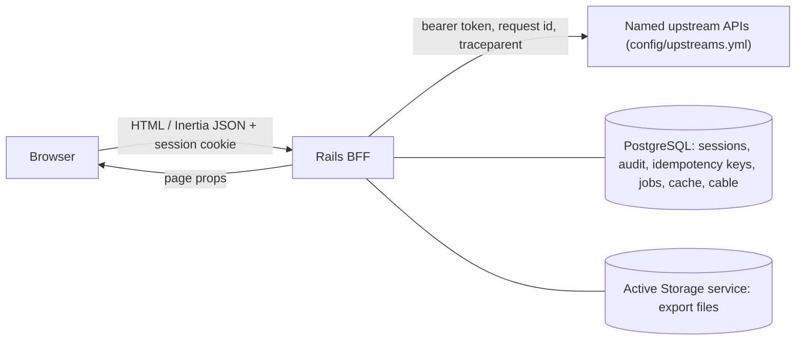
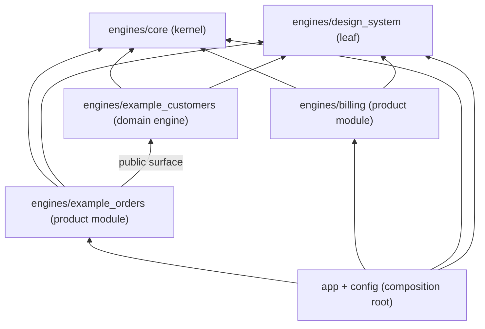
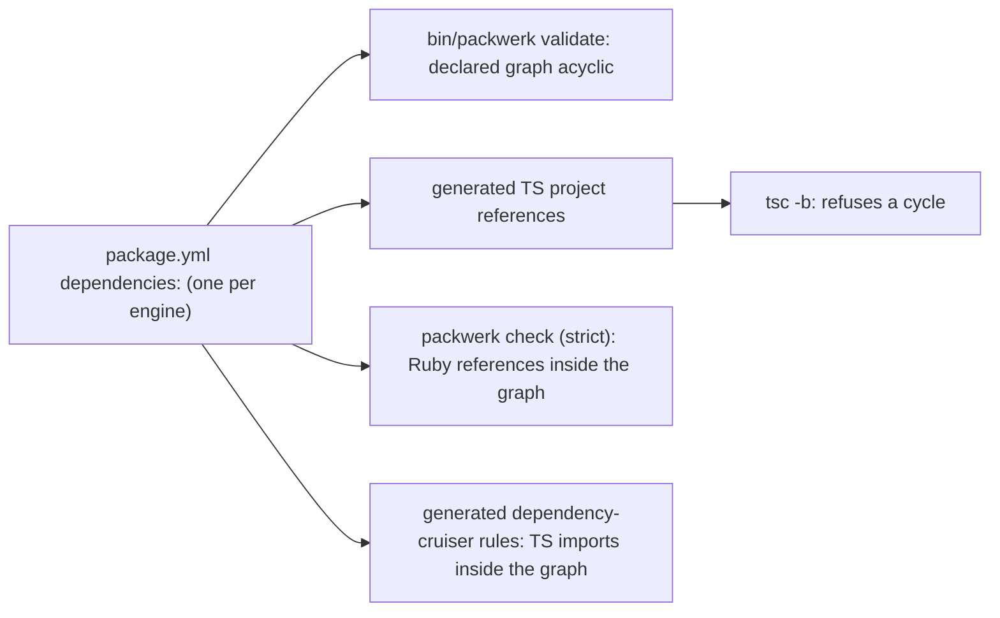
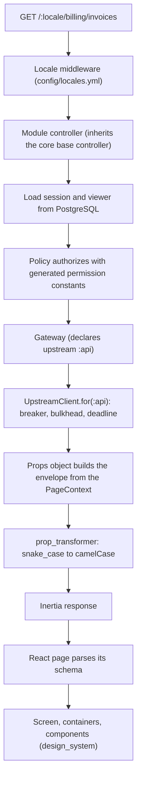

# 01 — Architecture

The application is one deployable Rails app. It is the only thing the browser
talks to. Behind it sit one or more upstream APIs, each configured by name,
that own business data and business rules.



## Responsibilities

| Concern | Owner |
| --- | --- |
| Routing, locale prefix, and every URL a page needs (built through `Acme::Core::Urls`, sent in props) | Rails, locales from `config/locales.yml` |
| Sessions, cookies, CSRF, token storage and refresh | Rails, stored in PostgreSQL |
| Authorization at the edge (can this viewer open this page or press this button?) | Rails, from upstream grants mapped through `config/permission_mapping.yml` |
| Page props, shared props, error pages | Rails |
| Copy and translations | Rails YAML in each engine, exported per engine as i18next namespaces |
| Formatting dates, numbers, and money | `@design_system/formatters` in React, `Acme::Core::DateFormatter` in Rails |
| Calls to the upstream APIs | Rails only, through one named client per upstream |
| Export files | Rails, in Active Storage |
| Rendering, local UI state, interaction | React |
| Business data, business rules, conditional (attribute-based) access | Upstream APIs |

## Rules

### ARCH-01 — Rails is the BFF and the Inertia server (MUST · ADR-01)

Rails owns HTTP, sessions, edge authorization, props, i18n, and integration.
It is not the source of truth for business data. React receives everything
through Inertia page responses.

### ARCH-02 — The browser never calls an upstream API (MUST · ADR-01)

Every upstream request goes through a Rails gateway (BE-06) and the named
upstream client it declares (BE-05, BE-08). The browser has no upstream URL,
no upstream token, and no CORS relationship with any upstream.

### ARCH-03 — Rails stores only what the BFF owns (MUST · ADR-01, ADR-10)

The PostgreSQL database holds sessions (with the viewer's grants), audit
records, idempotency keys, background jobs, cache entries, and cable messages.
Solid Queue, Solid Cache, and Solid Cable live in the primary database by
default (BE-21). Export files are blobs in an Active Storage service, and they
expire (BE-18).

Rails does not mirror upstream entities, and it does not re-implement business
rules that the upstream enforces. If a screen needs a rule, ask the upstream
for the result. So product modules rarely own tables. Tables an engine creates
carry its prefix (ARCH-10), kernel tables included: core's `core_sessions`,
`core_audit_events`, `core_idempotency_keys`, and `core_exports` are created
in `engines/core/db/migrate`, and the root `db/migrate` holds no kernel
tables. No state is kept outside PostgreSQL or the Active Storage service (ARCH-13).

### ARCH-04 — Engine kinds and dependency direction (MUST · ADR-03, ADR-21)

Every engine is one of four kinds. The application is the composition root
around them.

| Kind | Example | Holds | May depend on |
| --- | --- | --- | --- |
| core | `engines/core` (`Acme::Core`, `@core/`) | the kernel | nothing in the repository |
| design_system | `engines/design_system` (`Acme::DesignSystem`, `@design_system/`) | the UI kit and formatters | nothing in the repository, not even core |
| domain engine | `engines/example_customers` | a business concept several modules share | core, design_system, declared domain engines |
| product module | `engines/example_orders`, `engines/billing` | one product area: routes, pages, a registry entry | core, design_system, declared public surfaces of domain engines and other product modules |
| composition root | `app/`, `config/` | entrypoint, page resolver, layouts, app-level pages | every engine |

- **core** is the kernel. Ruby: the base controller, the `PageContext`
  factory, `Urls`, the page props base, the base policy, `PermissionSet`, the
  upstream clients, the concurrency executor, the error responder, the module
  registry, `ScopedCache`, `DateFormatter`, the `Export` base class, and the
  generators. Frontend (`engines/core/app/frontend`): `contracts/` (envelope,
  shared props, `definePage`, `appPathSchema` in `app_path.schema.ts` for
  app-relative navigation paths, the generated locale enum), `lib/` (the state
  wrappers `use_domain_reducer.ts` and `use_ui_state.ts`, `assert_plain.ts`,
  `deep_freeze.ts`, i18n helpers that do not format), and `domain/`
  (domain-free value objects such as `Money` and `DateRange`).
- **design_system** holds tokens and the theme, components (primitives and
  composites), the chart and data-table wrappers, the icon map, the error
  boundary, `formatters` (dates, numbers, and money through `Intl`, with
  the calendar set per locale), and `safe_url` (`isSafeUrl`, FE-18). It is
  the only place for `react-aria-components`, `@internationalized/date`,
  `tailwind-variants`, `tailwind-merge`, `echarts`, `@tanstack/react-table`,
  and `lucide-react`. It is a leaf and has its own i18n namespace,
  `design_system`. From Inertia it imports only `Link` and `Deferred`
  (FE-03). It is mostly frontend; the Ruby engine is
  minimal and exists for uniformity. Its name is never abbreviated.
- **Domain engines** (`engines/<name>`) exist to offer a public surface for a
  shared concept: its gateway, value objects, and presentational components.
  They have no routes, no pages, no navigation, and no registry entry.
- **Product modules** (`engines/<module>`) each hold one product area, with
  routes, pages, and a registry entry (ARCH-06).
- **The application** (`app/`, `config/`) owns the entrypoint, the page
  resolver, the layouts (app shell, auth shell, bare shell), and app-level
  pages. No engine imports it.

Engine code imports, within these limits, `@core/`, `@design_system/`, its own
`@<engine>/` alias, and `@<dependency>/public/...` for a declared dependency;
never `@/`. Only the app's page resolver reaches into engines' pages.



Arrows point at the dependency. Every arrow is declared in a `package.yml`
(ARCH-08); an arrow into a domain engine or product module reaches only its
public surface (ARCH-09).
Packwerk enforces the Ruby side and dependency-cruiser the frontend side
(`09_enforcement.md`). A change to core or design_system runs every engine's
checks (for design_system, narrowed while `engines/design_system/api.d.ts` is
unchanged, FE-21), which is why both have growth budgets (ARCH-12).

In a brownfield migration, existing code stays in `app/` and moves into
engines feature by feature (`14_working_with_ai.md`).

### ARCH-05 — Shared code is a public interface (MUST · ADR-03)

Anything two or more engines use is a public interface of exactly one engine.
Choose its home by this ladder:

1. The engine that owns the concept exposes it in its public surface
   (ARCH-09), and the consumer declares the dependency (ARCH-08).
2. No clear owner: extract a domain engine (`rafelo:domain`, GEN-05) that both
   depend on.
3. Core, only when the code is domain-free and every module needs it.

Copying code between engines is forbidden, with one exception in the kernel.
Core and design_system depend on nothing in the repository (ARCH-04), so
neither can import the other, and each implements the safe-URL predicate
itself: `isSafeUrl` in `@design_system/safe_url` and `appPathSchema` in
`@core/contracts/app_path.schema` (FE-18, CT-02). Their guard is the one
fixture of hostile inputs, `spec/fixtures/hostile_urls.json`, which both test
suites read by path and never import, so the two cannot drift (FE-18); the
clone detector does not scan either file. This is the
only copy allowed: a second one needs an ADR. A clone detector is a CI gate:
flay for Ruby, jscpd for TypeScript and TSX. It reports only pairs across two
engines (a match inside one engine is ignored), and it scans only `domain/`,
`forms/`, `hooks/`, `app/public/`, `app/frontend/public/`, gateways, and
policies. Its minimum token count is calibrated so generated skeletons never
match: it is set where the two example engines report 0. The baseline stays
and only shrinks (a ratchet, `09_enforcement.md`). There are no cross-engine
Active Record associations or foreign keys.

Public interfaces change additively first, like page contracts (CT-05,
CT-12): add the new member, move the consumers, then remove the old one.

### ARCH-06 — One module registry, declared in each module (MUST · ADR-04)

Each product module declares its registry entry in its own `config/module.rb`,
which the engine loads at boot. Mounting, navigation, permission prefixes, and
old URLs are all derived from these entries, so they cannot drift apart.
Domain engines, core, and design_system have no entry.

```ruby
# engines/billing/config/module.rb
Acme::Core::Modules.register(
  key: :billing,
  engine: Acme::Billing::Engine,
  path: "/billing",                    # default "/<key>"
  permission_prefixes: %w[billing],    # default [key]
  legacy_paths: { "/invoicing" => "" }, # old prefix => path under this module, answered with 301 redirects
  nav: { label_key: "billing.nav.title", icon: "receipt", order: 20 },
  flag: nil,                          # optional: ship the module dark (BE-25)
)
```

```ruby
# config/routes.rb
Rails.application.routes.draw do
  get "up" => "rails/health#show", as: :rails_health_check
  mount Acme::Core::Engine => "/core", as: :core # internal endpoints, no locale

  scope ":locale", locale: Acme::Core::Locales.route_constraint do # generated from config/locales.yml (npm run locales:generate)
    get "sign_in", to: "sessions#new"
    # ...other application routes

    Acme::Core::Modules.each do |mod|
      mount mod.engine => mod.path, as: mod.route_name
      mod.legacy_paths.each { |old, target| get "#{old}(/*rest)", to: Acme::Core::LegacyRedirect.new(mod, target) } # 301
    end

    root "home#show"
  end
end
```

- Boot validation raises on duplicate keys, paths, and navigation orders, and
  on a permission key (BE-03) that two modules' `config/permissions.yml` both
  declare. Two modules may declare the same permission prefix: a moved
  resource's target keeps the source's prefix (GEN-06). The module generator
  picks the next free order in steps of 10 (GEN-01).
- Boot validation also raises on a reserved key or first path segment: one
  that matches the locale segment pattern (`segment_pattern`, ARCH-07),
  whether or not that locale is available, so an unprefixed path is never
  taken for a locale; one that equals a route name or first path segment of
  the app's own routes (`up`, `rails_health_check`, `core`, `sign_in`,
  `root`, and whatever the app adds; a clash would otherwise surface only as
  Rails' "route name already in use" at boot); or a kernel error-code prefix
  (`auth`, `upstream`, `resource`, `validation`, `request`, and `unexpected`,
  the one kernel code without a dot; CT-06). The module generator refuses the
  same names before it writes anything (GEN-01).
- `legacy_paths:` maps each old path prefix to a path under the declaring
  module: `{ "/invoicing" => "" }` in `billing` above, whose path was
  `/invoicing`; `{ "/billing/refunds" => "/refunds" }` in a `payments` module
  that a `refunds` resource moved to from `billing` (GEN-06).
  `LegacyRedirect` answers a path under `<old>` with a 301 to the same
  remainder under the module's `path:` plus `<target>`, in the same locale
  (`/en/billing/refunds/5` → `/en/payments/refunds/5`).
- A spec checks that every registry icon name exists in the design_system icon
  map (FE-17).
- Navigation props are built from the same entries and keep a module only
  when `PermissionSet#reads_any?(prefixes)` is true (BE-03). Rails translates
  each entry's `label_key` and sends the text as `nav[].label`.
- A navigation entry links to the engine's own `root` route, built through
  `Urls`, and core marks the entry of the module that served the request
  `current: true` (CT-02). The `mount` line itself defines an app-level named
  route, so a link built from it would pass `have_resolvable_hrefs` while the
  engine has no route there; a module whose engine has no `root` route
  therefore stays out of navigation, and GEN-02 adds `root` with the module's
  first `index` page.
- A module with a `flag:` stays out of navigation, and its routes answer
  404, until the flag is on for the viewer (BE-25). The core base
  controller's callback list (BE-24) declares
  `before_action :require_module_enabled` after `load_session` and before
  `require_viewer`. It reads the registry entry of the controller's engine
  and renders the 404 error page while the flag is off. Navigation uses the
  same predicate. Routing constraints are not used, because no session is
  loaded there.
- Generators never edit `config/routes.rb`. The rename and move generators
  keep URLs and permission prefixes stable through `path:`,
  `permission_prefixes:`, and `legacy_paths:` (GEN-06).

### ARCH-07 — Every application URL carries a configured locale (MUST · ADR-17)

Locales are configured once:

```yaml
# config/locales.yml (the default configuration)
available: [en, th]
default: en
segment_pattern: "[a-z]{2}" # the locale segment pattern; this is its default
```

Everything locale-related is derived from this file: Rails'
`config.i18n.available_locales`, the route constraint, the Zod locale enum
(`@core/contracts/locales.generated.ts`), the parity checks, and the
placeholders generators write for non-default locales (CT-08). Nothing else
lists locales. English stays the default and the fallback unless configured
otherwise. When `th` is available, FE-20 applies.

A first path segment is a locale segment when the whole segment matches
`segment_pattern` (by default two lowercase letters), whether or not that
locale is available. Every available locale matches it. The locale middleware
below and the registry's reserved names (ARCH-06) both use it.

Application URLs look like `/<locale>/billing/invoices` (with the default
configuration, `/en/billing/invoices` or `/th/billing/invoices`). A small Rack
middleware redirects an unprefixed `GET`/`HEAD` to the default locale,
canonicalizes trailing slashes, and raises `ActionController::RoutingError`
for a locale segment that is not an available locale, so the viewer gets the
shared 404 page (CT-06). Core inserts it after
`ActionDispatch::DebugExceptions`, never at index 0: host authorization, SSL
and HSTS, static files, request ids, and
request logging then cover its responses too. Exempt paths: `/up`, `/core`,
`/rails` (Active Storage), `/cable` when the realtime pattern is used,
`/.well-known`, the Vite paths, and every file `public/` serves. Unprefixed
non-GET requests are not redirected; they return 404. A middleware spec pins
its position and the pass-through of each exempt path.

- The middleware MAY remember the last locale the viewer chose in a cookie and
  use it for unprefixed redirects. Without that cookie it uses the default
  locale.
- URL helpers keep the prefix through request recall, not through
  `default_url_options`. Engines are mounted inside `scope ":locale"`, so the
  locale is a path parameter of the current request; Rails recalls it
  (`_recall`, `request.engine_script_name`), and both an engine helper
  (`invoices_path`) and a `main_app` helper return `/th/...` under a `/th`
  request without extra arguments. Do NOT add the locale to
  `default_url_options`: it is not a segment of an engine's own routes, so Rails
  appends it as `?locale=th`. Outside a request (jobs, mailers) nothing is
  recalled, and such code passes the locale itself. A request spec under `/th`
  asserts that an engine helper and a `main_app` helper both return
  `/th/...` paths with no query string.

### ARCH-08 — One declared dependency graph, acyclic, checked twice (MUST · ADR-03)

The `dependencies:` list in each engine's `package.yml` is the single source
of the dependency graph. Everything else is generated from it or checked
against it.

```yaml
# engines/example_orders/package.yml
enforce_dependencies: strict
enforce_privacy: strict
public_path: app/public/
dependencies:
  - engines/core
  - engines/design_system
  - engines/example_customers
```

Each language checks the graph twice: once for the declared graph, once for
the references the code actually makes.

- **The declared graph has no cycles.** `bin/packwerk validate` refuses a
  cyclic declared graph (Packwerk's dependency validator checks the graph is
  acyclic). The TypeScript project references are generated from the same
  lists, so `tsc -b` refuses a cycle too.
- **Actual references stay inside the declared graph.** `bin/packwerk check`
  runs with `enforce_dependencies: strict`. dependency-cruiser rules are
  generated from the same lists and cover `import type` as well.

`script/ci/engine_graph` writes every generated tsconfig file and the
dependency-cruiser engine rules. Each engine gets a generated `tsconfig.json`:
a composite project that emits declarations only, so `tsc -b` can build it
against its references (without `composite` and emitted declarations,
`tsc -b` fails with TS6310). `app/frontend/tsconfig.json` references every
engine, because the composition root may use them all.
`tsconfig.tooling.json` covers the TypeScript outside every `app/frontend/`:
the root and engine `e2e/` folders, `script/**/*.ts`, the root configuration
files (`playwright.config.ts`, `vite.config.mts`, `vitest.config.mts`,
`config/frontend_react.mts`, `config/frontend_aliases.mts`), every engine's
`vitest.config.mts` (each takes `reactPlugins()` from
`config/frontend_react.mts`, FE-10), but never the
deliberately broken canary fixtures (TS-07); it references every engine.
The root `tsconfig.json` is a solution file (`files: []`, generated
`references` to every project, the tooling project included), so a tool that
reads it finds no alias `paths`: scripts run through tsx name the tooling
project (CT-03).
`npm run aliases:generate` writes the alias `paths` in the shared
`tsconfig.base.json`, which every project extends and dependency-cruiser's
`tsConfig.fileName` points at, and Vite's aliases in
`config/frontend_aliases.mts` (FE-10). CI caches `tmp/tsc/`.

```jsonc
// engines/example_orders/tsconfig.json (generated by script/ci/engine_graph; do not edit)
{
  "extends": "../../tsconfig.base.json",
  "compilerOptions": {
    "composite": true,
    "declaration": true,
    "emitDeclarationOnly": true,
    "outDir": "../../tmp/tsc/example_orders", // tmp/tsc/<engine> at the repository root
    "tsBuildInfoFile": "../../tmp/tsc/example_orders.tsbuildinfo"
  },
  "include": ["app/frontend/**/*"],
  // generated from dependencies: in package.yml
  "references": [{ "path": "../core" }, { "path": "../design_system" }, { "path": "../example_customers" }]
}
```

There is no `package_todo.yml` and no dependency-cruiser known-violations
baseline for these rules: a violation is fixed, never recorded. File-level
cycles inside one engine fail dependency-cruiser's `no-circular`. Canary
fixtures prove each check fires, including a declared A → B → A cycle
(TS-07).



Changing a `dependencies:` list is a guard change and needs a person's
approval (CODEOWNERS, ARCH-12).

### ARCH-09 — Public surfaces are enforced (MUST · ADR-03)

A domain engine or product module exposes to other engines only what sits in
its public surface:

- **Ruby:** `engines/<e>/app/public/`. `packwerk-extensions` enforces it
  (`enforce_privacy: strict`, `public_path: app/public/`). Packwerk loads the
  privacy checker through `packwerk.yml`; verify the `require:` entry when
  adopting.
- **TypeScript:** `engines/<e>/app/frontend/public/`, imported as
  `@<e>/public/...`. dependency-cruiser allows a cross-engine import only into
  `public/`. A class in the surface, such as a value object, is defined in
  `domain/` and re-exported from `public/` (OOP-02).

Everything else in the engine is private and free to change.

Core and design_system are the kernel that every engine builds on, so their
alias is their surface, with one exception: implementation details live in
`internal/` (`Acme::Core::Internal`, `@core/internal/`,
`@design_system/internal/`), which no other engine may reference (the
`Rafelo/NoKernelInternals` cop and a dependency-cruiser rule). Their exports
are held down by growth budgets (ARCH-12), and design_system's public API is
checked against a committed `engines/design_system/api.d.ts` (FE-21).

A public interface changes additively first (ARCH-05).

### ARCH-10 — Coupling without constants is constrained (MUST · ADR-03)

Engines can couple without referencing each other's constants: through
reflection, shared tables, configuration, caches, copy, links, and events.
Each channel is closed or constrained, and each check has a canary fixture
(TS-07).

| Channel | Constraint | Checked by |
| --- | --- | --- |
| Reflection | `constantize`, `safe_constantize`, `const_get`, and string `class_name:` are forbidden in engines; the core registry is the one allow-listed place | RuboCop cop |
| Frontend globbing | `@engines/` and `import.meta.glob` appear only in the page resolver | ESLint |
| Tables | a table created by a migration in `engines/<e>/db/migrate` is prefixed `<e>_`; the cop reads the engine from the file path; no cross-engine associations or foreign keys (ARCH-05) | RuboCop cop (`Rafelo/EngineTablePrefix`) |
| Application config | `config.x` is read and written only in core | RuboCop cop |
| Cache | `ScopedCache` requires `module:` and validates it against the calling engine (BE-17) | `ScopedCache` raises |
| Copy | an engine uses only its own i18n namespace plus those of the kernel engines it may depend on (`core`, `design_system`) | `npm run i18n:check` |
| Links | links are server-built props (CT-02): props objects build every URL with `context.urls.route(<engine key>, <route name>, params)` (BE-04) and the UI offers an action URL only where `can` allows it; engine key and route name are symbols, not constants, so a link into another module references none of its constants or files and mutual links are fine; TypeScript never builds a URL (FE-18) | `have_resolvable_hrefs` (core request spec matcher, TS-02) asserts that every `href`, `*Href`, and `nav[].path` in props was built by `Acme::Core::Urls` for the request, so it resolves · ESLint `no-restricted-syntax` bans template literals and string concatenation that start with `/` and a locale or path segment in frontend code outside the page resolver, the formatters, and tests (verify the selector when adopting) |
| Events | if events are used, their names are constants in the publisher's public surface | the public-surface checks (ARCH-09) |

### ARCH-11 — Module-owned artifacts live in the module (MUST · ADR-03)

Each engine holds the files that describe it, so a change to an engine stays
in its folder and root files only aggregate.

| Per engine | Purpose |
| --- | --- |
| `config/locales/<locale>.yml` | the engine's copy, in its own i18n namespace (CT-08) |
| `config/errors.yml` | the engine's error codes, prefixed `<engine>.` (CT-06) |
| `config/permissions.yml` | resources × actions; generates permission constants and TypeScript (BE-03) |
| `config/budgets.yml` | page budget overrides (TS-02) |
| `config/ratchets.yml` | the engine's ratchet counts: a count rises only with an owner's approval, and every fall becomes the new ceiling (`09_enforcement.md`) |
| `config/module.rb` | the registry entry, product modules only (ARCH-06) |
| `config/contracts/` | generated page JSON Schemas (CT-03) |
| `db/migrate/` | the engine's migrations, when it owns tables (ARCH-10); the engine's initializer, written by GEN-01, appends this path to the app's migration paths (verify when adopting) |
| `spec/fixtures/upstream/<upstream>/` | recorded upstream responses (TS-03) |
| `e2e/` | the engine's Playwright tests |
| generated TypeScript under `app/frontend/` | `locales/*.json`, `errors.generated.ts`, `permissions.generated.ts` |

The root holds only aggregation and kernel files:

| Root file | Purpose |
| --- | --- |
| `config/errors.yml` | kernel error codes (CT-06) |
| `config/budgets.yml` | default, growth, and connection budgets; a spec asserts it has no `pages:` key (ARCH-12, TS-02, BE-21) |
| `config/contracts/_shared.json` | the shared props schema, referenced with `$ref` (CT-03); app page schemas sit beside it |
| `config/locales.yml` | available and default locales (ARCH-07) |
| `config/docs.yml` | `ai_instruction_files`: further AI instruction files `docs:check` reads (CT-09) |
| `config/upstreams.yml` | named upstreams (BE-08) |
| `config/permission_mapping.yml` | upstream grant names to permission keys (BE-03) |
| `config/ratchets.yml` | counts for the kernel (core, design_system) and the app, and the clone baseline, whose entries span two engines; every other engine's counts live in that engine (`09_enforcement.md`) |

The Gemfile loads engines by a glob over `engines/*/*.gemspec`, so adding a
module does not edit it (the lockfile still changes).

### ARCH-12 — Growth has budgets (MUST · ADR-29)

A codebase built this way fails slowly: shared code is promoted into the
kernel because two modules needed it, the kernel grows, every change touches
it, and affected-only CI stops narrowing anything. Budgets make that drift
visible while it is still cheap to reverse. They live under `growth:` in the
root `config/budgets.yml`, which `07_testing.md` shows; the connection budget
(BE-21) sits beside `growth:` at the root level, under `connections:`.

| Budget | Measures | Default | Checked by | On breach |
| --- | --- | --- | --- | --- |
| Core size | files, not counting `spec/` and `lib/generators/`; public exports (frontend) and public constants (Ruby) | set at adoption | `script/ci/growth` | fails |
| design_system size | public exports | set at adoption | `script/ci/growth` | fails |
| Domain engine size | public surface: public exports (frontend) and public constants (Ruby), `growth.domain_engine.max_public_exports` and `max_public_constants` | set at adoption | `script/ci/growth` | fails |
| Module size | files and pages per engine | set at adoption | `script/ci/growth` | fails; split with `rafelo:module` and `rafelo:move_page` (GEN-06) |
| Fan-in | `max_dependents` per product module | 5 | `script/ci/fan_in` over the `package.yml` files | fails; extract the shared part into a domain engine (ARCH-05) or write an ADR |
| Touch rate | share of merged pull requests over 30 days that touch `engines/core` or `engines/design_system`; the job is enabled once there are at least 3 product modules, not counting the examples (`growth.touch_rate.min_modules: 3`) | 0.15 (`growth.touch_rate.max`) | scheduled `script/ci/touch_rate` over `git log` | opens an issue; a metric, not a merge gate |

`script/ci/fan_in` ignores core and design_system: every engine depends on
them, so their size budgets apply instead. Many dependents on a product module
mean part of it is a shared concept that belongs in a domain engine. Domain
engines exist to be depended on, so they are budgeted on the size of their
public surface, not on dependents.

Raising any growth budget needs an ADR. CODEOWNERS covers `engines/core`,
`engines/design_system`, and every guard file except the ratchet files
(`09_enforcement.md`), so a person approves each of these changes. The
ratchet files have no CODEOWNERS entry: a separate required check runs
`script/ci/ratchet` against the merge base, passes a fall, and fails a rise
until an owner approves it (through the GitHub API, like
`script/ci/guard_approval`).

### ARCH-13 — No host-local state (MUST · ADR-10, ADR-26)

Everything that must outlive a request or a job lives in PostgreSQL or in an
Active Storage service. The local disk holds only the temporary files of one
request or one job. Code never writes a file it expects to read again on
another request, and never keeps state in process memory that another process
must see.

The Active Storage service is configuration, chosen per deploy profile
(OPS-06). So moving from one host to several needs no code change.

## Request lifecycle



## Directory layout

```text
.devcontainer/            # Dev Container: Rails base + Node, Playwright browsers, PostgreSQL service; image_digest is the one record of the prebuilt image, which CI reads and devcontainer.json repeats (script/ci/pins, OPS-09)
.github/                  # CI workflows, CODEOWNERS
.env.ci.production        # dummy values for every environment variable production reads, the only committed env file (`!/.env.ci.production` after `/.env*` in .gitignore and .dockerignore); the dummy boots (ci:production_routes, the image build's assets:precompile) source it (SEC-12, BE-08)
.rubocop.yml              # RuboCop configuration with the custom cops (09_enforcement.md)
KERNEL_VERSION            # template release the kernel copy is based on (GEN-07)
VERSION                   # the release being prepared; set by the release pull request, tagged after merge (WF-05)
AGENTS.md                 # always-on guide for AI agents (14_working_with_ai.md)
.opencode/skills/         # OpenCode: task skills and the pinned design skills pack, oo-* (14_working_with_ai.md)
Gemfile                   # loads engines by glob over engines/*/*.gemspec
.npmrc                    # save-exact=true (WF-06)
mise.toml                 # Node and npm versions; Ruby version, asserted equal to .ruby-version and the Dev Container image tag (OPS-09)
.ruby-version             # Ruby version the Gemfile reads; the production Dockerfile pins the same one (script/ci/pins)
renovate.json5            # dependency bot rules and peer groups; the held-back table is generated from them (WF-06)
Dockerfile                # production image, separate from the Dev Container
bin/
  ci                      # the gate
  check                   # bin/check <engine>: fast loop for one engine
  kernel_update           # bin/kernel_update <version>: three-way kernel merge
script/ci/                # affected, engine_graph, ratchet, growth, fan_in, touch_rate, guard_approval,
                          # production_routes, pins, generator_smoke, ...
docs/architecture/        # these files
e2e/                      # the app's own Playwright journeys: sign-in, refresh, sign-out
db/
  migrate/                # application migrations only; no kernel tables (ARCH-03)
  structure.sql           # schema dump; audit partitions excluded (OPS-08)
spec/
  enforcement/fixtures/   # canary fixtures, each breaking one guard on purpose (TS-07)
  fixtures/formats/       # v<VERSION>/: rows in every persisted format, committed in each release pull request (SEC-16)
  fixtures/hostile_urls.json   # hostile URL inputs; the isSafeUrl and appPathSchema suites read it by path, never import it; shipped with the kernel (ARCH-05, FE-18)
app/                      # composition root; brownfield code stays here until migrated (14)
  controllers/            # app-level pages: home, sessions, component_catalog (development and test only, TS-11)
  policies/  props/
  frontend/               # alias @/  (composition root only)
    entrypoints/application.tsx   # initialises i18next
    lib/page_resolver.tsx         # the one place for import.meta.glob and @engines/
    layouts/              # app shell, auth shell, bare shell (persistent layouts)
    pages/  screens/  containers/  components/  hooks/  forms/
    locales/              # generated i18next JSON, namespace app (npm run i18n:generate; do not edit)
    styles/application.css
    tsconfig.json         # generated by script/ci/engine_graph: references every engine (ARCH-08)
config/
  application.rb          # requires the core dummy engine in the test environment only (TS-01); a dummy boot reads the dummy credentials (BE-08)
  credentials/            # production.yml.enc: production secrets, encrypted; its key arrives as RAILS_MASTER_KEY and is never committed (BE-08, OPS-06)
                          # dummy.yml.enc + dummy.key: dummy values for the dummy boots, both committed (`!/config/credentials/dummy.key` in .dockerignore)
  environments/test.rb    # cache_store :memory_store, so throttle specs count (BE-12)
  routes.rb               # mounts modules from the registry; generators never edit it
  ci.rb                   # Rails 8.1's CI steps, run by bin/ci locally and in CI (09_enforcement.md)
  frontend_aliases.mts    # generated by npm run aliases:generate: engineAliases (engine aliases, @engines) and engineFsAllow (server.fs.allow); Vite's root is app/frontend
  frontend_react.mts      # reactPlugins(): the React Compiler plugin set that vite.config.mts, vitest.config.mts, and every engine's vitest.config.mts share (FE-10)
  locales.yml             # available and default locales (ARCH-07)
  locales/                # copy for app-level pages and layouts
  upstreams.yml           # named upstreams (BE-08)
  permission_mapping.yml  # upstream grant names to permission keys (BE-03)
  errors.yml              # kernel error codes (CT-06)
  budgets.yml             # default, growth, and connection budgets, no pages: key (ARCH-12, TS-02, BE-21)
  ratchets.yml            # kernel and app counts and the cross-engine clone baseline; a rise needs an owner, a fall is the new ceiling
  contracts/              # generated: _shared.json and app page schemas (do not edit)
  initializers/patches/   # monkey patches, one file per gem (BE-23)
  initializers/legacy_constants.rb   # job class aliases kept for one release after a rename (GEN-06)
  database.yml            # PostgreSQL
  queue.yml               # Solid Queue processes and threads; BE-21 counts them
  deploy.yml              # Kamal: RAILS_MASTER_KEY the only app env.secret; boot: limit: 1 with more than one host (13_operations.md, BE-22)
engines/
  core/                   # Acme::Core: the kernel; depends on nothing
    app/{controllers,policies,props,services,errors}/acme/core/
    app/views/acme/core/unsupported_browser.html.erb  # the 406 upgrade page: no script, nonce'd style, translated (FE-19)
    app/frontend/         # alias @core/
      contracts/          # envelope, shared props, definePage, app_path.schema.ts, locales.generated.ts
      lib/                # use_domain_reducer.ts, use_ui_state.ts, assert_plain.ts, deep_freeze.ts, i18n helpers
      domain/             # domain-free value objects (Money, DateRange)
      internal/           # @core/internal/: no other engine may import it (ARCH-09)
      errors.generated.ts # kernel error codes, generated from config/errors.yml (do not edit)
    lib/acme/core/        # registry, PageContext factory, Urls, PermissionSet, UpstreamClient, Executor,
                          # ScopedCache, DateFormatter, Export, ListQuery, AssetVersion
    db/migrate/           # kernel tables, prefixed core_: core_sessions, core_audit_events, core_idempotency_keys, core_exports
    lib/acme/core/internal/       # Acme::Core::Internal: no other engine may reference it (ARCH-09)
    lib/generators/rafelo/   # module, domain, page, rename_module, move_page
    spec/dummy_engine/    # test-only engine for the kernel's request specs: loaded only when Rails.env.test?,
                          # part of core's Packwerk package (no package.yml), never mounted outside tests (TS-01)
    config/locales/<locale>.yml   # i18n namespace core
    tsconfig.json         # generated by script/ci/engine_graph (ARCH-08)
    package.yml           # dependencies: none
  design_system/          # Acme::DesignSystem: a leaf; depends on nothing, not even core
    app/frontend/         # alias @design_system/
      theme.css           # tokens and theme (FE-06)
      <component>/        # primitives and composites, one folder each (FE-07)
      chart/  data_table/ # ECharts and TanStack Table wrappers, loaded lazily (FE-08)
      icon/               # the icon map (FE-17)
      error_boundary/     # the one class component (FE-15)
      formatters.ts       # dates, numbers, money; Intl with an explicit calendar (FE-11, FE-20)
      safe_url.ts         # isSafeUrl: https, http, and app-relative paths only (FE-18)
      internal/           # @design_system/internal/: no other engine may import it (ARCH-09)
    api.d.ts              # committed public API, regenerated and diffed in CI (FE-21)
    e2e/                  # screenshots of the component catalog (TS-11)
    lib/acme/design_system/       # the minimal Ruby engine
    config/locales/<locale>.yml   # i18n namespace design_system
    tsconfig.json         # generated by script/ci/engine_graph (ARCH-08)
    package.yml           # dependencies: none
  example_customers/      # domain engine, an example: a shared concept, no routes or pages
    app/public/acme/example_customers/   # public Ruby surface: gateway, value objects
    app/frontend/         # alias @example_customers/
      public/             # @example_customers/public/...: re-exports the value objects defined in domain/ (OOP-02), a presentational component
      domain/             # private: the value object classes public/ re-exports
    config/locales/<locale>.yml  config/errors.yml
    config/ratchets.yml   # this engine's ratchet counts
    spec/                 # including spec/fixtures/upstream/<upstream>/
    tsconfig.json         # composite TypeScript project, generated by script/ci/engine_graph (ARCH-08)
    vitest.config.mts     # Vitest projects example_customers (jsdom) and example_customers:node; plugins from reactPlugins() (FE-10)
    package.yml           # dependencies: core, design_system
    README.md             # an example to learn from, not a feature to keep
  example_orders/         # product module, an example
    app/{controllers,policies,props,gateways,forms,jobs}/acme/example_orders/
    app/public/acme/example_orders/      # public Ruby surface
      permissions.rb      # generated from config/permissions.yml (BE-03; do not edit)
    app/frontend/         # alias @example_orders/
      pages/  screens/  containers/  components/  hooks/  domain/  forms/
      public/             # @example_orders/public/...
      locales/            # generated i18next JSON, namespace example_orders (do not edit)
      errors.generated.ts  permissions.generated.ts   # generated (do not edit)
    config/
      module.rb           # registry entry (ARCH-06)
      routes.rb
      locales/<locale>.yml
      errors.yml          # codes prefixed example_orders.
      permissions.yml     # resources × actions (BE-03)
      budgets.yml         # page budget overrides (TS-02)
      ratchets.yml        # this engine's ratchet counts
      contracts/          # generated page JSON Schemas (do not edit)
    spec/                 # including spec/fixtures/upstream/<upstream>/
    e2e/                  # this engine's Playwright tests
    acme_example_orders.gemspec
    lib/acme/example_orders/engine.rb    # isolate_namespace Acme::ExampleOrders
    tsconfig.json         # composite TypeScript project, generated by script/ci/engine_graph (ARCH-08)
    vitest.config.mts     # Vitest projects example_orders (jsdom) and example_orders:node; plugins from reactPlugins() (FE-10)
    package.yml           # dependencies: core, design_system, example_customers
    README.md             # an example to learn from, not a feature to keep
tsconfig.json             # generated by script/ci/engine_graph: solution file, files: [], references to every project (ARCH-08)
tsconfig.tooling.json     # generated by script/ci/engine_graph: e2e/, scripts, root configs, engine vitest.config.mts files; never the canary fixtures (ARCH-08, TS-07)
tsconfig.base.json        # shared compiler options; alias paths written by npm run aliases:generate; dependency-cruiser resolves through it
vite.config.mts  vitest.config.mts  playwright.config.ts   # Vite, the Vitest project list, Playwright projects per engine
package.yml  packwerk.yml  .dependency-cruiser.cjs  eslint.config.mjs  .gitattributes
```
