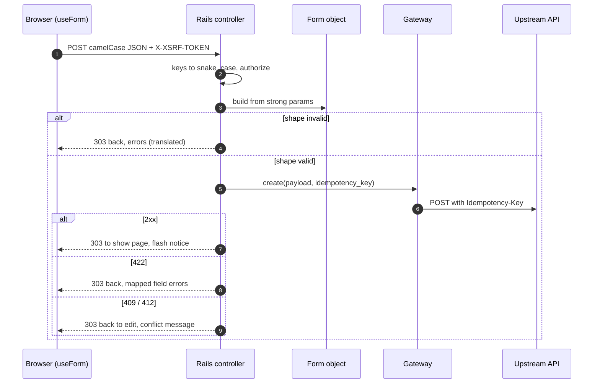

# 02 — Backend conventions

Rails code in Rafelo is small and explicit. Controllers handle HTTP,
policies decide access, gateways talk to named upstreams, and props objects
shape what React receives. The core engine (`Acme::Core`) provides the shared
pieces; product modules and domain engines use them (ARCH-04).

## Rules

### BE-01 — The shape of a controller action (MUST · ADR-01, ADR-05)

Every page action follows the same four steps and nothing else:

1. authenticate (inherited `before_action`, BE-24);
2. authorize through a policy;
3. fetch through a gateway and build a props object with the page context;
4. render the Inertia page.

```ruby
# engines/billing/app/controllers/acme/billing/invoices_controller.rb
module Acme::Billing
  class InvoicesController < ApplicationController # < Acme::Core::BaseController
    def index
      authorize :invoice, :index?, policy_class: InvoicePolicy

      query  = Acme::Core::ListQuery.from(params, sort: %w[issued_on total], filters: %w[status])
      result = gateway(InvoicesGateway).list(query)

      render inertia: "billing/invoices/index",
             props: InvoiceIndexProps.new(context: page_context, result: result)
    end
  end
end
```

No business workflow, no response shaping, and no upstream HTTP in the
controller. The core base controller provides two helpers:

- `page_context`, built by the core factory `Acme::Core::PageContextFactory`
  from the session, the evaluated feature flags (BE-25), the locale, the
  request id, and an `Acme::Core::Urls` object that the base controller builds
  for the request's locale (BE-04). The factory is the only way to obtain a
  `PageContext` (BE-04). A cop forbids `PageContext.new` (and
  `PageContext[...]`) outside core, so adding a member breaks exactly one
  place. Specs build contexts through a core
  test helper that calls the same factory.
- `gateway(klass)`, which builds the gateway and passes its constructor the
  token provider of the kind the gateway declares (BE-06: the current
  session's viewer provider for `token :viewer`, the default, or the
  upstream's service provider for `token :service`, SEC-10), the request's
  call budget (BE-16), and the request id and trace id (BE-05). The gateway
  hands them to `Acme::Core::UpstreamClient.for(...)` for the upstream it
  declares (BE-06).

```ruby
# engines/core/lib/acme/core/page_context_factory.rb
module Acme::Core
  # The only code that builds a PageContext (BE-01).
  class PageContextFactory
    def self.build(session:, flags:, locale:, request_id:, urls:)
      PageContext.new(
        viewer: session.viewer,
        permissions: session.permission_set, # grants mapped through config/permission_mapping.yml (BE-03)
        flags: flags,
        locale: locale,
        request_id: request_id,
        urls: urls, # Acme::Core::Urls for the request's locale (BE-04)
      )
    end
  end
end
```

Write actions follow BE-13.

### BE-02 — Authorization is verified and denied by default (MUST · ADR-08)

- The core base controller includes Pundit and runs `verify_authorized` as an
  `after_action` on every action that does not render an error. That check
  comes too late to protect the upstream: it fires after the action has
  already called the upstream or streamed a body. The base controller's
  `gateway(klass)` helper (BE-01) is therefore also a pre-call guard: it
  raises `Pundit::NotAuthorizedError` (403, `auth.forbidden`) unless
  `pundit_policy_authorized?` is already true, before any upstream call. An
  action on the skip list below that reaches an upstream (sign-in, unlock)
  calls `skip_authorization` first, which also satisfies the guard (Pundit 2.5.2).
  Core's own session calls (token refresh, SEC-03; grant re-fetch, SEC-15) do
  not go through `gateway(klass)`. A request spec drives an action that forgets
  `authorize` and asserts the 403 and that the upstream stub was never
  requested.
- The base policy returns `false` for every action. A policy opts in.
- A few actions must work without a session. The core endpoints
  `/core/ready` (OPS-05), `/core/client_errors` (OPS-03), and
  `/core/csp_reports` (SEC-05) skip authentication and `verify_authorized`
  explicitly, are rate-limited (BE-12), and return nothing about the viewer.
  The app's sign-in page (`sessions#new`), sign-in (`sessions#create`), and,
  when the optional idle lock is added (03_session_security.md), its unlock
  action skip `require_viewer` and call `skip_authorization`.
- `/core/csp_reports` also skips forgery protection
  (`skip_forgery_protection`), because a browser sends a CSP report without
  a token. It is the only action that does; `/core/client_errors` keeps it
  (OPS-03). Its byte cap and rate limit stay (BE-12), and a request spec in
  the `:csrf` shared context (SEC-05) accepts a report sent without a token.
- A spec lists every action allowed to skip a core callback, and the one
  action that skips forgery protection, so a new one cannot slip in
  unnoticed.
- Controllers and views enforce a decision; they never contain the rule.

### BE-03 — Permission manifests, keys, and wildcards (MUST · ADR-08)

Each product module declares the permissions it checks in its own
`config/permissions.yml`: resources × actions, under the module's permission
prefixes (`permission_prefixes` in its registry entry, ARCH-06; by default the
module key).

```yaml
# engines/billing/config/permissions.yml
billing:                                  # a prefix from the module's permission_prefixes
  invoice: [read, create, update, export]
  payment: [read]
```

The manifest generates Ruby constants and TypeScript
(`permissions.generated.ts`); CI fails when the generated files drift. The
Ruby constants are generated under the engine's `app/public/`
(`engines/billing/app/public/acme/billing/permissions.rb`), so a module that
declares a dependency on another (ARCH-08, ARCH-09) can read that module's
constants, for example to show a link to it only when the viewer may follow
it. Keys have three parts:

```text
<prefix>:<resource>:<action>     e.g. billing:invoice:read
                                 → Acme::Billing::Permissions::INVOICE_READ
```

- Policies and props objects use the generated constants. A cop forbids string
  literals in `allows?` and `capabilities`, and a cop
  (`Rafelo/OwnPermissionPrefixes`) still fails when a module requires a key
  outside its own declared prefixes: another module's public constants may
  inform what a page shows, never authorize the module's own actions.
- Required keys never contain wildcards; only grants do.

A grant matches a required key when it is:

| Grant | Matches |
| --- | --- |
| `*` | everything |
| `billing:*` | every key under the prefix |
| `billing:invoice:*` | every action on the resource |
| `billing:invoice:read` | exactly that key |

**Malformed keys and grants.** Each segment of a key is `[a-z][a-z0-9_]*`.
A grant has exactly one of the four shapes above; `PermissionSet` drops every
other grant after mapping (`billing`, `billing:`, `billing:invoice`, `*:*`,
`billing:*:read`, `Billing:Invoice:Read`) and counts it as a metric (OPS-04),
so a matcher written from the table alone cannot over-grant on a prefix. The
manifest compiler and `allows?` reject a required key that is not
`<prefix>:<resource>:<action>`, a wildcard included, and
`config/permission_mapping.yml` is validated at boot. The `PermissionSet` spec
lists each of those grants as matching nothing.

**Upstream grant names.** `PermissionSet` is built from the upstream's grants
through one mapping file, `config/permission_mapping.yml`. By default it is the
identity: the upstream already speaks `<prefix>:<resource>:<action>`, and an
entry is added only where the upstream names a grant differently. This file is
the only place upstream grant names appear. When the upstream offers a grant
catalog, the scheduled drift job (TS-03) diffs the module manifests against it,
so a key the upstream never grants is noticed.

```yaml
# config/permission_mapping.yml
# Grants not listed here pass through unchanged (identity).
# Example for an upstream that grants roles instead of keys:
INVOICE_CLERK: ["billing:invoice:read", "billing:invoice:create"]
```

**One matcher.** The matching lives in one value object,
`Acme::Core::PermissionSet`. Nothing else parses permission strings. Besides
`allows?(key)`, it answers `reads_any?(prefixes)`: true when any grant allows a
`read` action somewhere under one of the prefixes (`*`, `billing:*`,
`billing:<resource>:*`, or `billing:<resource>:read`). Navigation keeps a
module when `reads_any?` is true for the prefixes in its registry entry
(ARCH-06). Rails checks only unconditional grants; conditional,
attribute-based rules stay in the upstream.

```ruby
# engines/billing/app/policies/acme/billing/invoice_policy.rb
module Acme::Billing
  class InvoicePolicy < Acme::Core::BasePolicy
    def index?  = permissions.allows?(Permissions::INVOICE_READ)
    def create? = permissions.allows?(Permissions::INVOICE_CREATE)
    def export? = permissions.allows?(Permissions::INVOICE_EXPORT)
  end
end
```

### BE-04 — Props objects are pure (MUST · ADR-06)

A props object receives everything it needs through its constructor and
returns a hash from `to_inertia`. It does not read `Current`, the session,
`params`, flags, or the environment.

```ruby
# engines/core/lib/acme/core/page_context.rb
module Acme::Core
  # Built only by PageContextFactory (BE-01).
  PageContext = Data.define(:viewer, :permissions, :flags, :locale, :request_id, :urls)
end
```

```ruby
# engines/billing/app/props/acme/billing/invoice_index_props.rb
module Acme::Billing
  class InvoiceIndexProps < Acme::Core::PageProps
    def initialize(context:, result:)
      super(context: context) # the base keeps it as #context for helpers such as #capabilities
      @result = result
    end

    def to_inertia
      {
        data: {
          invoices: @result.items.map { |invoice| row(invoice) },
          # always sent; the page offers it only while can["invoice.create"] allows it (CT-02)
          new_invoice_href: context.urls.route(:billing, :new_invoice),
        },
        meta: {},
        query: @result.query.to_h,
        pagination: @result.pagination.to_h,
        can: capabilities(Permissions::INVOICE_EXPORT, Permissions::INVOICE_CREATE),
      }
    end

    private

    def row(invoice)
      { id: invoice.id.to_s, number: invoice.number, status: invoice.status, # ids go out as strings (CT-02)
        total: Acme::Core::Money.wire(invoice.total_minor, invoice.currency), # { minor:, currency:, exponent: } (CT-02)
        issued_on: invoice.issued_on.iso8601,
        href: context.urls.route(:billing, :invoice, id: invoice.id) }
    end
  end
end
```

`to_inertia` returns the page's own envelope keys and nothing else: `data`,
`meta`, `query`, `pagination`, and `can` (CT-01). Core raises when the hash
has any other top-level key, so a page cannot shadow a shared prop (`auth`,
`errors`, `trace`, …) or smuggle in a key that only the page schema would
catch. A core props spec returns an extra key and expects the raise.

`Acme::Core::PageProps#capabilities` builds the `can` map (CT-01) from the
context's permission set and flags (BE-25). Each key is the permission key
without its prefix (`invoice.export`), matching the capability keys the page
schema declares (CT-01); the boundary transform camelCases any snake_case part
(ADR-07), so `new_invoice_href` arrives as `newInvoiceHref`.

`can` and the policy encode one decision twice, so each capability names the
policy method it mirrors in the module's capability declaration (for example
`INVOICE_CREATE => :create?` on `InvoicePolicy`). The core matcher
`match_policy_capabilities` (TS-02) builds the page's `can` and calls each
named policy method over a grant matrix (no grant, the exact key, the resource
and prefix wildcards, the guarding flag off, BE-25) and fails when
`can[key].allowed` and the method's answer differ. The generator templates
(GEN-02) write that spec for every generated page.

Every URL a page needs comes from `context.urls`, an `Acme::Core::Urls` object
that the core base controller builds for the request's locale.
`route(engine_key, route_name, **params)` takes the module's registry key
(ARCH-06), a route name, and the route's parameters, and returns the
app-relative path with the locale prefix, through the mounted engine's route
proxy. The engine key and route name are symbols, not constants, so a link
into another module references none of its constants and ARCH-10 holds.
`Urls` records every path it builds for the request (`urls.built`), and
`have_resolvable_hrefs` (TS-02) asserts that every `href`, `*Href`, and
`nav[].path` in the props is one of them (CT-02). A route helper raises on an
unknown route name, so a recorded path resolves. Verify the mounted-engine
route proxies when adopting.

### BE-05 — One HTTP adapter for named upstreams (MUST · ADR-01, ADR-30)

The BFF may call more than one upstream. Each has a name and an entry in
`config/upstreams.yml` (BE-08); the template ships one, `api`.
`Acme::Core::UpstreamClient` is the only object that performs HTTP to any
upstream. `Acme::Core::UpstreamClient.for(:api)` returns the client for one
named upstream; the gateway passes in the token provider, the request's
budget, and the request id and trace id that the base controller gave it
(BE-01). For each upstream, the client owns:

- the Faraday connection, base URL, and open, read, and write timeouts from
  typed configuration (BE-08);
- persistent connections (SHOULD): the default `net_http` adapter (3.5.0)
  opens a new TCP and TLS connection for every call. Each upstream keeps a
  pool of persistent connections no larger than its bulkhead
  (`max_concurrent_calls`), so a call reuses an open connection. The adapter
  is pinned (WF-06) and must apply BE-16's per-call timeouts to each request
  without changing state that other threads share (verify when adopting);
  a client spec asserts that sequential calls open one connection;
- the bearer token, supplied by a token provider passed into its constructor;
- request id and trace id propagation to the upstream (`traceparent`,
  OPS-02; core's trace middleware handles the incoming header);
- the headers that carry identity, ids, and write safety: only
  `UpstreamClient` sets `Authorization`, `traceparent`, the request-id header
  (`X-Request-Id`), `Idempotency-Key`, and `If-Match`. A gateway hands it
  the values (`idempotency_key:`, `if_match:`), never the header; a gateway
  that passes one of these headers itself makes the client raise (a
  programming error, `500`), so no gateway can swap the token kind (SEC-10)
  or forge an id. A client spec passes each header and expects the raise;
- retries for `GET` and `HEAD` only, with backoff and a small cap, inside the
  retry budget below (writes are retried only with an idempotency key, and
  only to an upstream that declares `idempotency_keys: true`, BE-15). The
  single resend after a `401` and a successful refresh is not a retry
  (BE-16);
- a response size limit per upstream, `max_response_bytes` in
  `config/upstreams.yml`, checked while the body streams in (SEC-14);
- a circuit breaker and a concurrency limit (bulkhead), described below;
- a per-request deadline and call counter (BE-16);
- outbound safety: escaped path segments, no cross-host redirects, TLS
  verification always on (SEC-14);
- normalization of failures into error catalog codes (CT-06):

| Upstream result | Catalog code | Status | Retryable |
| --- | --- | --- | --- |
| timeout | `upstream.timeout` | 504 | yes |
| connection error, 5xx | `upstream.unavailable` | 503 | yes |
| 429 | `upstream.unavailable` (retried only as described below) | 503 | yes |
| circuit open (no call made) | `upstream.circuit_open` | 503 | yes |
| 304 to a conditional `GET` sent from a `ScopedCache` entry | none: the cached body is served (BE-17) | — | — |
| 401 | `auth.expired` (triggers refresh, SEC-04) | 401 | no |
| 403 | `auth.forbidden` | 403 | no |
| 404, 410 | `resource.not_found` | 404 | no |
| 409, 412 | `resource.conflict` (BE-13 step 6, BE-15) | 409 | no |
| 413 to a write | `validation.failed` with the message in `errors.base` | 422 | no |
| 422 | `validation.failed` with field errors (BE-13 step 5) | 422 | no |
| any other 3xx (never followed; Faraday follows none), 400, any other 4xx | `unexpected` (reported, OPS-03) | 500 | per catalog |
| a body over the upstream's `max_response_bytes` (SEC-14) | `unexpected` (reported, OPS-03) | 500 | per catalog |

A client spec walks this table, one row per status. A 429 is retried only
for `GET` and `HEAD`, only when its `Retry-After` fits inside the request
deadline (BE-16) and the retry budget below, and it never counts as a breaker
failure.

**Resilience.** A slow or failing upstream must not take the BFF down with it
(ADR-30).

- **Circuit breaker.** Timeouts, connection errors, and 5xx answers count as
  failures; 4xx answers do not. Past a threshold the breaker opens and calls
  fail at once with `upstream.circuit_open`, without touching the network.
  After a cool-off, trial calls decide whether it closes again.
- **Bulkhead.** Each upstream has a limit on concurrent calls per process, so
  one slow upstream cannot occupy every Puma thread. A call that cannot get a
  slot within a short wait fails as `upstream.unavailable`.
- **Retry budget.** Retries to one upstream are capped as a share of its recent
  calls (for example 10%), never happen while its breaker is open, and never
  outlive the request deadline (BE-16). Retries then cannot multiply the load
  on an upstream that is already failing.
- Thresholds, limits, and budgets live in `config/upstreams.yml`. The
  template ships one default breaker library (for example semian, circuitbox,
  or stoplight), chosen when the template is built, wired behind
  `UpstreamClient` and used only inside it; step 5 of adopting
  (`00_README.md`) re-resolves the stack and may swap it (ADR-30). Whether
  breaker and bulkhead state is kept per process or shared depends on that
  library; verify when adopting.
- Breaker state and open counts are metrics (OPS-04), never a health check
  (OPS-05).

Call budgets (TS-02), the service-token allow-list (SEC-10), fake-upstream
fixtures, and drift checks (TS-03) are all keyed per upstream.

### BE-06 — Gateways declare their upstream and return value objects (MUST · ADR-05, ADR-30)

Each upstream resource has one gateway, in the engine that owns the concept:
the product module that uses it, or a domain engine when several modules share
it (for example `engines/example_customers`, ARCH-05). A gateway declares its
upstream by name and the token kind it needs: `token :viewer`, the default,
or `token :service`, only for a gateway on SEC-10's allow-list for that
upstream. It receives the matching token provider, the call budget, and the
ids through the base controller (BE-01), hands them to
`UpstreamClient.for` (BE-05), maps upstream payloads into `Data` value
objects, and returns them. Raw JSON never leaves the gateway.

```ruby
# engines/billing/app/gateways/acme/billing/invoices_gateway.rb (excerpt)
module Acme::Billing
  class InvoicesGateway < Acme::Core::Gateway
    upstream :api # a name from config/upstreams.yml; an unknown name raises when the class loads
    token :viewer # the default; token :service only for a gateway on SEC-10's allow-list

    # list(query), find(id), create(payload, idempotency_key:) map upstream JSON into Invoice values
  end
end
```

```ruby
# engines/billing/app/gateways/acme/billing/invoice.rb
module Acme::Billing
  Invoice = Data.define(:id, :number, :status, :total_minor, :currency, :issued_on)
end
```

### BE-07 — Lists are paginated by the upstream (MUST · ADR-06)

`Acme::Core::ListQuery` turns request params into a safe query: page at least
1 or an opaque cursor, `per_page` 25 by default (zero or negative becomes the
default; above 100 is clamped to 100), sort and filter keys limited to an
allow-list, and a sort direction of `asc` or `desc` (anything else gives the
default sort). A `page` or `per_page` that is not a
scalar integer string becomes its default. A filter value is a scalar string
of bounded length (for example 200 characters); a filter declared multi-valued
takes at most a declared number of such strings, and a filter may declare its
allowed values. Any other value, a nested hash such as
`filters[status][$ne]=paid` included, drops that filter: Rails would otherwise
pass the hash through `slice` to the upstream and echo it in `query`. The
cursor is an opaque string of bounded length; a cursor that is not a string
is dropped. The `ListQuery` spec builds real `ActionController::Parameters`,
never a plain hash: `Parameters` is not a `Hash` (actionpack 8.1.4.1), so a
check that passes on a hash can miss a nested value in real params. It covers
a nested hash, an array on a single-valued filter, a 10 kB value, `filters`
that is not a hash (a string, an array), a `page` and a `per_page` that are
non-scalar, zero, or negative, a sort direction other than `asc` or `desc`,
and a cursor that is not a string.

The gateway passes the query to the upstream and
returns items plus a pagination value object of the kind the upstream supports
(offset or cursor, CT-01). Never invent a total the upstream does not return,
and never fetch a whole collection to filter or page in Ruby.

### BE-08 — One typed configuration boundary (MUST · ADR-05)

Environment variables and credentials are read once, at boot, into typed
configuration objects (`config_for` plus `Data`). Models, controllers, jobs,
and gateways receive configuration; they never read `ENV` or credentials
directly. Upstreams are configured in one file, `config/upstreams.yml`, with
one entry per named upstream (BE-05).

```yaml
# config/upstreams.yml (read with config_for, so it has per-environment sections)
production:
  api:
    base_url: <%= ENV.fetch("ACME_API_BASE_URL") %>
    open_timeout: 2           # seconds
    read_timeout: 8           # seconds; below the request deadline (BE-16, BE-21)
    write_timeout: 8          # seconds; each call caps it by the time left (BE-16)
    max_concurrent_calls: 8   # bulkhead, per process (BE-05)
    max_response_bytes: 2097152  # 2 MiB; a larger body is refused as `unexpected` (BE-05, SEC-14)
    retry_budget: 0.1         # retries add at most 10% to recent calls (BE-05)
    idempotency_keys: false   # true only if the upstream dedupes on Idempotency-Key (BE-15)
    breaker:                  # mapped onto the breaker library the template ships (BE-05, ADR-30)
      failure_threshold: 5
      cool_off: 30            # seconds
```

```ruby
# engines/core/lib/acme/core/engine.rb (excerpt)
initializer "acme_core.upstreams" do |app|
  # One frozen Data object per upstream; a missing or unknown key raises at boot.
  app.config.x.upstreams = Acme::Core::UpstreamConfig.load_all(app.config_for(:upstreams))
end
```

`config.x` is read and written only in core (ARCH-10).

- **Production secrets are encrypted credentials.** Every secret production
  reads (`secret_key_base`, the Active Record encryption keys, any upstream
  client secret) lives in `config/credentials/production.yml.enc`, committed
  encrypted. Its key, `config/credentials/production.key`, is never committed;
  production receives it as `RAILS_MASTER_KEY` through Kamal's secrets
  (OPS-06), and `config.require_master_key = true` in production makes a
  process without it fail at boot. Settings that are not secret (base URLs,
  hosts, limits) stay environment variables, set as clear values in
  `config/deploy.yml`. A `config_for` file's production section reads a secret
  from `Rails.application.credentials` and anything else from `ENV`; typed
  configuration raises at boot on a missing or blank value from either, so a
  missing encryption key fails boot instead of the first sign-in. The one
  exception is a setting whose default is the safe value, stated next to its
  key in typed configuration: `csp.report_only` defaults to `false`, so an
  environment that never sets it enforces the policy (SEC-05). A value that
  is present but malformed still raises.
- **The image build boots production.** The Rails Dockerfile runs
  `SECRET_KEY_BASE_DUMMY=1 ./bin/rails assets:precompile`, which loads the
  production environment without the production key, so typed configuration
  would raise and the build would fail. A dummy boot (`SECRET_KEY_BASE_DUMMY`
  set) therefore reads dummy values from two committed sources: the
  environment variables in `.env.ci.production` (SEC-12), and the credentials
  in `config/credentials/dummy.yml.enc` with its key
  `config/credentials/dummy.key` (`bin/rails credentials:edit --environment
  dummy`; delete the line it adds to `.gitignore`). Both hold dummy values
  only, so that key is no secret. The build step is
  `RUN set -a && . ./.env.ci.production && SECRET_KEY_BASE_DUMMY=1 ./bin/rails assets:precompile`.
  `.env.ci.production` therefore stays plain `KEY=value` lines a shell can
  source, and `.dockerignore` keeps Rails' `/.env*` and
  `/config/credentials/*.key` rules followed by `!/.env.ci.production` and
  `!/config/credentials/dummy.key`. Configuration code holds no dummy values;
  its one dummy branch chooses the credentials file, and a key missing from
  either dummy source still raises.

  ```ruby
  # config/application.rb (excerpt)
  # A dummy boot (assets:precompile in the image build, ci:production_routes) reads the
  # committed dummy credentials; every other process reads config/credentials/production.yml.enc.
  if ENV["SECRET_KEY_BASE_DUMMY"]
    config.credentials.content_path = root.join("config/credentials/dummy.yml.enc")
    config.credentials.key_path = root.join("config/credentials/dummy.key")
  end
  ```

  In Rails 8.1.4.1, `RAILS_MASTER_KEY` takes precedence over the key file, so
  a process that holds the production key and sets the flag cannot decrypt the
  dummy file and stops at boot
  (`ActiveSupport::MessageEncryptor::InvalidMessage`).
- **Dummy mode is for the asset build and the route check only.** A
  production boot with `SECRET_KEY_BASE_DUMMY` set raises unless the process
  runs the Rake task `assets:precompile` or `ci:production_routes` (SEC-12;
  Rake's top-level tasks, verify how the pinned Rails exposes them when
  adopting), so a server, `bin/jobs`, or a console never runs on a throwaway
  secret or dummy values. A spec boots production in a subprocess
  with the flag and the dummy values (`bin/rails runner`) and expects the
  raise; another boots it without `RAILS_MASTER_KEY` and expects exit status
  1 with Rails' "Missing encryption key" message (Active Support's
  `require_master_key` initializer prints it and exits, Rails 8.1.4.1).

### BE-09 — `Current` stays at the edge (MUST · ADR-05)

`Acme::Core::Current` holds the request id, trace id, session, and viewer. Only
controllers, middleware, the request log payload
(`Acme::Core::LogPayload`, OPS-01), the `Rails.error` subscriber (OPS-03), and
core's job base class when a job is enqueued (BE-11) read it; the last three
run at the end of a request or outside the controller and still need the
request's ids. Everything deeper receives what it needs as arguments (BE-04,
BE-05). The trace id starts in the request env, where core's trace
middleware stores it before any controller callback runs (OPS-02);
`Current` copies it from there, and the log payload reads it there, so a
throttled request logs the trace id its error page shows.

The base controller assigns `Current`'s attributes in a `before_action`
(BE-24), never inside `Current.set { }` or another block: `rescue_from` runs
after around-callbacks have unwound, so a block-scoped value is gone by the
time the error page renders. Rails resets `Current` when each request ends.
The error responder does not depend on `Current` at all: it reads the request
id and trace id from the request (`request.request_id`, and the trace id in
the request env, OPS-02) and the locale from the path (ARCH-07), and it sets
`Cache-Control: no-store` itself, so it renders the same page from a
prepended throttle (BE-12), which runs before `set_response_headers`, from
`rescue_from`, and from the exceptions app (CT-06).

### BE-10 — The smallest object that fits (SHOULD · ADR-05)

Use Rails conventions first. Extract a plain Ruby object only when a rule spans
records, coordinates an external system, or gives a class a second reason to
change. Choose by job:

| Need | Object |
| --- | --- |
| Talk to one upstream resource | gateway |
| A domain value that must stay valid | `Data` value object |
| Form-backed input with validation | form object |
| A complex read over BFF-owned tables | query object |
| An access rule | policy |
| A page response | props object |

Each object lives in the engine that owns its concept: the product module for
its own resources; a domain engine (for example `engines/example_customers`)
for a business concept that several modules share, exposed through its public
surface; core only for what is domain-free and needed by every module (ARCH-05).

Do not create a service object per controller action. Use AASM only for state
that the BFF owns (for example, a session's lifecycle), never to mirror
upstream state. Callbacks are for persistence concerns only.

### BE-11 — Jobs are small and idempotent (MUST · ADR-10)

Use Solid Queue through Active Job; its tables live in the primary database by
default (BE-21). A job takes ids and plain values, can run twice without harm,
and publishes external side effects only after its transaction commits
(BE-20). Job arguments are a persisted format: a job enqueued by one release
may run on the next (SEC-16).

- **Request and trace ids.** Every job inherits core's job base class,
  `Acme::Core::BaseJob` (the viewer job base class of BE-19 included). When
  a job is enqueued, the base class records the request id and trace id from
  `Current` (BE-09) and carries them in `serialize` and `deserialize`, never
  as positional arguments, so the job's own arguments stay as declared. The
  job logs them (OPS-01) and passes both to its `UpstreamClient`, which sends
  them upstream (BE-05, OPS-02). A job enqueued outside a request (a
  recurring task) has none and starts a new trace. The two keys are part of
  the job format (SEC-16). A spec walks every job class defined under `app/`
  and `engines/*/app/` after eager loading (framework jobs such as Active
  Storage's and Action Mailer's are out of scope) and fails on one that does
  not inherit the base class.
- Job arguments never reach a log line: `log_arguments` is off (OPS-01).

### BE-12 — Throttle authentication and writes (MUST · ADR-09)

Throttle sign-in, unlock, and every state-changing endpoint with core's
`throttle` macro. It wraps Rails' built-in controller `rate_limit`, answers
with the catalog code `request.throttled` (429), and records each
`(action, name, limit)` on the controller class.

```ruby
# app/controllers/sessions_controller.rb
class SessionsController < ApplicationController
  throttle to: 10, within: 1.minute, only: :create
end
```

```ruby
# engines/core/app/controllers/concerns/acme/core/throttling.rb
module Acme::Core::Throttling
  extend ActiveSupport::Concern

  included do
    class_attribute :throttle_limits, instance_accessor: false, default: {}.freeze
  end

  class_methods do
    # Each limit on an action needs its own name: Rails keys the counter by
    # "rate-limit:<controller_path>:<name>:<by>", so two limits with one name share a counter.
    def throttle(to:, within:, only:, by: -> { request.remote_ip }, name: nil)
      actions = Array(only).map(&:to_sym)
      name ||= actions.join(",")
      actions.each do |action|
        if Array(throttle_limits[action]).any? { |limit| limit[:name] == name }
          raise ArgumentError, "#{self.name}##{action} already has a limit named #{name.inspect}; pass name:"
        end
      end
      # prepend: limits run before every base callback (BE-24), so a throttled
      # request loads no session and triggers no refresh or grant re-fetch.
      rate_limit(to:, within:, only: actions, by:, name:, prepend: true,
                 with: -> { render_error("request.throttled") })
      self.throttle_limits = throttle_limits.merge(
        actions.index_with { |action| [*throttle_limits[action], { name:, to:, within: }].freeze }
      ).freeze
    end
  end
end
```

- A route-table spec walks every route of the application and its mounted
  engines and fails when a non-GET action is neither in its controller's
  `throttle_limits` nor on the spec's allow-list, where every entry states a
  reason. A new write action cannot ship unthrottled by accident.
- `rate_limit` counts in the Rails cache store by default (Solid Cache in
  PostgreSQL), so a limit holds across processes and hosts. In Rails 8.1.4.1
  it takes `store:`, `name:`, and `scope:`, passes other options such as
  `prepend:` to `before_action`, and keys the counter
  `rate-limit:<scope>:<name>:<by>`. It writes to the cache store directly, a
  deliberate exemption from `ScopedCache` (BE-17).
- The limits run first: the order spec (BE-24) asserts that every `throttle`
  callback precedes the base callbacks. Their `with:` handler therefore runs
  before `Current` is assigned or the locale is set, which the error
  responder tolerates (BE-09).
- `rate_limit` treats a `nil` count as under the limit, and a store whose
  `increment` returns `nil` (`:null_store`) silently disables every limit. A
  config spec fails when the test or production environment uses such a
  store. Solid Cache also returns `nil` on a transient database error, so
  limits fail open while the database is unreachable; that is accepted,
  because sessions fail with it.
- Byte limits never live in a controller: Rails parses a JSON body before the
  first callback runs (`ParamsWrapper`). Request bodies are capped at the proxy
  (SEC-13), and the smaller cap on `/core/client_errors` and
  `/core/csp_reports` (OPS-03, SEC-05) is a core Rack middleware that rejects
  a larger `Content-Length` or body with 413 before Rails parses it.
- `rate_limit` takes its store when the controller class loads, so a helper
  that swaps the store during a spec would not reach it. The test environment
  therefore sets `config.cache_store = :memory_store` in
  `config/environments/test.rb`, and a global `before` hook clears the cache
  before every example (TS-01), so throttle specs count for real.
- Limits key on `request.remote_ip`, which is only right behind correctly
  trusted proxies (OPS-06).
- A limit "per session and IP" is two limits with distinct names, one keyed
  by IP and one by session, never one limit keyed by both
  (`by: -> { [request.remote_ip, session.id] }`). A combined key counts per
  pair, so a client that drops its cookie gets a fresh session and a fresh
  count, and the IP cap never holds.

### BE-13 — The shape of a write action (MUST · ADR-01, ADR-05)

Writes follow the Inertia form flow. On success, on validation failure, and
on conflict, a write action redirects with `303 See Other`; it never renders a
normal page. Only unexpected failures (timeouts, upstream 5xx, an open circuit,
`403`) render the shared error page through the error responder.

1. Authorize through the policy.
2. Build a form object from strong parameters (already snake_case, BE-14). It
   checks shape only (presence, format, length); business rules stay upstream.
3. Inside the idempotency claim (`Acme::Core::IdempotencyClaim`, BE-15), call
   the gateway with the form's payload and the idempotency key the claim
   yields.
4. On success, redirect to the resulting page with a flash message translated
   by Rails (`notice:`, or `alert:`). inertia_rails sends it once, as the
   page-level `flash` of the page that follows, never as a prop (CT-07).
5. On upstream `422`, redirect back with the mapped and translated field
   errors (`inertia: { errors: ... }`). `UpstreamClient` hands the gateway the
   parsed `422` body, capped at a few kilobytes and never put into an
   exception message or a log (SEC-07), and the gateway maps it to field
   codes (CT-07). An upstream field the form does not know becomes
   `errors.base` with a generic code, so a `422` never redirects with empty
   errors: inertia_rails passes errors on only when they are present, and the
   viewer would see the form come back with no message.
6. On upstream `409`/`412` (a stale edit, BE-15), redirect back to the edit
   page with a translated message in `errors.base`; the page reloads with the
   current version and Inertia keeps the viewer's input.
7. Anything else raises and goes through the error responder, or, when it is
   raised outside an action or not rescued, through the exceptions app
   (CT-06).

A write that ends in `422`, a conflict, or any error is audited with outcome
`failure` (OPS-08), never `success`. The write path records the outcomes it
handles (success, `422`, conflict, a refused claim), and the error responder
records `failure` for a non-GET request that raises; neither relies on an
`after_action`, which does not run when the action raises or a callback
halts (BE-24). Each audited request gets exactly one row (OPS-08). A core
request spec answers a `422` with one known and one unknown upstream field
and asserts both messages and the `failure` audit.

```ruby
# engines/billing/app/controllers/acme/billing/invoices_controller.rb (excerpt)
def create
  authorize :invoice, :create?, policy_class: InvoicePolicy
  form = InvoiceForm.new(invoice_params)
  return redirect_to(new_invoice_path, inertia: { errors: form.error_messages }, status: :see_other) if form.invalid?

  # BE-15: the claim checks and claims form.token and records the outcome (the redirect the block answers,
  # or a raise, which it re-raises); a replayed or refused token gets a 303 from the claim, never the block.
  # It derives the Idempotency-Key value (the HMAC) and yields it; UpstreamClient sets the header (BE-05).
  Acme::Core::IdempotencyClaim.call(self, token: form.token, payload: form.payload, back: new_invoice_path) do |idempotency_key|
    invoice = gateway(InvoicesGateway).create(form.payload, idempotency_key:)
    redirect_to invoice_path(invoice.id), status: :see_other, notice: t(".created", number: invoice.number)
  end
rescue Acme::Core::Errors::ValidationFailed => error
  redirect_to new_invoice_path, inertia: { errors: form.translate(error.field_codes) }, status: :see_other
end
```



Core proves this flow with its own request specs, run against a committed
test-only engine, `engines/core/spec/dummy_engine`, which is never mounted
outside tests: `303` with a flash on success, `303` with errors on validation
failure and on conflict, and the error responder for everything else. The
generator templates (GEN-02) produce the same shape, and GEN-04 runs them. The
example engines show the flow in use, but no kernel spec depends on them
(TS-01).

### BE-14 — Incoming keys are snake_case once (MUST · ADR-07)

Inertia sends camelCase JSON. The core base controller converts incoming
parameter keys to snake_case in one `before_action`
(`params.deep_transform_keys!(&:underscore)`), before strong parameters run.
No other code converts casing. Field keys in `errors` go back out camelCase
through `prop_transformer`, so they match the form fields on the client.
In Rails 8.1.4.1, `ActionController::Parameters#deep_transform_keys!`
converts keys inside nested hashes and inside arrays of hashes
(`lineItems[0].unitPrice` arrives as `line_items[0].unit_price`).

### BE-15 — Writes are idempotent and conflict-aware (MUST · ADR-01)

- **Duplicate submits.** The form page includes a one-time form token in
  `meta` (CT-03). Before calling the upstream, the write claims the token
  through `Acme::Core::IdempotencyClaim` (BE-13), which inserts a row into the
  BFF-owned `core_idempotency_keys` table (unique on
  the token, bound to the viewer id, with a status and an expiry). A cache
  cannot do this job: two concurrent submits would both miss it, and entries
  can be evicted.
  - A row is `pending`, `succeeded`, `failed`, or `unknown`. It also holds an
    integer `attempt` and a digest of the normalized payload.
  - Core issues the form token: 32 random bytes, signed (a
    `Rails.application.message_verifier` of its own) together with
    the BFF session's id and the issue time. Before any claim, core refuses
    a token that is blank, fails the signature, names another session, or
    was issued longer ago than the row retention (OPS-07). The retention is
    at least the absolute session lifetime (SEC-08) plus a margin, so a
    token is never accepted after the row that would dedupe it was purged;
    a config spec fails when it is not. The claim runs only after the form
    object's shape checks pass (BE-13 step 2).
  - The claim wins: call the upstream, then record the outcome. The
    `Idempotency-Key` value is derived on the server by `IdempotencyClaim`,
    which yields it to the write: an HMAC of the viewer id and the token with
    a key from `Rails.application.key_generator`, never from the payload, so
    an edited resubmit of the same token still carries the same key. The
    gateway passes it on as `idempotency_key:`, and `UpstreamClient` sets the
    header, only for an upstream that declares `idempotency_keys: true` in
    `config/upstreams.yml` (BE-05).
  - Outcomes. A 2xx marks the row `succeeded` with the outcome (for example
    the redirect location). A definite failure, a 4xx answer or a connection
    failure before the request was sent, marks it `failed`. An ambiguous
    failure, a timeout, a connection lost after sending, or a 5xx, marks it
    `failed` only when the upstream declares `idempotency_keys: true`, so a
    retry with the same key is safe; otherwise it marks it `unknown`.
  - The claim finds a `succeeded` row: replay its redirect. Only `succeeded`
    replays.
  - The claim finds an `unknown` row: never replay it and never take it over.
    Redirect back with a translated message in `errors.base` saying the
    outcome could not be confirmed and the viewer should check before trying
    again; the reloaded page carries a new token.
  - The claim finds a `failed` row, or a `pending` row whose `claimed_at` is
    older than the request deadline (BE-16) plus a margin: take it over and
    try again. PostgreSQL decides staleness
    (`claimed_at < now() - interval '<deadline + margin>'`), never an
    application clock.
  - Every claim and takeover increments `attempt`, and the outcome write
    matches the row's id, `status = 'pending'`, and the attempt it claimed,
    so the late outcome of an attempt that was taken over updates no row.
  - The claim finds a fresh `pending` row: redirect back with a "still
    processing" message.
  - A token claimed by another viewer, or a claim whose payload digest differs
    from the row's (the Back button restores an old token with edited data),
    is rejected without an upstream call: a `303` back to the form with a
    translated message in `errors.base`; the reloaded page carries a new
    token, and Inertia keeps the viewer's input (BE-13 step 6). A request
    spec covers both cases and asserts that the upstream stub was never
    requested.
  - The claim, the takeover, and the outcome are each one statement that
    commits on its own; no transaction spans the upstream call (BE-20).
  - Submit buttons are `isPending` (React Aria) while `form.processing` is
    true: they ignore presses and keep focus. A natively disabled button
    would drop focus to the page body (FE-13). Expired rows are purged in
    batches by a job (OPS-07).
  - Concurrency specs (TS-10) prove the fence (a first claimant's late
    outcome write updates no row), the `unknown` path (a timeout against an
    upstream without `idempotency_keys` records `unknown`, and a resubmit
    makes no upstream call), and that no write is retried without the
    declaration.
- **Lost updates.** Edit pages carry the version the viewer saw (an upstream
  `ETag` or a version number in the upstream's payload). Updates send it back
  (`If-Match` or that version field). An upstream `409`/`412` becomes the catalog code `resource.conflict`
  and follows step 6 of BE-13. A gateway spec asserts that `If-Match`
  carries the version the viewer submitted, not one the gateway fetched.
- **Version and token are read at submit time.** In @inertiajs/react 3.11,
  `post`, `put`, `patch`, and `delete` default to `preserveState: true`. After
  the `303` back, the same page component stays mounted: its props carry the
  new version and a new form token, but `useForm` keeps the data it captured
  at mount. A form that put the version or the token into `useForm`'s initial
  data therefore resubmits the stale `If-Match` and gets `412` on every try.
  The version and the form token are never `useForm` fields; the form adds them
  from the current props when it submits
  (`form.transform((data) => ({ ...data, version: props.data.version, formToken: props.meta.formToken }))`,
  set on every render so the closure sees the latest props). The generated
  edit page's test submits, receives a conflict redirect with a new version,
  submits again, and asserts the second request carries the new version and
  token.
- **Retries.** `UpstreamClient` may retry a write only when it carries an
  idempotency key and its upstream declares `idempotency_keys: true`.

### BE-16 — Upstream calls have a budget and a deadline (MUST · ADR-01, ADR-30)

- `UpstreamClient` counts calls per request and per upstream. Each page has an
  `upstream_calls_per_request` budget for each upstream it calls (TS-02).
  Prefer list or batch endpoints over one call per row; calling the upstream in
  a loop is this architecture's N+1.
- A request has an overall deadline, `requests.upstream_deadline_seconds` in
  typed configuration (required, BE-08); past it the request fails as
  `upstream.timeout`. Time left is measured on the monotonic clock
  (`Process.clock_gettime(Process::CLOCK_MONOTONIC)`), never `Time.now`,
  which jumps when the system clock is adjusted. A job has no
  request: a viewer job gets the same budget object per unit of work, with
  its own deadline (BE-19). Per-call timeouts alone do not enforce the
  deadline:
  - Each call sets all three Faraday timeouts on the request, `open_timeout`,
    `read_timeout`, and `write_timeout`, each the smaller of its configured
    value in `config/upstreams.yml` (BE-08) and the time left. Setting only
    `timeout` is not enough: Faraday (2.15.1) prefers a specific key over
    `timeout`, so a connection-level `open_timeout` would stay uncapped.
  - Net::HTTP's `read_timeout` limits each socket read, not the whole body, so
    an upstream that trickles bytes keeps a call alive past the deadline. The
    client therefore reads every body in chunks (`on_data`, buffered calls
    too) and aborts once the deadline has passed.
  - A spec against a fake upstream that sends one byte per interval asserts
    that the call ends at the deadline with `upstream.timeout`, and a spec
    with a slow connect asserts that `open_timeout` was capped.
- Independent calls may run concurrently, but only through core's bounded
  executor, `Acme::Core::Executor`: a fixed thread pool per process, sized by
  `executor.size` in typed configuration and counted in the database pool
  (BE-21). Outside specs, `Concurrent::` appears only inside it (cop). A
  busy pool makes work wait within the request deadline; it never grows.
  Each upstream's bulkhead (BE-05) still applies.
- The executor wraps each task in `Rails.application.executor.wrap`. `Current`
  is per-thread, so context is passed explicitly into each task (BE-09), and the
  call counter and deadline live in one thread-safe object owned by the request.
- In development, the request thread waits for its tasks inside
  `ActiveSupport::Dependencies.interlock.permit_concurrent_loads`, so a task
  that autoloads a constant cannot deadlock against the waiting thread (verify
  when adopting).
- Token refreshes (SEC-03) and grant re-fetches (SEC-15) are counted
  separately and do not count against the page's budget, so budgets stay
  stable when a refresh happens to fall on a page request.
- **A `401` is not a retry.** A `401` on a viewer call triggers the
  single-flight refresh (SEC-03). After a successful refresh (as the winner,
  or as a loser that finds a new access token), the call is resent once with
  the new token, a write without an idempotency key included: the upstream
  refused the first request at authentication and did nothing. The resend is
  outside BE-05's retry rules and retry budget, and it is counted with the
  refreshes, not against the page's budget. The session ends only when the
  refresh answers `401` or the resent call gets a second `401`: core revokes
  the row and answers `auth.expired` (SEC-04). A refresh that fails any other
  way keeps the session (SEC-04). Client specs: a `GET` and a keyless `POST`
  that get a `401` are each resent once after the refresh, with the new
  token; a resent call that gets a second `401` revokes the row and answers
  `auth.expired`.

### BE-17 — Caching never crosses viewers, modules, or releases (MUST · ADR-08)

- Default: upstream responses are not cached.
- Viewer-independent reference data (for example a list of currencies) may be
  cached with an explicit TTL under a key that includes the locale and the
  upstream API version.
- Viewer-dependent data may be cached only under a key that includes the
  viewer id, a digest of the viewer's permission grants, and the locale, with
  a short TTL. Never share it across viewers.
- Prefer conditional requests with upstream `ETag`s over refetching a cached
  value blindly. A validator (`If-None-Match`, `If-Modified-Since`) is sent
  only from a `ScopedCache` entry that holds the body, because a `304` carries
  none (BE-05); without an entry, no validator is sent. Every cache names its
  invalidation path in a comment. Tokens and errors are never cached.
- All caching goes through `Acme::Core::ScopedCache`. It requires a scope
  (`:public` or `:viewer`) and a `module:`, validated against the calling
  engine, so one module cannot read or overwrite another's entries (ARCH-10).
  Outside specs, nothing else calls `Rails.cache` (the cache-clearing hook
  and the store check of BE-12 are specs).
- One exemption is deliberate: `rate_limit` (BE-12) writes its counters to the
  cache store directly, inside Rails. They hold only counts per action and
  client, never viewer data, and a counter that outlives a deploy does no
  harm.
- The key namespace includes the release, or an explicit schema version
  declared for that cache. Old and new containers run side by side during a
  deploy (OPS-06), and neither reads a value shaped by the other. A
  release-namespaced cache starts cold after each deploy; a cache that must
  stay warm declares a schema version and bumps it whenever the cached shape
  changes.

### BE-18 — Downloads stream through core; exports are stored and expire (MUST · ADR-01)

- A download is a normal authorized action. Upstream files stream through
  core's download controller, the only code that calls `send_stream` (cop). A
  module's download controller inherits from it, authorizes as usual, and
  hands over the gateway's upstream body (the BE-02 pre-call guard refuses a
  download whose action forgot `authorize` before the first byte is
  requested); core streams it instead of loading it
  into memory, enforces a size limit (`downloads.max_bytes` in typed
  configuration, in place of the upstream's `max_response_bytes`; found over
  it before the first byte, the answer is the `unexpected` error page, 500,
  reported, BE-05), and sets `Content-Disposition`
  with a sanitized filename, `Cache-Control: no-store`, and
  `X-Content-Type-Options: nosniff`.
- Once the first byte is written, the `200` and the download headers are
  committed (`ActionController::Live`). Core therefore checks the upstream
  status and `Content-Length` against the size limit in the first `on_data`
  callback (SEC-14), before it sets any download header or writes a byte, and
  answers a failure there with the catalog error page. A failure after the
  first byte (the running total passes the limit, the deadline passes, the
  upstream drops) aborts the connection without a clean end of stream, so the
  browser sees a failed download rather than a truncated file that looks
  complete (verify on the pinned Puma and proxy), and is audited with outcome
  `failure` (OPS-08). Download specs cover an upstream `500` before the first
  byte (an error page without `Content-Disposition`) and an overflow after it
  (a `failure` audit).
- `send_stream` runs its block on a thread of its own, which leases its own
  database connection for any query inside the block, so concurrent downloads
  are capped per process (`downloads.max_concurrent` in typed configuration;
  a download over the cap answers `upstream.unavailable`) and the cap counts
  in the pool (BE-21). Database work inside the stream block is limited to
  the final audit insert.
- A large or slow export runs as a job (BE-19), built on core's
  `Acme::Core::Export` base class. The job writes the file to Active Storage,
  attached to a BFF-owned record in `core_exports` bound to the requesting
  viewer. Nothing outlives the job on the host's disk (ARCH-13).
- Downloading a finished export is an authorized action that checks the
  record belongs to the viewer, then answers `303 See Other` to a short-lived
  signed URL for the file (minutes, served as an attachment). The URL is made
  at click time and never appears in props or logs.
- Exports expire after a few hours; a job purges expired records and their
  files in batches (OPS-07).
- Download links are plain links (not Inertia visits); the design system
  provides a `DownloadLink`. Exports are throttled (BE-12).
  `Acme::Core::Export` formats every date through `Acme::Core::DateFormatter`,
  and its spec feeds it a `Date` and asserts a Buddhist Era year in `th`
  (FE-20).

### BE-19 — Jobs that act for a viewer use the viewer's session (MUST · ADR-08, ADR-09)

A background job has no request and no cookie, but SEC-10 still applies: data
fetched for a viewer must be fetched with that viewer's token.

- The job's arguments carry the session id (never tokens). The job builds its
  token provider from that session row, refreshing through the same
  single-flight path as requests (SEC-03). The provider re-reads the row
  before every upstream call, so a sign-out during a long job stops it at its
  next call instead of after its last.
- If the session has reached its absolute expiry or been revoked, the job
  stops and records the outcome (for example "export cancelled: signed out").
  It never falls back to the service token. Idle expiry (SEC-08) does not stop
  a job: the idle timeout protects an unattended browser, and a job neither
  extends it nor needs the browser.
- Stopping is not a failure. The viewer job base class records the outcome
  and then discards its stop error (`discard_on`), so Solid Queue records no
  failed execution and nothing retries. A job spec asserts that a stopped job
  leaves no `solid_queue_failed_executions` row.
- **A deadline per unit of work.** A job has no request deadline, and the
  request's deadline (BE-16) would be wrong for it anyway. The viewer job base
  class gives each unit of work (one `perform`, or one batch of an export)
  its own call budget (BE-16), with the deadline from
  `jobs.upstream_deadline_seconds` in typed configuration; past it the unit
  fails as `upstream.timeout`, and Active Job's retry rules decide what
  follows (BE-11).
- Active Job serializes the enqueuing locale and runs the job inside
  `I18n.with_locale`, so a job enqueued during a request formats in the
  viewer's locale; a job spec enqueued under `th` asserts a Buddhist Era year
  (FE-20).
- Jobs that need no viewer data (cleanup, purges) take no session.

### BE-20 — No upstream call inside a database transaction (MUST · ADR-10, ADR-30)

A transaction keeps a database connection checked out, with any row locks it
took, until it ends. Around an upstream call, that is as long as the upstream
takes: when the upstream slows down, the pool drains and pages that never
touch the upstream stop too. A rollback also cannot undo what the upstream
already did.

- Commit local writes first, call the upstream, then record the outcome in a
  new statement (as BE-15 and SEC-03 do).
- An upstream side effect that must follow a local change runs from a job
  enqueued after commit (BE-11), never from inside the transaction, including
  model callbacks that run inside it.
- In the test environment, `UpstreamClient` raises when a transaction other
  than the test's own wrapping transaction is open. Transactional specs open
  one such transaction and concurrency specs (TS-10) open none, so the client
  compares against the baseline of the running spec. Verify how the pinned
  Rails counts open and lazily started transactions when adopting.

### BE-21 — Connection and timeout arithmetic is checked (MUST · ADR-10, ADR-30)

Connection exhaustion and mismatched timeouts fail only under load. A config
spec therefore checks the arithmetic, reading the files that define it
(`config/deploy.yml`, `config/puma.rb`, `config/database.yml` with both
database roles (OPS-08), `config/queue.yml`, `config/upstreams.yml`,
`executor.size` and `requests.upstream_deadline_seconds` (BE-16),
`sessions.refresh_timeout_seconds` (SEC-03), the download cap (BE-18), and
`config/budgets.yml` → `connections:`):

```text
per Puma process   pool ≥ Puma threads + executor.size + download cap (+ 1 per polling thread, if used)
                   e.g. 12 ≥ 5 + 4 + 2 + 1
in total           Σ over process kinds (count × pool) + headroom ≤ connection budget < server_max_connections
                   e.g. per host: Puma workers 2 × 12 + Solid Queue supervisor 1 × 2
                        + workers 2 × 5 + dispatcher 1 × 2 + scheduler 1 × 2 = 40
                        2 hosts × 40 + headroom 10 = 90 ≤ 90 < 100
timeouts           proxy response timeout > request deadline (BE-16) > each upstream's read timeout
                   e.g. 30 s > 10 s > 8 s
refresh takeover   sessions.refresh_timeout_seconds (SEC-03) > read timeout of the upstream that
                   issues the tokens (api unless the app names another)
                   e.g. 15 s > 8 s
```

```yaml
# config/budgets.yml (excerpt; the values are examples)
connections:
  server_max_connections: 100   # PostgreSQL's max_connections setting on the production server
  budget: 90                    # every process on every host, plus the headroom
  headroom: 10                  # consoles, migrations (the migration role, OPS-08), backups, monitoring
```

- **Two meanings of `max_connections`.** In Rails 8.1, `max_connections` in
  `config/database.yml` is the per-process pool (`pool` is its deprecated
  alias). The budget key for PostgreSQL's server-wide limit is therefore
  `server_max_connections`, never `max_connections`. The spec reads each
  process kind's pool from `config/database.yml` through Active Record
  (`ActiveRecord::DatabaseConfigurations::HashConfig#max_connections`, which
  also resolves the deprecated `pool`), not from a copy in `budgets.yml`.

- **Process kinds.** Solid Queue's Puma plugin forks a supervisor, and the
  supervisor forks workers and dispatchers (and a scheduler when recurring
  tasks are configured). Each is its own process with its own pool, so none of
  them draws on a Puma process's pool. The spec reads their counts and each
  worker's threads from `config/queue.yml`.
- **What one process holds.** Pools open connections only when a thread needs
  one, so each `count × pool` term uses what one process of that kind can hold
  at once: a Puma process, the pool above; a worker, one connection per thread
  plus its own polling and heartbeat (in the example, 5 = 3 threads + 2); the
  supervisor, a dispatcher, and the scheduler, a few each. `config/database.yml`
  must give every kind at least that. Verify these overheads for the pinned
  Solid Queue when adopting.
- A Puma process adds one connection per polling thread it runs, for example
  Solid Cable's listener when the realtime pattern is used (verify when
  adopting).
- Every host counts, and so do job-role containers (OPS-06), which run the
  same Solid Queue process kinds without Puma.
- The arithmetic assumes Solid Queue's default fork mode. Solid Queue 1.7.2
  also has an async mode (`bin/jobs --mode async`,
  `SOLID_QUEUE_SUPERVISOR_MODE=async`, or `solid_queue_mode :async` in
  `config/puma.rb` for the Puma plugin), in which workers, dispatchers, and
  the scheduler run as threads of the supervisor's process (with the Puma
  plugin, of the Puma process) and `processes:` in `config/queue.yml` is
  ignored. Their connections then come from that one process's pool, and a
  project that switches to it counts them there.
- The headroom covers migrations, consoles, backups, and monitoring, including
  connections made with the migration role (OPS-08). The connection budget and
  the server's limit (`server_max_connections`) are recorded in
  `config/budgets.yml` → `connections:`, beside the other budgets.
- Every proxy in front of Puma (load balancer, kamal-proxy, Thruster) has a
  response timeout above the request deadline; verify the option names when
  adopting.
- Solid Queue, Solid Cache, and Solid Cable live in the primary database by
  default, so each process holds one pool instead of four. ADR-10 names the
  trigger for giving them their own databases (measured queue or cache load on
  the primary); the spec then counts every pool.

### BE-22 — Migrations are zero-downtime (MUST · ADR-31)

Old and new containers run side by side against the same database during a
deploy (OPS-06). The Rails-generated `bin/docker-entrypoint` (Rails 8.1.4.1)
runs `./bin/rails db:prepare` when the command ends in `./bin/rails server`,
which the generated `CMD ["./bin/thrust", "./bin/rails", "server"]` does. So
the new web container migrates when it boots while the old one still serves,
and a `job` role container (`cmd: bin/jobs`, OPS-06) never migrates. Every
migration must therefore work with the code of the previous release.

The runtime role owns no table (OPS-08), so the template rewrites that one
line of the entrypoint to run `db:prepare` as the migration role, through an
environment switch that `config/database.yml` reads: while
`ACME_DATABASE_ROLE` is `migration`, it connects with the migration role's
credentials. The switch is set for that one command only, so the server the
entrypoint then starts runs as the runtime role.

```bash
# bin/docker-entrypoint (excerpt)
if [ "${@: -2:1}" == "./bin/rails" ] && [ "${@: -1:1}" == "server" ]; then
  ACME_DATABASE_ROLE=migration ./bin/rails db:prepare # the migration role, for this command only (OPS-08)
fi

exec "${@}" # the server: the runtime role
```

`db:prepare` runs only pending migrations, under Active Record's migration
lock, which it takes with `pg_try_advisory_lock`: a second container that
boots while the first one migrates fails with
`ActiveRecord::ConcurrentMigrationError` instead of waiting, so its boot
fails. Kamal 2.12.0 boots the new container on every host at once by default,
so the multi-host profile (OPS-06) sets `boot: limit: 1` in
`config/deploy.yml`. Kamal then boots one host at a time, primary-role hosts
first, and starts the next host only after the previous one's new container
is healthy (for a web role, kamal-proxy's deploy has passed its health
check), which is after its `db:prepare` finished. The first host migrates;
the others find nothing pending. A deploy takes about one container boot per
host. `script/ci/deploy_preflight` fails when `config/deploy.yml` lists more
than one host and `boot.limit` is not `1` (OPS-06).

**The boot has a deadline.** Kamal 2.12.0 waits `deploy_timeout` (default
30 seconds) for a new container to become healthy, passing it to
kamal-proxy as `deploy-timeout`; when the boot fails, it stops the new
container while the old one keeps serving. The
first host's `db:prepare` runs before `/up` answers, so a migration that
takes longer fails the deploy and is interrupted. A transactional migration
rolls back; a `disable_ddl_transaction!` migration does not, and an
interrupted `CREATE INDEX CONCURRENTLY` leaves an INVALID index behind
(PostgreSQL keeps a failed concurrent build's index, marked invalid).

- `config/deploy.yml` sets `deploy_timeout` explicitly, sized for the
  boot-time migrations; `script/ci/deploy_preflight` fails when it is absent
  (OPS-06).
- A migration that may outlast it (a backfill that cannot move to a job, an
  index on a large table) does not run at boot. It runs as its own step
  against the new release's image before the deploy, as the migration role
  (the same switch), with the old code still serving, which expand and
  contract already allows. The command depends on the pinned Kamal (verify
  when adopting).
- A concurrent-index migration is safe to re-run: it drops a leftover index
  of that name first (`remove_index ..., if_exists: true, algorithm:
  :concurrently`) and then creates it. `if_not_exists:` alone is not enough,
  because PostgreSQL's `IF NOT EXISTS` matches the name only and would keep
  the invalid index (verify the pair against the pinned `strong_migrations`).
- `strong_migrations` (exact version pinned by each template release,
  `00_README.md`) checks every migration in development, CI, and production
  and fails unsafe operations. It is a gate: a check is bypassed only with
  its explicit safety assertion, a reason in the migration, and approval in
  the pull request.
- Expand and contract across releases: add the new shape first (a nullable
  column, a new table); write both shapes; backfill in batches from a job,
  never inside the migration; switch reads; stop writing the old shape; drop it
  in a later release, after one release with it in `ignored_columns`. A rename
  is an add, a copy, and a drop, never `rename_column` on a live table.
- Indexes are created concurrently (`algorithm: :concurrently` with
  `disable_ddl_transaction!`). Constraints are added `NOT VALID` and validated
  in a separate migration.
- Migrations run with a short lock timeout, so a migration queued behind a
  long query fails instead of blocking every request (`strong_migrations` can
  set it; verify when adopting).

Stored formats follow the same principle (SEC-16), as do contracts (CT-12).

### BE-23 — Monkey patches live in one place (MUST · ADR-05, ADR-18)

- A patch to a gem lives only in `config/initializers/patches/`, one file per
  gem (`<gem>.rb`). Engines contain no patches.
- Each file says why the patch exists and links the upstream issue or pull
  request. It prepends a module to the narrowest class instead of reopening
  the class.
- Each patch has a spec for the behaviour it changes and a guard spec that
  records the gem version the patch was written for (from `Gem.loaded_specs`)
  and fails when the resolved version changes. Every upgrade of a patched gem
  therefore forces a decision: drop the patch, keep it, or rewrite it.

### BE-24 — Base controller callbacks are declared in one list (MUST · ADR-05, ADR-09)

Callback order is behaviour: parameter keys are converted before strong
parameters run, the session loads before anything authorizes, and
`verify_authorized` checks every action. After-callbacks do not run when the
action raises (the `rescue_from` error page) or an earlier callback halts, so
anything every response needs, such as `no-store` (SEC-05), is set before the
action; the 406 page, which `allow_browser` renders before
`set_response_headers` runs, sets `no-store` itself (FE-19). For the same
reason, `Current` is assigned in a `before_action`, not wrapped around the
action (BE-09), and throttles are prepended ahead of every base callback
(BE-12). The core base controller declares all
of its callbacks together, in one ordered list; core concerns define the
methods but declare no callbacks of their own. An order spec pins the resolved
callback chain, including callbacks that Rails macros add (forgery protection,
`allow_browser`), so a new or moved callback fails until the spec changes in
the same pull request (verify the introspection API on the pinned Rails).
Skipping a core callback is allowed only for the actions BE-02 lists, and
skipping forgery protection only for `/core/csp_reports` (BE-02).

```ruby
# engines/core/app/controllers/acme/core/base_controller.rb (excerpt)
module Acme::Core
  class BaseController < ActionController::Base
    include Pundit::Authorization
    include Throttling

    # The one list (BE-24); an order spec pins it. Every `throttle` in a
    # subclass is prepended and runs before all of these (BE-12).
    allow_browser versions: :modern, block: :render_unsupported_browser, # FE-19: core's translated, script-free 406 page, which sets no-store itself
                  unless: :browser_check_exempt?                      # the BE-02 core endpoints are exempt
    before_action :set_response_headers   # SEC-05: the first before_action after allow_browser; no-store before the action, so error pages keep it
    before_action :assign_request_context # request id, and the trace id from the request env (OPS-02), into Current; assigned, not block-scoped (BE-09)
    around_action :with_locale            # I18n.with_locale for the path's locale (ARCH-07); the responder re-wraps its own rendering
    before_action :underscore_param_keys  # BE-14
    before_action :load_session           # SEC-01, SEC-08
    before_action :require_module_enabled # ARCH-06, BE-25: 404 while the module's flag is off
    before_action :refresh_stale_grants   # SEC-15
    before_action :require_viewer         # SEC-08
    after_action  :verify_authorized      # BE-02 (the gateway helper also refuses before any upstream call)
  end
end
```

### BE-25 — Feature flags are server-side and arrive through `can` (MUST · ADR-08, ADR-19)

- Flags are evaluated on the server, once per request, when core builds the
  page context; policies and props objects read them from it (BE-01, BE-04).
  The flag store is the adopter's choice.
- The UI learns a flag's state only through `can`: while a flag is off, every
  capability it guards is `{ allowed: false, reason: "disabled" }` (the
  `capabilities` helper takes the flag, BE-04). There is no client flag SDK and
  no list of flags in props.
- The matching policy method refuses while the flag is off, so a hidden button
  is never the only guard.
- Flags let a module or a feature ship dark: its code deploys with everything
  else and is released by turning the flag on. That decouples deploy from
  release in a single deployable. Request specs cover both states of every
  flag.
- A whole product module can ship dark: its registry entry names a `flag:`
  (ARCH-06). Until the flag is on for the viewer, the module stays out of
  navigation and its routes answer 404.
- The base controller's `require_module_enabled` callback (BE-24) enforces
  this. It runs after `load_session` and before `require_viewer`, so a
  signed-out visitor to a dark module also gets a 404, not a sign-in page. It
  reads the registry entry of the controller's engine (engines without an
  entry, and the app, pass), evaluates the entry's flag for the viewer, and
  renders the 404 error page while the flag is off. Navigation uses the same
  predicate. Routing constraints are not used, because no session is loaded
  when routes match.
