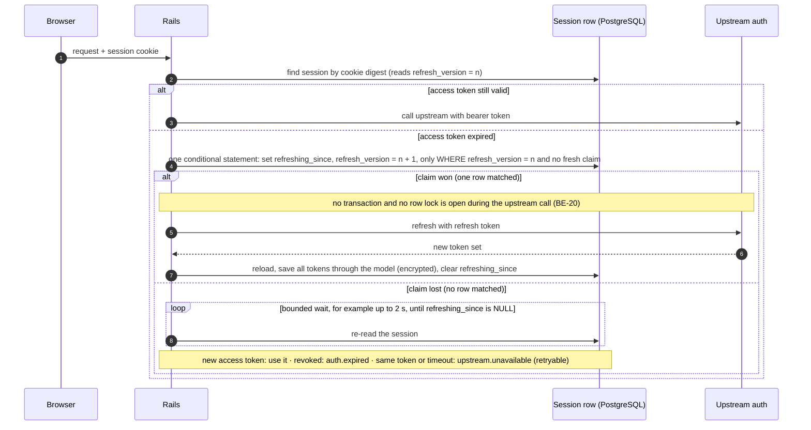

# 03 — Session and security

This file describes the session pattern as rules. It deliberately contains no
session-controller code: the implementation depends on the upstream's sign-in
and token contract, which differs per project.

The pattern is the standard browser-based BFF arrangement: the browser holds
two opaque session cookies, the BFF session cookie and Rails' own session
(SEC-01), and all upstream tokens stay on the server.

## Rules

### SEC-01 — Opaque session cookies (MUST · ADR-09)

- The BFF session cookie carries a random, high-entropy token and nothing
  else.
- Flags: `HttpOnly`, `SameSite=Lax`, `Secure` outside local development, and an
  expiry no longer than the server-side session.
- In production the cookie name carries the `__Host-` prefix (which requires
  `Secure`, `Path=/`, and no `Domain`), so a sibling subdomain cannot set or
  overwrite it.
- The database stores only a SHA-256 digest of that token, so a database leak
  does not yield usable cookies.
- Sign-out deletes the server-side session first, then the cookie. A browser
  ignores a deletion of a `__Host-` cookie that lacks `Secure` or `Path=/`;
  Rails sets `Path=/` on delete and `force_ssl` (SEC-13) adds `Secure` to
  every cookie header, deletions included. The SEC-01 production-config spec
  asserts the deletion header carries both.
- Rails' own session (SEC-08) is the second cookie, set with
  `config.session_store :cookie_store` and the same flags: `HttpOnly`,
  `SameSite=Lax`, `Secure` outside local development, and a `__Host-` name in
  production. The SEC-01 specs check both cookies.

### SEC-02 — Upstream tokens never leave the server (MUST · ADR-09)

- Access, refresh, and any upstream CSRF tokens live in the session row,
  encrypted with Active Record Encryption.
- They never appear in page props, shared props, logs, URLs, error pages,
  `localStorage`, `sessionStorage`, or JavaScript-readable cookies. (The
  readable `XSRF-TOKEN` cookie in SEC-05 holds Rails' own CSRF token, not an
  upstream token.)
- `filter_parameters` covers token, password, secret, and cookie fields.
- The session model's `serializable_hash`, which `as_json` and `to_json`
  call, leaves out the token columns and the cookie digest, so a session
  passed to a log line, an error report, or a props hash by mistake carries
  none of them. A model spec calls `as_json` on a session with every token
  set and finds none of their values.

### SEC-03 — Single-flight refresh without row locks (MUST · ADR-09, ADR-10)

Concurrent requests with an expired access token must trigger at most one
refresh. A refresh is an upstream call, and no row lock or open transaction is
ever held across an upstream call (BE-20): it would keep a database connection
checked out and block every other request for that session for as long as the
upstream takes. So the refresh uses no `lock!`, no `SELECT ... FOR UPDATE`, and
no surrounding transaction. It uses optimistic concurrency instead:

- **Claim.** The session row has a `refresh_version` counter and a
  `refreshing_since` timestamp. A request claims the refresh with one
  conditional statement that commits on its own:
  `UPDATE core_sessions SET refresh_version = refresh_version + 1, refreshing_since = now() WHERE id = ? AND refresh_version = ? AND (refreshing_since IS NULL OR refreshing_since < now() - make_interval(secs => ?))`.
  The parameters are the session id, the version the request read, and the
  refresh timeout in seconds; PostgreSQL's clock decides staleness on both
  sides of the comparison, never an application clock. The statement matches
  only while nobody has claimed since the read and no fresh claim exists. Exactly one
  request wins. The column is deliberately not named `lock_version`: that name
  turns on Active Record's optimistic locking, which would make later saves of
  the row raise.
- **Winner.** It calls the upstream with the refresh token, then reloads the
  row and writes the new token set through the model (an ordinary save, never
  a bulk statement such as `update_all`) so that Active Record Encryption
  applies, clearing `refreshing_since` in the same save. The save carries the
  tokens only; the grants a refresh re-fetches are written as SEC-15
  describes, never by this save. Verify on the pinned
  Rails whether bulk updates bypass encryption, and keep a spec that reads the
  raw columns after a refresh and finds ciphertext. If the refresh fails, the
  winner clears `refreshing_since` and follows SEC-04.
- **Losers.** A request that loses the claim remembers the access token its
  own call used and re-reads the row for a bounded time (for example up to 2
  seconds) until `refreshing_since` is `NULL`. Expiry is not the signal: after
  a forced refresh (a `401` on a token that is not yet locally expired,
  BE-16), the old token still looks valid, and `refresh_version` changes when
  the winner claims, not when it finishes. Then:
  - a different access token: the refresh succeeded; use it;
  - the session revoked: the refresh token was dead; answer `auth.expired`
    (SEC-04);
  - the same access token: the refresh failed; fail as
    `upstream.unavailable` (retryable);
  - the wait runs out: fail as `upstream.unavailable` (retryable).

  A loser never starts a second refresh. A concurrency spec (TS-10) sends two
  requests that both get a `401` on a locally valid token: one refresh call
  is made, both resent calls carry the new token, and the session survives.
- **Takeover.** The refresh timeout, `sessions.refresh_timeout_seconds` in
  typed configuration (BE-08), is longer than the read timeout of the upstream
  that issues the tokens (`api` unless the app names another), and BE-21's
  arithmetic checks it, so a live winner is never overtaken. A claim older
  than that belongs to a process that died, and the next request may claim
  over it.

Treat the access token as expired a short margin (for example 60 seconds)
before its stated expiry, so it never expires while a call is in flight and
small clock differences between servers do not matter.

### SEC-04 — What a refresh result means (MUST · ADR-09)

| Result | Action |
| --- | --- |
| 2xx | Replace access, refresh, and CSRF tokens together. |
| 401 | The refresh token is dead. Revoke the local session and send the viewer to sign-in. |
| 429 or 5xx | Keep the session. The next request may retry. Respond with a retryable catalog error. |
| 403 from a policy (not from refresh) | An access decision, not a session problem. Keep the session. |

An upstream `401` on a viewer call is not yet a dead session: it triggers the
refresh, and after a successful refresh the call is resent once with the new
token, a write without an idempotency key included, outside the retry budget
(BE-16). The session is dead when the refresh answers `401` or the resent
call gets a second `401`, whether that happens while a session loads or in
the middle of an action. Every such case ends the same way: core revokes the
row and deletes the cookie (SEC-01), and the error
responder answers `auth.expired` with a `303` to the locale's sign-in page,
never a `401` error page that keeps a dead cookie. `return_to` is the current
path for a `GET`, or the page the form came from for a write, through
`ReturnTo` (SEC-11). Non-Inertia JSON callers get a `401` JSON body. Request
specs cover the mid-action case for an Inertia `GET` and for a write, both
for a refresh `401` and for a second `401` on the resent call, and a dead
session under `/th` that lands on `/th/sign_in`.

### SEC-05 — Request protection (MUST · ADR-09)

- CSRF protection on (`protect_from_forgery with: :exception`). inertia_rails
  refreshes an `XSRF-TOKEN` cookie on every HTML and XHR response, and the
  Inertia client echoes it in the `X-XSRF-TOKEN` header, which the gem's
  middleware copies to `X-CSRF-Token` (inertia_rails 3.23.0 copies it on every
  request, not only on Inertia visits).
- Any non-Inertia `fetch` (for example the client error report, OPS-03) reads
  the token from the `XSRF-TOKEN` cookie at send time and sends it as
  `X-CSRF-Token`. It never reads the `csrf-token` meta tag: sign-in calls
  `reset_session` (SEC-08), which rotates the token, and Inertia never
  re-renders `<head>`, so the meta tag keeps the signed-out token and every
  report after sign-in would get 422. The sender checks `response.ok`, because
  `fetch` resolves on a 422 and the failure would otherwise be silent; a failed
  report is logged to the console once, never retried in a loop. A browser
  test signs in, triggers a client error, and asserts the report was accepted.
- The test environment keeps Rails' `allow_forgery_protection = false`, which
  makes every CSRF assertion in an ordinary spec vacuous, and inertia_rails
  then does not even set the `XSRF-TOKEN` cookie. So a core `:csrf` shared
  context turns protection on and restores it afterwards; every CSRF
  assertion runs inside it, beginning with a canary (TS-07): a `POST` without
  a token gets `422`. The server that Playwright drives (TS-03) runs with
  forgery protection on, so the browser test above proves the real token path.
- `/core/csp_reports` is the one action that skips forgery protection: a
  browser sends a CSP report with no token. Its byte cap and rate limit
  (BE-12) stay, and `/core/client_errors` keeps forgery protection (OPS-03). A
  spec in the `:csrf` context posts a report without a token and asserts it is
  accepted.
- `Cache-Control: no-store` on every response from the core base controller,
  so the back button and shared machines do not reveal data. The first
  `before_action` after `allow_browser` in the BE-24 list sets it, never an
  `after_action`: Rails skips after-callbacks when the action raises and
  `rescue_from` renders the error page, and when an earlier callback halts. A
  request spec asserts the header on a normal page and on 403 and 503 error
  pages. `allow_browser` runs before it (FE-19) and halts with the `406` page,
  so `render_unsupported_browser` sets `no-store` itself, and the FE-19 spec
  asserts it.
- A strict Content Security Policy, sent as a header:
  - `default-src 'self'`, with `script-src` and `style-src` limited to
    `'self'` plus a per-request nonce. Never `'unsafe-inline'`. The nonce is
    new on every request:
    `config.content_security_policy_nonce_generator = ->(_request) { SecureRandom.base64(16) }`
    with `config.content_security_policy_nonce_directives = %w[script-src style-src]`.
    The commented example in Rails' generated initializer returns
    `request.session.id`, which repeats for every request of a session; never
    use it. Tailwind's own output is a static stylesheet, but other code
    injects tags: the pre-hydration idle-lock shield (a script), and Inertia's
    progress bar and development error dialog (styles). `createInertiaApp`
    takes a `nonce` option and puts it on both style elements (Inertia
    3.11.0); the entrypoint passes the value it reads from the `csp-nonce`
    meta tag below, through the element's `nonce` property.
  - In development, Vite injects scripts and styles and the React refresh
    preamble, and they get the request nonce. The layout renders
    `vite_client_tag`, `vite_react_refresh_tag`, and
    `vite_typescript_tag "application.tsx"` (the entrypoint is TSX, so the
    TypeScript helper and the extension). In vite_rails 3.11.1,
    `vite_react_refresh_tag` adds `nonce: true` itself, and `nonce: true`
    given to the other two reaches Rails' `javascript_include_tag` and
    `stylesheet_link_tag`, which replace it with the request nonce. The
    `modulepreload` links that `vite_typescript_tag` adds receive the option
    unchanged, as a literal `nonce="true"`; that is harmless, because the
    chunks are same-origin and `'self'` allows them, so no spec asserts a
    nonce on a preload link. Vite's client (`@vite/client`, which injects
    CSS at runtime) reads the nonce from `<meta property="csp-nonce" nonce="…">` (Vite 8.3.7:
    `querySelector("meta[property=csp-nonce]")?.nonce`). Rails' `csp_meta_tag`
    renders `<meta name="csp-nonce" content="…">`, which Vite's client does not
    read, and Vite's `html.cspNonce` only applies to HTML that Vite itself
    serves, never to a Rails layout. The layout therefore also renders
    `tag.meta(property: "csp-nonce", nonce: content_security_policy_nonce)`.
    No `'unsafe-inline'` in development either: a browser ignores
    `'unsafe-inline'` in a directive that carries a nonce, so it would not
    help and only hides the missing meta tag. Allow the Vite dev server origin
    in `script-src`, `style-src`, and `connect-src` (for the hot-reload
    websocket).
  - `connect-src 'self'` in production (plus same-origin `wss:` if the
    realtime pattern is used). The browser then refuses any direct call to the
    upstream, which enforces ARCH-02 on the client side as well.
  - Direct uploads (Active Storage direct uploads to an S3-compatible service,
    or upstream-signed uploads) add exactly that storage origin to
    `connect-src`, nothing broader.
  - Roll the policy out as `Content-Security-Policy-Report-Only` in staging,
    with reports sent to `/core/csp_reports`, and enforce it once the reports
    are clean. This catches whatever a library injects that the list above
    missed. Rails parses no `application/csp-report` body, so the endpoint
    reads the raw body under the same byte cap as `/core/client_errors`
    (BE-12) and logs one allow-listed line per report: the effective
    directive, the blocked URI reduced to its origin (or `inline`, `eval`),
    the document path without its query string, the source file's origin and
    line, and the release (OPS-01). OPS-04 counts reports per directive and
    blocked origin. "Clean" means both: the Playwright smoke job, which runs
    with Report-Only, fails when `/core/csp_reports` received a report (a CI
    gate, `09_enforcement.md`), and staging shows no new directive and origin
    pair for a stated period.
  - Report-Only is one typed setting (BE-08), `csp.report_only`: a boolean
    that accepts only `true` or `false` (anything else raises at boot) and
    defaults to `false`, the safe value, so an environment that never
    mentions it enforces; only a staging deploy and the Playwright smoke job
    set `true`. Rails'
    `config.content_security_policy_report_only` is set from it and nowhere
    else. A production-config spec asserts that a page carries
    `Content-Security-Policy` and no `Content-Security-Policy-Report-Only`
    when the setting is absent, and the reverse when it is `true`.
  - Every HTML response that passes Rails' CSP middleware obeys the policy,
    including a page a controller renders from `public/`. The default
    `block:` of `allow_browser` renders `public/406-unsupported-browser.html`
    inside the controller (actionpack 8.1.4.1), so that response gets the
    policy, and the page's one inline `<style>` has no nonce and is blocked.
    FE-19 replaces that block with core's own page; its spec asserts
    `no-store` and the CSP header on the `406` response, the `<style>`
    element's nonce equal to the header's, no `<script>`, and no `style`
    attribute.
  - Vite inlines every imported asset under 4096 bytes as a `data:` URL
    (Vite 8.3.7; SVGs in development as well), which `default-src 'self'`
    blocks. `vite.config.mts` sets `build: { assetsInlineLimit: 0 }`, feature
    code never imports an asset with `?inline` (review), the bundle check
    fails on `url(data:` in built CSS (canary, TS-07), and the Playwright smoke
    suite fails on any `securitypolicyviolation` event.
  - Rails accepts any `config.<name> =` without an error (Rails 8.1.4.1), so
    a misspelled CSP setting boots cleanly and changes nothing. Specs assert
    the response headers and the rendered tags, never configuration values.
  - The remaining headers are in SEC-13.
- Error pages show a request id and trace id as the support reference, never
  a stack trace or a raw upstream message (CT-06).

### SEC-06 — No flag may elevate a real account (MUST · ADR-08)

No environment variable, query parameter, or header may grant permissions to
an authenticated real account. Demo environments use dedicated
seeded accounts with explicit roles. If a demo flag exists, production boot
raises when it is set.

### SEC-07 — Data and supply-chain hygiene (MUST · ADR-09, ADR-18)

- Development, tests, fixtures, screenshots, and logs use synthetic data only.
- Never commit `.env`, `config/master.key`, or a credentials key other than
  the dummy one. Production secrets are committed only encrypted, in
  `config/credentials/production.yml.enc`; its key reaches production as
  `RAILS_MASTER_KEY` (BE-08, OPS-06). `.gitignore` keeps Rails' `/.env*` rule
  followed by one negation, `!/.env.ci.production`: the only committed env
  file, holding dummy values (SEC-12). The dummy credentials
  (`config/credentials/dummy.yml.enc`, BE-08) hold dummy values too, so their
  key, `config/credentials/dummy.key`, is committed. Any check for tracked
  secrets allow-lists exactly those two paths: `.env.ci.production` and
  `config/credentials/dummy.key`. `.gitignore` neither untracks a file nor
  stops `git add -f`, so `script/ci/deploy_preflight` (OPS-06) fails when
  `git ls-files` lists any `.env*` file other than `.env.ci.production`,
  `config/master.key`, a `config/credentials/*.key` other than `dummy.key`, or
  `.kamal/secrets`, and fails when `git ls-files` itself fails.
- Brakeman runs on every pull request and blocks the merge.
- Dependency audits (bundler-audit and `npm audit --audit-level=high`) block
  every pull request that changes a lockfile, so no change introduces a
  version with a known advisory.
- New advisories appear without any change to the code, and blocking
  unrelated pull requests on them would stall everyone. A scheduled daily job
  therefore runs the same audits on `main` and opens an issue for each new
  advisory, with a fix deadline (for example one week for high and critical).
- Audits are never disabled. Every finding is fixed, or triaged with a linked
  issue and its deadline.
- Log only fields from the OPS-01 allow-list. Never log props, tokens, or
  upstream bodies.

### SEC-08 — Session lifecycle (MUST · ADR-09)

- **Two sessions, two jobs.** The BFF session row (SEC-01) holds identity and
  tokens. Rails' own session (the cookie store, SEC-01) holds only the CSRF
  token, flash messages (which inertia_rails sends as the page-level
  `flash`, never as a prop, CT-07), the form errors Inertia carries across a
  redirect, and the sign-out redirect's clear-history flag
  (`session[:inertia_clear_history]`, SEC-09); never identity.
- **Rotation.** Every sign-in and every unlock creates a new BFF session token,
  revokes the row of the cookie the request presented (if any) and no other
  row, and calls `reset_session` so the Rails session and its CSRF token are
  new too. Sign-out revokes the row and calls `reset_session`. This prevents
  session fixation on both layers. Only sign out everywhere revokes all of the
  viewer's rows: a spec signs one viewer in twice and asserts the first
  session survives.
- **Cookie size.** The cookie store is limited to about 4 KB, and redirect
  errors travel through it. Form objects send at most one short message per
  field, and a request spec submits the largest form with every field invalid
  and asserts the cookie stays under the limit (inertia_rails 3.23.0 keeps
  redirect errors in `session[:inertia_errors]` until the next render
  consumes them).
- **Timeouts.** Each session has an idle timeout (for example 30 minutes) and
  an absolute lifetime (for example 12 hours), enforced on the server. The
  first one reached ends the session. Idle expiry is measured from
  `last_seen_at`, which is written at most once per touch interval (below),
  so it can lag the last request by up to that interval: a session ends
  between `idle timeout − touch interval` and `idle timeout` after its last
  request (with 30 and 5 minutes, after 25 to 30 minutes). The configured
  idle timeout is the upper bound, never a guaranteed minimum; a session spec
  asserts both edges.
- **Write pressure.** `last_seen_at` is updated at most once per touch
  interval (a few minutes, for example 5) per session. PostgreSQL's MVCC
  writes a new row version on every update and
  leaves the old one as a dead tuple for vacuum to clean up; touching the
  session row on every request would multiply dead tuples and vacuum load on
  the busiest table. The touch leaves `refresh_version` alone, so it never
  makes a refresh claim (SEC-03) fail.
- **Indexes.** Index the token digest (unique), the viewer id, and the
  absolute expiry. Do not index the sliding idle expiry (`last_seen_at`): an
  update that changes no indexed column can stay a HOT (heap-only tuple)
  update, which is much cheaper.
- **Fill factor.** A HOT update writes the new row version into the same page
  as the old one, so the page needs free space. The `core_sessions` table (the
  kernel prefix, ARCH-03) is created with `fillfactor` 70 to keep that space
  (verify the value against the measured update rate when adopting).
- **Cleanup.** A recurring Solid Queue job deletes expired and revoked
  sessions in batches (for example a thousand rows per statement), so a purge
  never holds locks for long or builds one large transaction. It finds rows by
  absolute expiry alone, never by `last_seen_at`, which has no index (a purge
  by it scans the table): an idle-expired session is refused at once and
  reaches its absolute expiry within one lifetime, and revoking a session
  deletes the row or sets its absolute expiry to now.
- **Sign out everywhere.** A viewer can revoke all of their sessions; if the
  upstream supports token revocation, the BFF calls it too.
- **Format.** Session rows carry a `format_version` and follow SEC-16.

### SEC-09 — Clear client history on sign-out (MUST · ADR-09)

`Cache-Control: no-store` does not cover Inertia's own history state, where
page props for back and forward navigation are kept. Turn on
`encrypt_history` globally, in core's inertia_rails initializer (CT-01).
Sign-out answers with a redirect,
not a render, so it calls `reset_session` first and then
`redirect_to <sign-in path>, status: :see_other, inertia: { clear_history: true }`:
inertia_rails 3.23.0 stores the flag in the new session
(`session[:inertia_clear_history]`; a `reset_session` after it would drop
it), and the next page it renders, the sign-in page, carries
`clearHistory: true` once. The encryption key then rotates and earlier pages
can no longer be read. History encryption needs a secure context (HTTPS or
localhost).

### SEC-10 — Calls on behalf of a viewer use the viewer's token (MUST · ADR-08, ADR-09)

- A gateway declares the token kind it needs: `token :viewer` (the default)
  or `token :service`. `gateway(klass)` (BE-01) passes the matching provider
  to the gateway's constructor, which hands it to `UpstreamClient.for`.
  Anything that returns viewer-specific data, or data with access rules, uses
  the viewer's delegated token, so the upstream enforces its own
  authorization.
- Only `UpstreamClient` sets `Authorization`, from that provider; a gateway
  that passes the header itself makes the client raise (BE-05), so no
  gateway can swap the token kind.
- A service (client-credentials) token is allowed only for viewer-independent
  data, such as reference lists or health checks. It is never used to fetch or
  change data on a viewer's behalf; that would let Rails bypass the upstream's
  checks (the confused-deputy problem).
- A spec lists, per named upstream (BE-05), the gateways allowed to use that
  upstream's service token; only a gateway on that list may declare
  `token :service`. Everything else gets the viewer provider.

### SEC-11 — Redirect targets are internal (MUST · ADR-09)

A `return_to` value is accepted only when it is a relative path that starts
with a configured locale prefix (from `config/locales.yml`; with the default
configuration, `/en/…` or `/th/…`) and contains no scheme, no `//`, no
backslash, no control character, and no `.` or `..` path segment. `ReturnTo`
checks the value as given and once percent-decoded, never more: a browser
resolves `/en/%2e%2e/x` to `/x`, outside the locale, but does not treat
`%252e` as a dot. Rails strips only NUL, CR, and LF from a redirect target
and raises on other control characters, so `ReturnTo` refuses them first.
Anything else falls back to the locale's home page. Its spec lists the
hostile inputs `//host`, `https://host`, `en/x` (no leading slash), `/fr/x`
(a locale that is not configured), `/en//x`, `/en\x`, `/en/../x`,
`/en/%2e%2e/x`, `/en/.%2E/x`, `/en/%01x`, and `/en/%0Ax` (all refused) and
`/en/%252e%252e/x` (accepted). Only the
`ReturnTo` value object reads `return_to` from params; a cop fails anywhere
else. Keep Rails' protection against redirects to other hosts switched on.

### SEC-12 — Development and test routes do not exist in production (MUST · ADR-09)

Fake upstream endpoints, test sign-in shortcuts, and similar helpers are drawn
only inside `if Rails.env.local?`. `script/ci/production_routes` boots the
application in production and walks its route set in-process (the Rake
task `bin/rails ci:production_routes`, descending into every mounted engine),
never by parsing
the text of `bin/rails routes`: that text prints a mounted Rack app, a
redirect, an inline handler, or a `GET|POST` verb set in shapes a pattern
silently skips. Every route must match an allow-listed verb, path, and
`controller#action`, from one of two sources, never from the route set under
check (an allow-list derived from it would allow the route it should catch):

- **A committed list** for the routes nothing else declares: the app's own
  routes, core's routes under `/core`, and the framework's (for example
  `/up`). The list, `config/production_routes.yml`, is a guard file
  (`09_enforcement.md`), so a new production route outside a module needs a
  person's approval.
- **Derived from the registry** (ARCH-06) for module routes: each entry
  mounted at its locale-prefixed path, the routes inside that mount whose
  controller belongs to that engine, and its `legacy_paths` redirects.

The check fails on a walked route that matches neither source, on a route it
cannot classify (a Rack app that is not a registry engine, a `Proc` endpoint,
a redirect outside `legacy_paths`, a multi-verb route), on a listed route the
walk did not find (so the list cannot rot), and on an empty walk. It prints
how many routes it walked and matched (TS-07). It also reads a recorded walk
(`--routes FILE`, the Rake task's output), so its canaries need no broken
application. Canaries (TS-07): a development route outside
`Rails.env.local?` in the app's routes, a mounted fake app, a stray redirect,
a `via: [:get, :post]` route, a listed route missing from the walk, and an
empty walk.

The walk is a dummy boot (BE-08): `SECRET_KEY_BASE_DUMMY` set, the environment variables of the
committed `.env.ci.production`, and the committed dummy credentials, never
real secrets (SEC-07). Typed configuration (BE-08) raises at boot when a
setting has no value, by design, so those two files are the list of
everything production boot needs: a new setting fails this check, and the
image build (BE-08), until it gets a dummy value in one of them.

### SEC-13 — Security headers and first-party assets (MUST · ADR-09)

- Production uses `config.force_ssl = true` (HTTPS redirect and HSTS).
- Production sets `config.hosts` from typed configuration (BE-08, with a dummy
  value in `.env.ci.production`) and excludes `/up` through
  `config.host_authorization`, so Kamal's health check still passes. Without
  it, a redirect builds its absolute URL from a forged `Host` or
  `X-Forwarded-Host`, and Rails' own redirect check compares against that same
  forged host. A production-config spec asserts that an unknown host gets
  `403` and `/up` still answers.
- The CSP also sets `frame-ancestors 'none'`, `base-uri 'self'`,
  `form-action 'self'`, and `object-src 'none'`.
- Keep Rails' defaults for `Referrer-Policy` and `X-Content-Type-Options`, and
  send a `Permissions-Policy` header that disables features the app does not
  use (`camera=(), microphone=(), geolocation=()`). Rails 8.1.4.1's
  `config.permissions_policy` cannot do this: it still emits the legacy
  `Feature-Policy` header, and its source says `Permissions-Policy` is not yet
  supported. Core inserts a small Rack middleware before
  `ActionDispatch::ShowExceptions` that adds the header to every response, so
  error pages from the responder and the exceptions app (CT-06) carry it
  too; never set it from a controller after-callback (SEC-05). A header spec
  asserts it on a page, a `403`, and a router `404`.
- Fonts and images are served from the app itself, so the CSP needs no
  third-party origins and offline installs keep working.
- Request bodies are capped at the proxy (kamal-proxy request buffering
  limits; verify the option names when adopting), for example 1 MB for JSON
  requests. Uploads use their own path with their own limit.
- Internal applications MAY send `X-Robots-Tag: noindex`.

### SEC-14 — Outbound requests are constrained (MUST · ADR-01, ADR-09)

- Each upstream's base URL comes only from `config/upstreams.yml` through
  typed configuration (BE-05, BE-08). Input never supplies a host, scheme, or
  absolute URL.
- Gateways build paths from escaped segments and never interpolate raw params.
- `UpstreamClient` takes paths relative to the upstream's base URL. Faraday
  (2.15.1) drops the base path for a path that starts with `/` and switches
  host for an absolute URL, so the client raises (a programming error, `500`)
  on a path that starts with `/`, `//`, or a scheme, or contains `?`, `#`,
  `\`, or a control character; query values go only through `params:`.
  Escaping leaves dots alone (`ERB::Util.url_encode("..")` is `..`, and
  Faraday resolves `invoices/..` to the base path), so a segment value that is
  empty, `.`, or `..` names no resource: the client refuses it before any call
  with `resource.not_found` (`404`). Client specs have one row per refused
  class: a leading `/`, `//`, a scheme, `?`, `#`, `\`, and a control
  character each raise; `..`, `.`, and an empty segment each answer `404`
  with no request made; and a kept base path.
- `UpstreamClient` follows no redirects (BE-05) and never disables TLS
  verification.
- It limits response size to the upstream's `max_response_bytes`
  (`config/upstreams.yml`, BE-05) in the same `on_data` callback that
  enforces the deadline (BE-16): against the status and `Content-Length` in
  the first callback, and against the running total in every callback, so an
  oversized body is never buffered whole. A body over the limit is
  `unexpected` (`500`, reported, BE-05). Downloads apply the same checks
  against `downloads.max_bytes` before their first byte (BE-18).
- The size specs use a chunking fake that hands the body to the client in
  fixed chunks and records how many it handed over. One spec sends an
  oversized `Content-Length` and asserts the abort on the first chunk;
  another sends no `Content-Length` and crosses the limit in the third chunk
  (the first two stay under it), and asserts that the client aborted in the
  third callback, answered `unexpected`, and was handed no fourth chunk.

### SEC-15 — Permission grants stay fresh (MUST · ADR-08)

- Grants are loaded at sign-in, mapped through `config/permission_mapping.yml`
  (BE-03), and stored with the BFF session row, never in a cookie.
- They are re-fetched on every token refresh, and whenever they are older
  than a short limit (for example 5 minutes).
- When the upstream answers `403` to a call that Rails had allowed, the grants
  are marked stale and the next request re-fetches them. The mark is one
  statement, `UPDATE core_sessions SET grants_generation = grants_generation + 1 WHERE id = ?`,
  and a re-fetch writes its grants only `WHERE grants_generation = ?` with the
  value it read before its call; a write that matches no row leaves the
  grants stale for the next request. A plain save would let a re-fetch that
  started before the `403` overwrite the mark. The column is not named
  `lock_version` (SEC-03). A concurrency spec (TS-10) asserts that a re-fetch
  started before a `403` mark does not clear it.
- Edge checks keep the UI honest and add defence in depth; the upstream stays
  the authority because every viewer call carries the viewer's token (SEC-10).

### SEC-16 — Persisted formats survive two releases (MUST · ADR-31)

During a deploy, the old and new containers run side by side against the same
database (OPS-06), and a rollback runs the previous release against rows the
new one wrote. Every format that code writes and later reads back must
therefore be readable by two consecutive releases.

- Session rows carry a `format_version`. Readers accept the current format and
  the previous one.
- A new format arrives in two releases: the first learns to read it and still
  writes the old one; the second starts writing it. Dropping the old reader
  comes in a later release still.
- **Fixtures come from the release pull request.** In the pull request that
  bumps `VERSION` (WF-05), `bin/rails formats:dump` writes synthetic rows for
  every versioned format to `spec/fixtures/formats/v<VERSION>/`: sessions,
  idempotency outcomes, and one job of each job class defined under `app/`
  and `engines/*/app/`, serialized through
  Active Job's `serialize`. It also prunes folders older than N-2. That pull
  request commits the result; no workflow commits after the merge, and the
  release workflow fails while the folder for `VERSION` is missing. A
  compatibility spec loads the previous tag's folder and asserts that the
  current code reads every row. The fixtures hold synthetic values only
  (SEC-07) and are never written by hand.
- The same rule covers every other stored format that code reads back: job
  arguments and the request id and trace id keys that core's job base class
  adds in `serialize` (BE-11), idempotency outcomes (BE-15), and serialized values in
  BFF-owned tables. Caches are exempt because their key namespace carries the
  release, or an explicit schema version declared for that cache (BE-17).
- **Sessions may be revoked instead.** When a release changes the session
  format incompatibly, it MAY revoke all sessions instead of reading the old
  format: losing sessions only forces sign-in (OPS-07). Job arguments and
  idempotency outcomes have no such way out; for them this rule stays MUST.

This is the principle behind additive contract changes (CT-12) and
expand-and-contract migrations (BE-22), applied to stored data.

## Optional pattern: idle lock for shared machines

For applications used on shared workstations, add a client-side idle lock:

- Lock after a configurable idle period (for example 5, 15, or 30 minutes).
- Render a server-side shield before hydration when the lock flag is set, so
  content is never painted underneath the lock screen.
- Sync lock and sign-out across tabs with `BroadcastChannel` and the `storage`
  event. Reload on back-forward cache restore.
- Unlock by re-authenticating against the upstream, which replaces the session
  tokens, and keep the current route.

The idle lock is a privacy aid. It does not replace server-side session expiry
(SEC-08) or authorization. Locking also clears Inertia's history state
(SEC-09).
