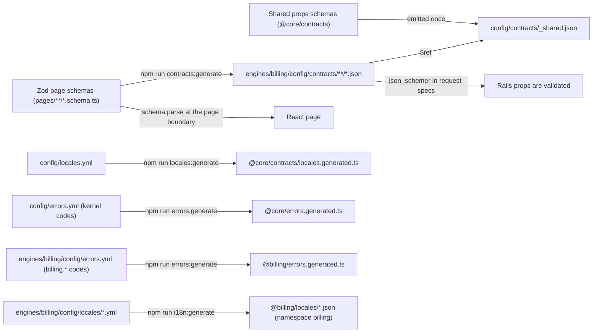

# 04 — Contracts

Three contracts connect Rails and React: page props, the error catalog, and the
translation catalog. Each has one source of truth, and the other side is
generated or checked from it. Each engine owns its part of every contract
(ARCH-11); the repository root holds only the kernel error codes, the shared
props schema, the locale configuration, and the app's own part: its pages'
JSON Schemas in `config/contracts/` (CT-03) and its copy under the `app`
namespace in `config/locales/` (CT-08).



`billing` stands for every engine: each one has its own schemas, error codes,
and locale files, and each gets its own generated outputs.

Every generator and check in this file (`contracts:*`, `errors:*`,
`locales:*`, `i18n:*`, `docs:*`, `pages:check`) takes `--root DIR`, prints
how many inputs it read, and fails on an empty input set or a failing
subprocess (TS-07). Each generator owns its whole output set: it deletes an
output it no longer produces, and its `--check` fails on an output that has
no source, such as the JSON Schema of a moved or deleted page, the locale
JSON of a dropped locale, or the `errors.generated.ts` of an engine whose
catalog was removed. Otherwise a stale file keeps passing every check.

## Rules

### CT-01 — The page envelope (MUST · ADR-06)

Every Inertia page receives the same top-level keys. Shared props are merged in
by the core base controller. Flash is not a prop: it travels as Inertia's
page-level `flash`, beside `props` (CT-07).

<!-- generated:envelope:start -->
| Key | Type | Purpose |
| --- | --- | --- |
| `data` | object | The page's content. Shape defined per page. |
| `meta` | object | Non-content details, such as `generatedAt` or a form token (BE-15). An empty strict object unless the page types it (CT-03). |
| `query` | object | The normalized query that produced `data` (search, sort, filters). |
| `pagination` | object or `null` | Offset (`kind: "offset"`, `page`, `perPage`, `total`, `pageCount`) or cursor (`kind: "cursor"`, `perPage`, `next`, `prev`), matching what the upstream supports; `null` when the page is not a list. |
| `can` | object | Server-owned capabilities for exactly the keys the page declares: `{ "<resource>.<action>": { allowed, reason } }` (CT-03). |
| `auth` | object | Shared: `viewer` (`id`, `name`) or `null`. |
| `trace` | object | Shared, always sent: `requestId` and `traceId` of the response that carried these props (OPS-02), the support reference an error state shows (FE-15). |
| `app` | object | Shared: app `name`, current `locale`, available `locales` (both from `config/locales.yml`), `localeHrefs` (the current page in every configured locale, CT-02), display `timeZone`. |
| `nav` | array | Shared: navigation entries built from the module registry, each with a `label` Rails translated; `current` marks the module that served the request (ARCH-06). |
| `errors` | object | Shared: form errors from the last submission, camelCase field key to a message translated by Rails (CT-07). |
<!-- generated:envelope:end -->

- **Page keys and shared keys.** A page's props object returns exactly the
  five page keys, `data`, `meta`, `query`, `pagination`, and `can`; every
  other key comes from core's shared props. Core checks the hash that
  `to_inertia` returns before it renders, and raises on a missing page key
  and on any other top-level key, a shared key included, so a page can
  neither shadow a shared prop nor open an unchecked top-level channel. Core
  request specs against the dummy engine prove both.
- **`trace` is an always-prop** (`InertiaRails.always { ... }`), so every
  partial reload carries the ids of its own response. A plain shared prop is
  filtered out by a partial reload's `only:` list (filters, pagination, a
  realtime `router.reload`), and an error state would show the ids of an
  earlier response. A request spec sends a partial reload whose `only:` omits
  `trace` and asserts that it is present and carries that response's ids.

`can` is the only capability map. Its keys are typed per page: the page schema
lists them, so a missing capability and an undeclared one both fail the
contract. `reason` is `null` when `allowed` is `true`; otherwise it is a stable
code such as `forbidden`, `read_only`, or `disabled` (a feature flag that is
off, BE-25) that the UI can translate. The client never derives permission
from anything else (OOP-08).

Core proves the envelope with its own request specs, run against
`engines/core/spec/dummy_engine`, a committed test-only engine that loads only
in the test environment and is never mounted outside tests (TS-01). The
example engines may exercise the envelope too, but the kernel's proof does not
depend on them.

Three inertia_rails 3.23.0 settings in core's initializer decide how the
envelope reaches the client. Core's request specs assert their effect on the
response, never the configuration values (SEC-05):

- `use_script_element_for_initial_page = true`. Inertia 3.11.0 reads the first
  page only from `<script data-page="app" type="application/json">`; with the
  inertia_rails default (`false`) the page travels in a `data-page` attribute
  that the client never reads, and `createInertiaApp` finds no page. The
  script element carries the request nonce.
- `always_include_errors_hash = true`, so `errors` is `{}` when there are
  none, as the table says. The default (`nil`) leaves `errors` out and logs a
  deprecation warning on every such response; `true` becomes the default in
  inertia_rails 4.0.
- `prop_transformer = ->(props:) { props.deep_transform_keys { _1.to_s.camelize(:lower) } }`
  (ADR-07). inertia_rails calls it with the keyword `props:` after resolving
  the props, and Active Support's `deep_transform_keys` also converts hashes
  inside arrays. It does not rename the deferred and merge metadata (CT-11).

`encrypt_history` (SEC-09), `version` (CT-12), and `flash_keys` (CT-07) are
set in the same file.

### CT-02 — Nulls and arrays (MUST · ADR-06)

- An absent value is `null`, never an omitted key and never an empty string.
  The one exception is deferred or optional props (CT-11).
- A collection is an array of objects with an `id`, never an object keyed by
  ids or other data values. (This keeps the camelCase boundary transform safe
  and keeps order explicit.) Two shared-prop collections use a natural key
  instead of `id`: `nav` (`key`) and `app.localeHrefs` (`locale`).
- Timestamps are ISO 8601 in UTC with an offset (`2026-11-09T07:30:00Z`).
  Calendar dates are `YYYY-MM-DD`. Both are always Gregorian on the wire; the
  UI decides how to display them (FE-14, FE-20).
- Identifiers are strings on the wire (`z.string()`), whatever type the
  upstream uses; props objects convert them with `to_s`. Every integer is
  `z.int()` (or `z.number().int()`), which Zod 4 exports with the safe-integer
  bounds ±(2^53 − 1), so the request spec rejects a value the browser would
  round. A quantity that can exceed that bound travels as a decimal string.
  `npm run contracts:check` fails when an `id` or `*Id` property is not a
  string (canary, TS-07).
- Money is an object `{ minor, currency, exponent }` (core's `moneySchema`):
  integer minor units, an ISO 4217 code, and the currency's ISO 4217 exponent,
  which Rails fills from one table in core (`Acme::Core::Money.wire`). The
  browser never derives the exponent from `Intl`: ICU's digits differ from
  ISO 4217 for currencies such as IQD (0 against 3), LAK, MMK, HUF, IDR, and
  COP (0 against 2), and they change with the browser's ICU version, so
  `1234567` minor units of IQD would show as 1,234,567 instead of 1,234.567.
  Formatters, `Money` (OOP), and forms that turn a typed amount into minor
  units all read `exponent`; one table in core means design_system and core
  never copy it (ARCH-05).
- `nav[].current` is set by core from the module whose route matched, and
  layouts render `aria-current="page"` from it. Comparing `nav[].path` with
  the page URL would fail on any query string (`/en/billing?page=2`), and
  TypeScript never handles URLs (FE-18). A core request spec asserts that a
  list page requested with `?page=2` marks exactly its own module current.
- Any URL a page needs, "back to list" included, comes from its props object:
  Rails builds it and it arrives in props. A row's link is `href`
  (`data.invoices[].href`); an action URL sits in `data` or `meta` under a key
  ending in `Href` (`data.newInvoiceHref`), and the UI offers it only when the
  matching `can` entry allows it. Props objects build each one with
  `context.urls.route(<engine key>, <route name>, params)` (BE-04), links into
  other modules included (ARCH-10). Core builds the shared ones with the same
  `Urls` object: `nav[].path`, and `app.localeHrefs`, the current page in
  every configured locale, which the locale switcher uses (FE-14). Page
  schemas type every URL as `z.string().refine(isSafeUrl)` (FE-18); shared
  props use `appPathSchema`. Every page's request spec calls the core matcher
  `have_resolvable_hrefs` (TS-02): `Urls` records every path it builds for the
  request, and the matcher asserts that every `href`, `*Href`, and
  `nav[].path` in the props is one of them. A route helper raises on an
  unknown route name, so a recorded path resolves. TypeScript never builds a
  URL (FE-18).

### CT-03 — Zod is the source of truth (MUST · ADR-06)

Each page has `<page>.schema.ts` exporting `pageSchema`, built with
`definePage`. `npm run contracts:generate` converts every page schema to JSON
Schema in the owning engine's `config/contracts/` (app pages: the root
`config/contracts/`; the core dummy engine's test pages:
`engines/core/spec/dummy_engine/config/contracts/`, TS-01). Request specs
validate the real props against it with `json_schemer`. Generated files are
committed and checked for staleness in CI.

- **Run with the alias paths.** The TypeScript scripts (`contracts:*`,
  `docs:*`) run as `tsx --tsconfig tsconfig.tooling.json <script>`
  (`00_README.md`). Bare `tsx` reads the root `tsconfig.json`, a solution
  file without `paths` whose references it does not follow (ARCH-08), so the
  first `@core/` or `@design_system/` import in a page schema fails with
  `ERR_MODULE_NOT_FOUND`. With `--tsconfig`, tsx 4.23.15 applies that
  tsconfig's `paths` to every importing file outside `node_modules`, engine
  files included; the tooling project extends `tsconfig.base.json`, which
  holds the alias paths. `npm run aliases:check` fails on a `package.json`
  script that runs `tsx` without `--tsconfig tsconfig.tooling.json` (canary,
  TS-07).
- **Every page schema file holds a page.** `contracts:generate` fails on a
  `pages/**/*.schema.ts` without a `pageSchema` export, and on a `pageSchema`
  whose top-level keys are not exactly the envelope's (CT-01), which is what
  a schema not built with `definePage` produces.
- **Strict by construction.** The conversion uses Zod 4's output mode
  (`io: "output"`, set explicitly), in which `z.object` emits
  `additionalProperties: false` at every depth (zod 4.6.7; json_schemer 2.5.0
  rejects an extra key in a nested object of the generated draft 2020-12
  schema, Zod's default target). A prop the schema does
  not name therefore fails the request spec, and a canary fixture (TS-07)
  proves that the generated schema rejects an extra key. In the browser,
  `z.object` strips unknown keys when it parses, so they never reach a
  component either.
- **Typed capabilities.** `definePage` takes the page's capability keys
  (`can: ["invoice.export", "invoice.create"] as const`) and builds a strict
  object from them; `can` is never an open record.
- **Empty meta by default.** `meta` defaults to an empty strict object. A page
  that needs meta types it, so meta cannot become an unchecked channel for
  extra fields (CT-10).
- **Pagination only where a page lists.** `pagination` is the nullable
  pagination object by default. A page that is never a list passes
  `paginated: false`, and its `pagination` is then `z.null()`; TS-02's
  maximum-page-size rule exempts exactly those pages.
- **Shared props once.** The shared props schemas are emitted once, to
  `config/contracts/_shared.json`, and page schemas reference them with `$ref`.
  A shared-prop change then rewrites one file instead of every page schema.
  The generator registers the shared schemas under stable ids in a Zod
  registry and converts the registry; request specs resolve the references
  through json_schemer's ref resolver (verify the registry `$ref`/`$defs`
  output, its stability across Zod upgrades, and the resolver option when
  adopting).
- **Generated locale enum.** `npm run locales:generate` generates the locale
  enum from `config/locales.yml` into `@core/contracts/locales.generated.ts`.
  No schema lists locales by hand.

```ts
// engines/core/app/frontend/contracts/locales.generated.ts — generated from config/locales.yml; do not edit
import { z } from "zod";

export const localeSchema = z.enum(["en", "th"]); // the default configuration
export type Locale = z.infer<typeof localeSchema>;
export const defaultLocale: Locale = "en"; // the default configuration
```

```ts
// engines/core/app/frontend/contracts/page_props.schema.ts  (imported as @core/contracts/...)
import { z } from "zod";

import { appPathSchema } from "./app_path.schema"; // app-relative paths only (FE-18)
import { localeSchema } from "./locales.generated";

export const capabilitySchema = z.strictObject({
  allowed: z.boolean(),
  reason: z.string().nullable(),
});

// exponent comes from core's ISO 4217 table on the server, never from Intl (CT-02)
export const moneySchema = z.object({
  minor: z.int(),
  currency: z.string().length(3),
  exponent: z.int().min(0).max(4),
});

export const paginationSchema = z.discriminatedUnion("kind", [
  z.object({
    kind: z.literal("offset"),
    page: z.number().int().min(1),
    perPage: z.number().int().min(1),
    total: z.number().int().min(0),
    pageCount: z.number().int().min(0),
  }),
  z.object({
    kind: z.literal("cursor"),
    perPage: z.number().int().min(1),
    next: z.string().nullable(),
    prev: z.string().nullable(),
  }),
]);

// Inertia's page-level flash, beside props and never a prop (CT-07): {} when the response carries none
export const flashSchema = z.strictObject({
  notice: z.string().min(1).optional(),
  alert: z.string().min(1).optional(),
});

export const sharedPropsSchema = z.object({
  auth: z.object({ viewer: z.object({ id: z.string(), name: z.string() }).nullable() }),
  // an always-prop, so a partial reload carries the ids of its own response (CT-01, OPS-02)
  trace: z.object({ requestId: z.string(), traceId: z.string() }),
  app: z.object({
    name: z.string(),
    locale: localeSchema,
    locales: z.array(localeSchema),
    // the current page in every configured locale, built by core with Urls (CT-02); the locale switcher uses it
    localeHrefs: z.array(z.object({ locale: localeSchema, href: appPathSchema })),
    timeZone: z.string(),
  }),
  // Rails translates label and sets current from the route that matched; TypeScript never compares URLs (FE-18)
  nav: z.array(z.object({ key: z.string(), label: z.string(), path: appPathSchema, icon: z.string(), current: z.boolean() })),
  errors: z.record(z.string(), z.string()),
});

const emptyMeta = z.strictObject({});

function canSchema<const K extends readonly string[]>(keys: K) {
  const shape = Object.fromEntries(keys.map((key) => [key, capabilitySchema]));
  return z.strictObject(shape as Record<K[number], typeof capabilitySchema>);
}

// paginated: false for a page that is never a list: pagination is always null (TS-02)
type PaginationFor<P extends boolean> = P extends false ? z.ZodNull : z.ZodNullable<typeof paginationSchema>;

export function definePage<
  D extends z.ZodType,
  Q extends z.ZodType,
  const C extends readonly string[],
  M extends z.ZodType = typeof emptyMeta,
  P extends boolean = true,
>(parts: { data: D; query: Q; can: C; meta?: M; paginated?: P }) {
  const pagination = parts.paginated === false ? z.null() : paginationSchema.nullable();
  return z.object({
    ...sharedPropsSchema.shape,
    data: parts.data,
    meta: (parts.meta ?? emptyMeta) as M,
    query: parts.query,
    pagination: pagination as PaginationFor<P>,
    can: canSchema(parts.can),
  });
}
```

```ts
// engines/billing/app/frontend/pages/invoices/index.schema.ts
import { z } from "zod";

import { definePage, moneySchema } from "@core/contracts/page_props.schema";
import { isSafeUrl } from "@design_system/safe_url";

export const pageSchema = definePage({
  data: z.object({
    invoices: z.array(
      z.object({
        id: z.string(),
        number: z.string(),
        status: z.enum(["draft", "issued", "paid", "void"]),
        total: moneySchema, // { minor, currency, exponent } (CT-02)
        issuedOn: z.string(),
        href: z.string().refine(isSafeUrl), // built by the props object through context.urls (CT-02, BE-04)
      }),
    ),
    newInvoiceHref: z.string().refine(isSafeUrl), // offered only while can["invoice.create"] allows it
  }),
  query: z.object({ q: z.string().nullable(), status: z.string().nullable() }),
  can: ["invoice.export", "invoice.create"] as const,
});
```

A form page types its `meta`, for example
`meta: z.object({ formToken: z.string() })`, so the form token (BE-15) is
checked like any other field.

### CT-04 — Parse at the page boundary (MUST · ADR-06)

A page component calls `pageSchema.parse(props)` once and passes typed, parsed
values down. Screens, containers, and components never see unparsed props. A
parse failure throws with the Zod issue list; the page's error boundary
catches it, renders the shared error state with the request id and trace id,
and reports it (FE-15).

Layouts parse too: a layout parses the shared props once per page object with
`sharedPropsSchema` and fails through the same path as a page. Nothing else
reads raw props: a hook never returns `usePage().props` or a value taken from
them, and a container receives parsed values from its page or uses
`useForm`'s own `errors`. ESLint reports an import of `usePage` from
`@inertiajs/react`, named, aliased, or through a namespace import (so any
namespace import of `@inertiajs/react`), everywhere except
`app/frontend/layouts/**` and the page resolver (canaries, TS-07).

### CT-05 — How a contract changes (MUST · ADR-06)

- Additive changes (a new optional field, a new capability) are the default.
- A breaking change (rename, removal, type change) takes two releases, as
  CT-12 rolls it out: one release adds the new field, a later one removes the
  old field. Each pull request updates the Rails props, the Zod schema, the
  generated JSON Schema, and the React page together, and the one that
  removes the old field carries the `!` marker in its title (WF-03).

### CT-06 — Error catalogs are split by owner (MUST · ADR-06)

Every error the UI can show has a catalog code. Codes are owned like any other
artifact (ARCH-11).

The root `config/errors.yml` holds only the kernel codes, which core raises on
behalf of every engine:

```yaml
# config/errors.yml (kernel codes only)
upstream.timeout:      { status: 504, i18n_key: core.errors.upstream_timeout,      retryable: true }
upstream.unavailable:  { status: 503, i18n_key: core.errors.upstream_unavailable,  retryable: true }
upstream.circuit_open: { status: 503, i18n_key: core.errors.upstream_circuit_open, retryable: true }
auth.expired:          { status: 401, i18n_key: core.errors.auth_expired,          retryable: false }
auth.forbidden:        { status: 403, i18n_key: core.errors.forbidden,             retryable: false }
resource.not_found:    { status: 404, i18n_key: core.errors.not_found,             retryable: false }
resource.conflict:     { status: 409, i18n_key: core.errors.conflict,              retryable: false }
validation.failed:     { status: 422, i18n_key: core.errors.validation_failed,     retryable: false }
request.throttled:     { status: 429, i18n_key: core.errors.throttled,             retryable: true }
request.invalid:       { status: 400, i18n_key: core.errors.request_invalid,       retryable: false }
request.csrf_failed:   { status: 422, i18n_key: core.errors.csrf_failed,           retryable: true }
unexpected:            { status: 500, i18n_key: core.errors.unexpected,            retryable: true }
```

Each engine that needs codes of its own lists them in its own
`config/errors.yml`, prefixed with the engine name:

```yaml
# engines/billing/config/errors.yml
billing.invoice_already_paid: { status: 409, i18n_key: billing.errors.invoice_already_paid, retryable: false }
```

- `npm run errors:check` enforces prefix ownership: an engine's catalog holds
  only `<engine>.` codes, the root catalog holds no engine prefix, and no code
  is defined twice, across catalogs or within one file. `YAML.load` keeps the
  last of two equal keys without a warning (Psych 5.3.1), so the check reads
  each file's node tree to see a duplicate. A spec checks that every raised
  code exists in a catalog.
- `errors:check` also validates every entry: the code is lowercase
  snake_case segments joined by dots (`unexpected`, `upstream.timeout`,
  `billing.invoice_already_paid`); `status` is an integer from 400 to 599;
  `i18n_key` is a non-empty string; `retryable` is `true` or `false`; and the
  entry has no other key. A typo such as `retriable:` or `status: "409"`
  fails the check instead of reaching the generated module as a missing or
  mistyped value. Canaries (TS-07): a duplicate code within one file, and one
  entry per broken field.
- `upstream.circuit_open` is what a call gets while the upstream's circuit
  breaker is open (BE-05): the upstream is not called at all, and the viewer
  may try again later.
- Rails raises `Acme::Core::ApplicationError` subclasses that carry a catalog
  code. One error responder renders the shared Inertia error page, or a JSON
  error body for non-Inertia JSON callers, with request id and trace id.
  Core's request specs prove the responder against
  `engines/core/spec/dummy_engine` (CT-01).
- **Errors outside an action.** A router 404, `ActionController::ParameterMissing`,
  `ActionController::InvalidAuthenticityToken`, `ActiveRecord::RecordNotFound`,
  and any `StandardError` that no `rescue_from` handles would otherwise fall
  to Rails' static English `public/*.html`, with no ids in the body, no
  `no-store`, and no CSP: `ShowExceptions` runs outside the cookie, session,
  and CSP middleware and outside every controller callback. Core therefore
  sets `config.exceptions_app` to its own endpoint, which renders through the
  same responder (HTML, Inertia, or JSON). It maps the exception wrapper's
  status to a kernel code (404 → `resource.not_found`, 400 →
  `request.invalid`, the forgery failure's 422 → `request.csrf_failed`,
  anything else → `unexpected`), takes the locale from
  `action_dispatch.original_path` and the ids from the request (BE-09), reads
  no session, and sets `no-store` and the CSP header itself; the
  `Permissions-Policy` middleware wraps it (SEC-13). Its request specs run
  with `action_dispatch.show_exceptions` set to `:all` and cover a router
  404, a missing parameter, a forgery failure, and a raised `StandardError`,
  under `/th`, for HTML, Inertia, and JSON, asserting the Thai message, both
  ids, `no-store`, and the CSP.
- A TypeScript module of codes and retry flags is generated per engine from
  its catalog (`errors.generated.ts` in the engine's frontend; the kernel codes
  go to core), so the UI can decide whether to offer "Try again", and a new
  module code changes only that module.
- React never renders an upstream message verbatim.

### CT-07 — Rails translates flash and field errors (MUST · ADR-17)

- Flash messages and form errors are one-shot and rendered once, so Rails
  translates them with the request's locale before they leave the server.
  This matches what Inertia's `useForm` expects (`errors` is field key to
  message).
- The gateway or form object maps each upstream field to a form field key and
  each upstream error to a code (`blank`, `too_long`, `taken`). Rails turns the
  code into a message from the locale files (`core.errors.fields.<code>`), with
  interpolation such as the maximum length. An upstream field the form does
  not know becomes `errors.base` with a generic code, so a `422` never comes
  back without a message (BE-13 step 5).
- A date interpolated into a flash message or an error goes through
  `Acme::Core::DateFormatter`, so it shows the viewer's calendar (FE-20).
- **Flash is Inertia's page-level flash, never a prop.** inertia_rails 3.23.0
  copies the Rails flash keys listed in `flash_keys` (default
  `%i[notice alert]`, which core's initializer sets explicitly) into the
  page object's own `flash`, beside `props`, on every response whose request
  has such a flash, and leaves the key out otherwise (`Renderer` with
  `inertia_collect_flash_data`); the client then reads `{}`.
  A `flash` prop as well would send each notice twice, and props come back
  from browser history. Writes set only `flash[:notice]` or `flash[:alert]`,
  each a translated, non-empty string; `flash.inertia` and other flash keys
  are not used. The strict envelope rejects a `flash` prop (CT-03). A GET
  answered `409` for a stale asset version keeps the flash for the full
  reload that follows (`Middleware#force_refresh`, CT-12).
- The page-level flash is one-shot on the client. @inertiajs/core 3.11.0
  stores `flash: {}` in the history entry, so Back and Forward never replay a
  notice; it replaces the flash on every response, partial reloads included
  (`only:` filters props, not the flash), except a deferred-props request,
  which keeps the current one; and it fires its `flash` event once per
  response that carries one. The layout's status container renders it after
  parsing it with `flashSchema` (`@core/contracts/page_props.schema`; FE-13).
- A core request spec asserts the page-level `flash` of the write flow: the
  GET after the `303` carries the translated `notice` and no `flash` prop,
  and the GET after that carries no `flash`.
- Data values in `data` are never translated by Rails; React formats and
  labels them (FE-11).
- Core's request specs prove the translated page-level `flash` and `errors`
  in every configured locale against `engines/core/spec/dummy_engine`
  (CT-01). The request specs that the generator templates write (GEN-02)
  assert the same in every generated engine, and GEN-04 runs them.

### CT-08 — The translation catalog (MUST · ADR-17)

- **Configured locales.** The locales are configured once, in
  `config/locales.yml` (default configuration: `available: [en, th]`,
  `default: en`). Rails' `available_locales`, the route constraint (ARCH-07),
  the Zod locale enum (CT-03), the parity checks, and the generator
  placeholders all derive from it. English is the default and the fallback
  unless the configuration says otherwise.
- **Per-engine source.** Rails YAML is the source of truth for every
  user-facing string, server and UI. Each engine owns its copy in
  `engines/<engine>/config/locales/<locale>.yml`, with its keys under the
  engine's name; that name is its i18next namespace. Core and design_system
  have the namespaces `core` and `design_system`. A module uses only its own
  namespace plus those two (ARCH-10, `npm run i18n:check`). Copy for
  app-level pages and layouts stays in the root `config/locales/`, under the
  `app` namespace. Code in `app/` may use every namespace, because the app
  composes the engines.
- **Well-formed source files.** Each locale file holds exactly one top-level
  key, the locale its file name names (`th.yml` holds only `th:`), and no
  mapping holds a key twice: Rails' YAML loading keeps the last of two equal
  keys without a warning, so `i18n:check` reads each file's node tree. The
  parity check also fails on a `nil` or blank value (empty or whitespace
  only) in any locale, which would render an empty label while every key
  exists. Canaries (TS-07): a second top-level key, a file whose key names
  another locale, a duplicate key, a blank value.
- **Per-engine export, loaded lazily.** `npm run i18n:generate` exports each
  engine's UI keys to `engines/<engine>/app/frontend/locales/<locale>.json`,
  and the `app` namespace to `app/frontend/locales/<locale>.json`. Nothing is
  exported into core for another engine. i18next is initialised in
  the app entrypoint. Inertia calls the page resolver on every visit, back and
  forward included, with the page object; before it returns the component,
  the resolver awaits every namespace the page needs (its module, `core`,
  `design_system`, `app`) for `page.props.app.locale`, caches each load by
  namespace and locale (checked with `hasResourceBundle`), and only then sets
  the i18next language. Loading "when a page is first rendered" is not
  enough: after a locale switch the page was already rendered, and with
  bundles added by hand i18next reports every namespace as loaded, so the
  page silently shows the old locale's text. A resolver test renders a module
  page in `en`, visits it in `th`, and asserts `th` text. Generated JSON is
  never edited by hand; CI fails on drift.
- **Export transform.** Rails and i18next disagree on syntax, so
  `i18n:generate` transforms instead of copying: `%{name}` becomes
  `{{name}}`, `%%{` a literal `%{`, and a plural hash under `key` becomes
  `key_zero`, `key_one`, `key_other` (one key per category). A source string
  that contains `{{`, `$t(`, or a `%<x>s` format fails the export. Canaries
  (TS-07): an untransformed `%{}`, a nested plural, a missing category, and
  one source string each with `{{`, `$t(`, and `%<x>s`.
- **Parity.** Every configured locale has the same keys in every engine
  (`i18n-tasks` missing/unused plus a parity check). Parity is per plural
  category: each plural hash has `one` and `other`, because Rails' default
  backend picks `one` for a count of 1 in every locale (Thai included, though
  `Intl.PluralRules("th")` reports only `other`), plus every category
  `Intl.PluralRules(<locale>)` reports. A locale with categories beyond `one`
  and `other` needs a Rails pluralization backend, chosen by ADR, before it is
  configured.
- **Missing keys raise.** Fallbacks stay on, but development and test set
  `config.i18n.raise_on_missing_translations = :strict`. The parity check sees
  only static keys; a dynamically built key (a catalog `i18n_key`,
  `core.errors.fields.<code>`) missing everywhere would otherwise render
  "Translation missing" text in a passing spec. A spec resolves every catalog
  `i18n_key` and every field-error code in every configured locale with
  `fallback: false`.
- **Placeholders.** Generators write copy for each non-default locale as a
  visible placeholder, `[<locale>] …` (`"[th] Invoices"` in the default
  configuration), so parity holds while untranslated copy stays obvious. The
  release workflow (WF-05) fails while any placeholder remains, so none ships.

### CT-09 — Documentation tables are generated (SHOULD · ADR-06)

Tables that restate a contract, such as the envelope table in CT-01, sit
between `generated:` markers and are rewritten from the Zod schema by
`npm run docs:generate`. CI runs it with `--check`, so the documentation cannot
claim a different envelope from the code. The same check fails when a topic
file or an AI instruction file cites a rule or ADR ID that does not exist, or
a superseded ADR, and when such a file names, in backticks, a repository path
under `script/`, `bin/`, `spec/`, `engines/`, `config/`, `app/`, or
`.github/` that does not exist, with or without an extension: a pattern that
requires an extension never checks `script/ci/*`.

- AI instruction files are `AGENTS.md` and `CLAUDE.md` at any depth, plus
  the files the `ai_instruction_files` list in `config/docs.yml` names
  (paths and globs, for example a skills or recipes folder and a glossary).
- In an AI instruction file every such path is checked. In a topic file only
  paths under `script/`, `bin/`, `.github/`, `engines/core/`, and
  `engines/design_system/` are checked: other engine names there are
  illustrative, and a `config/`, `app/`, or `spec/` path there often names a
  file inside an engine (a module's `config/permissions.yml`), so it is not
  checked.
- Placeholders such as `<engine>`, globs, and paths git ignores
  (`git check-ignore`) are exempt everywhere.
- Canaries (TS-07): a missing extensionless `script/ci/` path and a missing
  kernel path fail; a gitignored path, an illustrative engine path, and an
  engine-relative `config/` path in a topic file pass.

`docs:check` reads the definitions it checks against from the topic files,
so it parses them strictly:

- A definition is a Markdown heading outside fenced code that starts with an
  ID and ` — ` (`00_README.md` shows a rule heading inside a fence, which
  defines nothing). A rule heading ends with its strength and decisions, as
  in `(MUST · ADR-06)`; an ADR has a `Status:` line, `Accepted` or
  `Superseded by ADR-NN`. A heading that starts with an ID but does not
  parse fails.
- It fails on an ID defined twice; on a rule that does not have exactly one
  row in the `09_enforcement.md` matrix, and on a row whose ID is not
  defined; and on a status cell that, with its scopes in parentheses
  removed, is not the four statuses of `00_README.md` joined by `·` or `+`.
- It fails when it finds no definition at all, like every check here
  (TS-07). Canaries (TS-07): a heading inside a fence, an ID defined twice, a
  rule with no row and one with two, a row for an undefined ID, an unknown
  status.

### CT-10 — Props are visible to the viewer (MUST · ADR-06, ADR-08)

Everything in props can be read by the viewer: it sits in the initial HTML,
in network responses, and in browser history. Props objects therefore pick
fields from an allow-list (as in BE-04). They never serialize an upstream
value object wholesale (`to_h`, `as_json`), and they omit or `null` any field
the viewer is not allowed to see. Internal notes, other people's personal data,
and upstream ids that the UI does not need stay on the server.

The strict page schemas (CT-03) enforce the shape of the allow-list: a field
the schema does not name fails the request spec, and `meta` and `can` accept
only declared keys. Whether a named field may be shown to this viewer remains a
review question. The props budget (TS-02) catches accidental bloat.

### CT-11 — Deferred and optional props (MUST · ADR-06)

Expensive or secondary sections (a chart, a side panel) use Inertia deferred
props or optional props loaded by a partial reload. Their schema keys are
`.optional()`, which is the only exception to CT-02. The screen wraps the
section in design_system's deferred-section component, which renders
Inertia's `Deferred` with a skeleton until the data arrives (FE-03, FE-16).
Deferred and partial
requests run the same policy as the full page; omitting a prop is never an
authorization mechanism.

A deferred, optional, merge, or once prop, at any depth, is named by one
lowercase word, and so is every key a client names in `only` or `except`.
inertia_rails 3.23.0 applies `prop_transformer` to prop values only: it
reports `deferredProps` and `mergeProps` by the Ruby name
(`data.sales_chart`) and matches partial-reload paths against the Ruby names,
so the camelCase name the client knows (`data.salesChart`) matches nothing.
`npm run pages:check` fails on a multi-word name there. Canaries (TS-07): a
multi-word deferred, optional, merge, and once prop, and a multi-word key in
`only` and in `except`.

### CT-12 — Deploys never mix contracts (MUST · ADR-02, ADR-06, ADR-31)

- Set the Inertia asset version from the Vite build, computed once per
  process: `config.version = -> { Acme::Core::AssetVersion.call }`, where
  `AssetVersion` memoizes `ViteRuby.digest` behind a `Mutex` (and offers
  `reset!` for specs). Do NOT call `ViteRuby.digest` per request: it re-hashes
  the watched sources inside `Dir.chdir` (vite_ruby 3.11.1
  `Builder#watched_files_digest`), and two Puma threads doing so at once raise
  "conflicting chdir during another chdir block". The digest is computed from
  the watched source files, so the production image keeps them (the build
  stage may drop `node_modules`, not the frontend sources); an image without
  them reports the same version for every release. When a tab still runs old
  JavaScript after a deploy, Inertia sees the version mismatch on its next
  GET visit and reloads the whole page instead of feeding new props to old
  code.
- inertia_rails compares the version on GET visits only: its middleware's
  `stale_inertia_get?` is `request.get? && stale_inertia_request?`, and a
  stale GET gets `409` with `X-Inertia-Location`, on which the client reloads
  the page. A write from an old tab is processed by the new release, and the
  reload happens on the GET that follows its redirect: Inertia 3.11.0 sends
  `X-Inertia-Version` on every visit through `XMLHttpRequest`, which follows a
  same-origin `303` with the same request headers. The server therefore
  accepts the previous release's form payloads, which the additive rollout
  below guarantees.
- Roll contract changes out additively: add the new field (optional in the
  schema), deploy, switch the UI to it, and remove the old field in a later
  release.
- Request spec helpers send the current `X-Inertia-Version` header on GET
  visits, so specs exercise the same path as real visits.
- Old assets stay available during a deploy: Kamal's asset bridging
  (`asset_path`) points at the Vite output directory, `/rails/public/vite`, so
  a tab that still runs the previous release can load its lazy page chunks
  (OPS-06).

### CT-13 — Shared props have their own budget (MUST · ADR-06, ADR-20)

Shared props (`auth`, `trace`, `app`, `nav`, `errors`) travel with every
Inertia response; `nav` grows with every module and `app.localeHrefs` with
every locale. They have their own byte budget (`shared_props_bytes` in
`config/budgets.yml`), separate from each page's props budget (TS-02). One
request spec measures them at their largest: a viewer whose grants show every
registered module, in every configured locale. Growth in shared props
then fails in one place, instead of slowly eating every page's budget.
