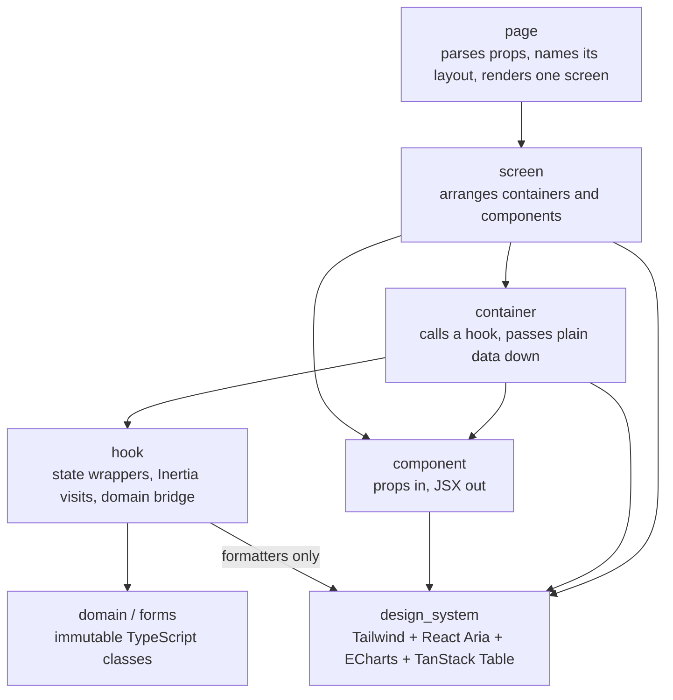

# 05 — Frontend conventions

React renders pages that Rails routes. Inertia carries props in and visits
out. Tailwind CSS styles everything, and the design system engine
(`@design_system/`) is the only place that knows how widgets, charts, and
tables are built.

## Layers



| Layer | Folder | May import | Must not |
| --- | --- | --- | --- |
| page | `pages/<resource>/<action>.tsx` | screens, `@core/contracts`, `@core/lib`, `@design_system/safe_url` (in its schema, FE-18), Inertia's `Head` (FE-13) | hold state, call hooks other than i18n, import or render a layout (it names one, FE-02) |
| screen | `screens/<resource>/` | containers, components, `@design_system/`, `@core/lib` | fetch, hold state, import layouts |
| container | `containers/<resource>/` | hooks, components, `@design_system/`, `@core/lib` | contain business rules |
| component | `components/<resource>/` | `@design_system/`, `@core/lib` | fetch, visit, hold global state, import hooks or containers |
| hook | `hooks/` | domain, forms, `@core/contracts`, `@core/lib`, `@design_system/formatters`, Inertia | render JSX |
| domain / forms | `domain/`, `forms/` | other domain code, `@core/domain/` | import React, Inertia, i18next, or `@design_system/` (OOP-04) |
| design system | `engines/design_system/app/frontend/<name>/` (`@design_system/<name>/`) | Tailwind helpers, React Aria, `@internationalized/date`, ECharts, TanStack Table, lucide-react, Inertia's `Link` and `Deferred` (FE-03), its own `design_system` i18n namespace | import anything else in the repository, `@core/` included |

The shared kit lives in two engines. Both are leaves: they depend on nothing
in the repository.

- `@core/` (`engines/core/app/frontend`) is the kernel: `contracts/` (the
  envelope, shared props, `definePage`, the app-relative path schema, and the
  generated locale enum), `lib/` (the state wrappers `use_domain_reducer.ts`
  and `use_ui_state.ts`, `assert_plain.ts`, `deep_freeze.ts`, and i18n
  helpers that do not format), and `domain/` (domain-free value objects such
  as `Money` and `DateRange`).
- `@design_system/` (`engines/design_system/app/frontend`) holds the tokens and
  theme, primitives and composites (FE-07), the chart and data-table wrappers,
  the icon map, the error boundary, and the formatters (FE-11). It is the only
  place that imports react-aria-components, @internationalized/date,
  tailwind-variants, tailwind-merge, echarts, @tanstack/react-table, and
  lucide-react. It does not import core, and it translates its own strings in
  the `design_system` namespace.

A domain engine (for example `engines/example_customers`) holds a business
concept that several modules share: its gateway, value objects, and
presentational components, exposed only through its `public/` folder (which
re-exports classes defined in its `domain/`, OOP-02). It has
no pages. A product module (for example `engines/example_orders`) has its own
`pages/`, `screens/`, `containers/`, `components/`, `hooks/`, `domain/`, and
`forms/` under `engines/<module>/app/frontend/`, plus a `public/` folder for
anything another engine may use. Engine code imports `@core/`,
`@design_system/`, its own alias, and the `public/` surface of each engine its
`package.yml` declares (ARCH-04, ARCH-08, ARCH-09). The app holds the
entrypoint (which initialises i18next), the page resolver, the layouts, and
app-level pages; no engine imports it.

## Rules

### FE-01 — Respect the layers (MUST · ADR-13)

Follow the table above. Every page renders exactly one screen, even when the
screen holds a single container; the screen is where layout grows later.

Page component names are unique by construction:

- app pages: `<resource>/<action>` → `app/frontend/pages/<resource>/<action>.tsx`;
- module pages: `<module>/<resource>/<action>` →
  `engines/<module>/app/frontend/pages/<resource>/<action>.tsx`.

The Inertia resolver maps names to files with `import.meta.glob`, so there is
no committed page registry. A check script (`pages:check`) fails when a
`render inertia:` name has no page file or a page has no `.schema.ts`. Both the
glob and `pages:check` leave out `engines/core/spec/`, where the test-only
dummy engine lives (TS-01).

```ts
// app/frontend/lib/page_resolver.tsx (sketch; normalise glob keys in one place)
const pages = {
  ...import.meta.glob<PageModule>(["@/pages/**/*.tsx", "!**/*.test.tsx"]),
  ...import.meta.glob<PageModule>([
    "@engines/*/app/frontend/pages/**/*.tsx",
    "!**/*.test.tsx",
    "!@engines/core/spec/**", // the test-only dummy engine is never resolved (TS-01)
  ]),
};
```

`@engines/` is an alias used only by this resolver: ESLint forbids `@engines/`
imports and `import.meta.glob` anywhere else. Vite's root is `app/frontend`,
so the `@engines/` alias and the `server.fs.allow` entries that let Vite serve
files from `engines/` are in the generated `config/frontend_aliases.mts`
(FE-10). Confirm the glob key format and `server.fs.allow` when adopting.

### FE-02 — Layouts are persistent and chosen by name (MUST · ADR-13, ADR-21)

Layouts live in the app (`app/frontend/layouts`), which module code may not
import (ARCH-04). So a page never imports a layout: it names one, and the
app's resolver maps the name to a persistent Inertia layout. Pages without a
name get `"app"` (the app shell). Screens and components never render a
layout. Because Inertia keeps persistent layouts mounted across visits, shell
state such as an open sidebar survives navigation.

```tsx
// any page, in the app or in a module
import type { LayoutName } from "@core/contracts/layout.types"; // "app" | "auth" | "bare"

SessionsNew.layoutName = "auth" satisfies LayoutName;
```

```tsx
// app/frontend/lib/page_resolver.tsx (excerpt)
// Every layout returns the same root element type, so React keeps LayoutRoot mounted
// when the layout changes: it holds the locale provider (FE-14), the page announcer, and the flash status (FE-13).
const LAYOUTS: Record<LayoutName, (page: ReactNode) => ReactNode> = {
  app: (page) => <LayoutRoot><AppShell>{page}</AppShell></LayoutRoot>,
  auth: (page) => <LayoutRoot><AuthShell>{page}</AuthShell></LayoutRoot>,
  bare: (page) => <LayoutRoot><BareShell>{page}</BareShell></LayoutRoot>, // no chrome, but SkipLink and MainContent (FE-13)
};

const wrappers = new Map<string, ResolvedComponent>(); // ResolvedComponent from @inertiajs/react

// Inertia reads `layout` from the component the resolver returns: the error-boundary wrapper,
// built once per page name and cached (FE-15), never the page module's own export. So the
// layout is set on the wrapper when it is built.
function wrapperFor(name: string, page: PageModule): ResolvedComponent {
  const cached = wrappers.get(name);
  if (cached !== undefined) return cached;
  // the design_system error boundary (FE-15); reportClientError posts to /core/client_errors (OPS-03)
  const wrapper = withPageBoundary(page.default, reportClientError);
  wrapper.layout = LAYOUTS[page.default.layoutName ?? "app"];
  wrappers.set(name, wrapper);
  return wrapper;
}
```

### FE-03 — One router, no second data layer (MUST · ADR-02)

Navigation and data loading go through Inertia (`<Link>`, `router.visit`,
partial reloads, `useForm`). Do not add a client router, a client data cache,
or a global store.

design_system takes exactly two things from Inertia: `Link`, which its link
component renders so that an app-relative link is an Inertia visit and not a
full page load, and `Deferred`, which its deferred-section component renders
with a skeleton as the fallback (CT-11). It imports nothing else from
`@inertiajs/react` (no `router`, `usePage`, `useForm`, `WhenVisible`, default,
or namespace import) and nothing from any other `@inertiajs/` package. Visits,
page props, and forms stay in the engines and the app. An ESLint allow-list
enforces it (`designSystemInertia` in `09_enforcement.md`), with a canary.

### FE-04 — Local state goes through two core wrappers (MUST · ADR-15)

Local state uses one of two wrappers from `@core/lib`, both built on React's
own hooks:

- **State with business transitions** →
  `useDomainReducer(reducer, initialPlain)` with a typed event union
  (`{ type: "quantity_changed"; lineId: string; quantity: number }`). The
  reducer delegates every transition to a domain object:
  `X.fromPlain(state).method().toPlain()` (OOP-07).
- **Presentation-only state** (a dialog is open, a tab is selected) →
  `useUiState({ open: false })`, updated with a patch such as
  `setMenu({ open: true })`. The state is always an **object**, never a bare
  boolean or string; the type parameter rejects primitives, so the compiler
  checks it.
- ESLint forbids `useState`, `useReducer`, `useActionState`, and
  `useOptimistic` in core, the engines, and the app, except in the two
  wrapper files. The ban also covers the same hooks reached through a
  namespace or default import of `react` (`React.useState` and the like,
  ESLint `no-restricted-properties`). design_system, a leaf that holds no
  domain state and cannot import core, may use React's state hooks inside its
  widgets for their own presentation state (FE-07).
- Forms and server-backed optimistic updates use Inertia's `useForm` and
  router. A purely local optimistic change uses `useDomainReducer` with an
  explicit rollback event. Server-issued values that change between submits
  (the edit version and the form token) are read from the current props at
  submit time, never kept in `useForm` data (BE-15).
- In development, both wrappers check and lock what they store (OOP-05).
  `assertPlain` throws unless the initial state, every next state, and every
  `useUiState` patch are plain data as OOP-05 defines it, and its message
  names the path of the first value that is not (`state.lines[0].unitPrice
  is a Money`); `deepFreeze` then freezes each of them
  in place. Code that edits state instead of replacing it (a reducer that
  pushes onto `state.lines`, a handler that sets `menu.open` on the state it
  read) throws a `TypeError` at that line, instead of leaving React holding
  a changed object it does not re-render. Freezing in place also freezes the
  props objects a state was built from, which nothing may edit either.
  Production builds skip both.

```ts
// engines/core/app/frontend/lib/assert_plain.ts  (development only: callers check import.meta.env.DEV)
// Plain data (OOP-05): null, undefined, strings, numbers, booleans, bigints, arrays, and objects whose
// prototype is Object.prototype or null, all the way down. Anything else throws a TypeError that names
// the path: functions, symbols, symbol keys, Date, Map, Set, RegExp, and every class instance.
export function assertPlain(value: unknown, path = "state", seen = new WeakSet<object>()): void {
  if (value === null || value === undefined) return;
  const type = typeof value;
  if (type === "string" || type === "number" || type === "boolean" || type === "bigint") return;
  if (typeof value !== "object") throw new TypeError(`${path} is a ${type}, not plain data (OOP-05)`);
  // A shared or circular reference is checked once, so the walk always ends.
  if (seen.has(value)) return;
  seen.add(value);
  const prototype: unknown = Object.getPrototypeOf(value);
  const isArray = Array.isArray(value) && prototype === Array.prototype;
  if (!isArray && prototype !== Object.prototype && prototype !== null) {
    const name = (prototype as { constructor?: { name?: string } }).constructor?.name ?? "object";
    throw new TypeError(`${path} is a ${name}, not plain data (OOP-05)`);
  }
  if (Object.getOwnPropertySymbols(value).length > 0) {
    throw new TypeError(`${path} has a symbol key, not plain data (OOP-05)`);
  }
  for (const [key, child] of Object.entries(value)) {
    assertPlain(child, isArray ? `${path}[${key}]` : `${path}.${key}`, seen);
  }
}
```

```ts
// engines/core/app/frontend/lib/deep_freeze.ts  (development only: callers check import.meta.env.DEV)
export function deepFreeze(value: unknown, seen = new WeakSet<object>()): void {
  if (typeof value !== "object" || value === null || seen.has(value)) return;
  seen.add(value);
  Object.freeze(value);
  // Object.freeze is shallow, so the walk does not stop at an already frozen
  // object; `seen` ends it on shared or circular references instead.
  for (const child of Object.values(value)) deepFreeze(child, seen);
}
```

```ts
// engines/core/app/frontend/lib/use_domain_reducer.ts  (imported as @core/lib/use_domain_reducer)
import { useReducer } from "react";

import { assertPlain } from "./assert_plain";
import { deepFreeze } from "./deep_freeze";

export function useDomainReducer<S extends object, E extends { type: string }>(
  reducer: (state: S, event: E) => S,
  initialPlain: S,
) {
  if (import.meta.env.DEV) {
    assertPlain(initialPlain);
    deepFreeze(initialPlain);
  }

  return useReducer((state: S, event: E): S => {
    const next = reducer(state, event);
    if (import.meta.env.DEV) {
      assertPlain(next);
      deepFreeze(next);
    }
    return next;
  }, initialPlain);
}
```

```ts
// engines/core/app/frontend/lib/use_ui_state.ts  (imported as @core/lib/use_ui_state)
import { useState } from "react";

import { assertPlain } from "./assert_plain";
import { deepFreeze } from "./deep_freeze";

export function useUiState<T extends object>(initial: T) {
  if (import.meta.env.DEV) {
    assertPlain(initial);
    deepFreeze(initial);
  }
  const [state, setState] = useState<T>(initial);

  function update(patch: Partial<T>) {
    if (import.meta.env.DEV) {
      assertPlain(patch);
      deepFreeze(patch);
    }
    setState((current) => {
      const next = { ...current, ...patch };
      // current and patch are frozen already; only the new top level is not.
      if (import.meta.env.DEV) Object.freeze(next);
      return next;
    });
  }

  return [state, update] as const;
}
```

### FE-05 — Imports, files, and names (MUST · ADR-13)

- Import through aliases:
  - `@core/` for the kernel (`engines/core/app/frontend`);
  - `@design_system/` for the design system
    (`engines/design_system/app/frontend`);
  - `@<engine>/` for an engine's own code (`engines/<engine>/app/frontend`),
    used only inside that engine;
  - `@<engine>/public/` for the public surface of another domain engine or
    product module, only when the importing engine declares that dependency
    in its `package.yml` (ARCH-08, ARCH-09);
  - `@/` for `app/frontend` (app code only; no engine imports it).

  `@engines/` belongs to the page resolver alone (FE-01). Relative imports are
  allowed only as `./` within the same folder; never `../`.
- Files and folders are `snake_case`. Components export `PascalCase`; hooks,
  functions, and variables are `camelCase`; types and classes are `PascalCase`.
- Exported types live in `*.types.ts`, Zod schemas in `*.schema.ts`, constants
  in `*.constants.ts`, tests next to the file as `*.test.ts(x)`. A schema file
  may also export the types it infers (`z.infer`), and generated files
  (`*.generated.ts`) export their own. What ESLint enforces is narrower: a
  `.tsx` file exports no types.
- Import order (enforced): side effects, built-ins, packages, aliases, `./`,
  then type imports.

### FE-06 — Tailwind with the full palette plus semantic tokens (MUST · ADR-11)

- The full Tailwind palette stays available.
- `@theme` adds semantic tokens on top. Status and brand colors SHOULD use them
  so a theme change happens in one place. Tokens that point at palette
  variables are declared with `@theme inline static`: `inline` puts the
  palette variable into each utility, and `static` still emits every token as
  a CSS variable, which the chart theme reads (FE-08). With Tailwind 4.3.5,
  plain `@theme inline` emits no variable for its tokens. The theme lives in
  the design system engine.
- Dark mode MAY be added later without touching components: define a `dark`
  custom variant and override the semantic tokens for it. Components use
  tokens, so they follow.
- Variants live in the design system with `tailwind-variants`; merging of
  caller classes goes through `tailwind-merge`. tailwind-merge knows
  Tailwind's default scales, not the theme: it takes an unknown name after a
  color prefix for a color, so a custom non-color token conflicts with a real
  color. With tailwind-merge 3.7.0, a custom font-size token `--text-display`
  makes `twMerge("text-primary text-display")` drop `text-primary`, and a
  custom `--shadow-card` makes `shadow-card shadow-danger` keep only the
  color. design_system therefore merges through one `extendTailwindMerge`
  instance that registers every custom non-color theme token under its
  scale (`theme: { text: ["display"], shadow: ["card"], radius: [...] }`);
  semantic color tokens need no entry. Variant recipes merge through the same
  instance. tailwind-variants 4.0.1 bundles its own merge engine, and its
  default entry throws on `twMergeConfig` when a recipe is defined, so
  design_system exports a `tv` built with `createTV({ twMerge })` from
  `tailwind-variants/lite`, which ships no engine and calls the function it
  is given (`@design_system/internal/tailwind`, below). Components import
  that `tv`, never the package's. A design_system test merges each
  custom token with a semantic color of the same prefix and keeps both, so a
  token added to `theme.css` without its entry fails.
- `@apply` is allowed only in CSS inside `engines/design_system`.
- Class order is normalized by `prettier-plugin-tailwindcss`. Unknown classes
  fail lint, because Tailwind silently drops a misspelled utility: the rule is
  `better-tailwindcss/no-unknown-classes` (eslint-plugin-better-tailwindcss
  4.10.0; message "Unknown class detected: <class>"), with its `entryPoint`
  option set to the v4 CSS entry that imports the design_system theme. The
  Prettier plugin's `tailwindStylesheet` option names the same entry.
- `app/frontend/styles/application.css` imports the theme by relative path
  (`@import "../../../engines/design_system/app/frontend/theme.css";`), never
  through the `@design_system/` alias. Both tools read the entry outside Vite,
  so they cannot resolve a Vite alias: prettier-plugin-tailwindcss 0.8.1 fails
  with "Can't resolve '@design_system/theme.css'", and
  eslint-plugin-better-tailwindcss 4.10.0 then reports every class, `p-4`
  included, as unknown.
- Tailwind must see the class names in every engine's frontend, not only in
  `app/frontend`. If automatic source detection does not reach `engines/`,
  register it with `@source` in the CSS entry (verify when adopting).

```css
/* engines/design_system/app/frontend/theme.css, imported by app/frontend/styles/application.css */
@import "tailwindcss";

/* inline: utilities use the palette variable; static: each token is still emitted for the chart theme (FE-08) */
@theme inline static {
  --color-primary: var(--color-indigo-600);
  --color-primary-hover: var(--color-indigo-700);
  --color-danger: var(--color-rose-600);
  --color-success: var(--color-emerald-600);
  --color-surface: var(--color-white);
  --color-muted: var(--color-slate-500);
  --font-sans: "Inter", "Noto Sans Thai", ui-sans-serif, system-ui, sans-serif;
}
```

```ts
// engines/design_system/app/frontend/internal/tailwind.ts  (design_system only; internal/ is never public, ARCH-09)
import { extendTailwindMerge } from "tailwind-merge";
import { createTV } from "tailwind-variants/lite";

// Every custom non-color theme token, under its scale (FE-06); semantic color tokens need no entry.
export const twMergeConfig = { extend: { theme: { text: ["display"], shadow: ["card"] } } };

// The one merge instance: caller classes and every variant recipe merge through it.
export const twMerge = extendTailwindMerge(twMergeConfig);

// The lite entry has no merge engine of its own; it calls twMerge (tailwind-variants 4.0.1).
export const tv = createTV({ twMerge });
```

```tsx
// engines/design_system/app/frontend/button/button.tsx  (imported as @design_system/button/button)
import { Button as AriaButton } from "react-aria-components";

import { tv } from "@design_system/internal/tailwind";

import type { ButtonProps } from "./button.types";

const button = tv({
  base: "inline-flex items-center gap-2 rounded-md px-3 py-2 text-sm font-medium focus-visible:outline-2 disabled:opacity-50",
  variants: {
    intent: {
      primary: "bg-primary text-white hover:bg-primary-hover",
      danger: "bg-danger text-white hover:bg-rose-700",
      ghost: "bg-transparent text-slate-700 hover:bg-slate-100",
    },
  },
  defaultVariants: { intent: "primary" },
});

export function Button({ intent, className, testId, ...rest }: ButtonProps) {
  return <AriaButton {...rest} className={button({ intent, className })} data-testid={testId} />;
}
```

### FE-07 — Controls come from a domain-free design system (MUST · ADR-11)

Pages, screens, containers, and components do not render raw `<button>`,
`<input>`, `<select>`, or `<textarea>`. They use design-system components,
which carry focus styles, accessibility wiring, and test ids.

- **Primitives** (button, text field, select, date field, dialog, menu,
  combobox, tabs) are built on React Aria Components inside
  `engines/design_system` only. `@internationalized/date` supplies the
  Gregorian and Buddhist calendars (FE-20).
- **Composites** combine primitives into a reusable pattern: a data table with
  pagination, a filter bar, a confirm dialog, an empty state.
- design_system accepts only domain-free components. Nothing in it knows a
  business concept such as an invoice or a customer. A composite that does
  stays in its module's `components/`, or, when several modules need it, moves
  to a domain engine's `public/` surface (ARCH-05). It never moves into
  design_system to be shared.

### FE-08 — Charts use ECharts through one wrapper (MUST · ADR-12)

- Import ECharts only inside `@design_system/chart/`, from `echarts/core`, and
  register only the charts, components, and renderer in use so the bundle
  stays small.
- The wrapper is lazy: it loads ECharts through `React.lazy`, so only pages
  that render a chart download it. A test asserts that the wrapper stays lazy
  (FE-16).
- The wrapper owns `init`, resize (a `ResizeObserver`), `dispose`, and the
  loading, empty, and error states, each with its own test id. It calls
  `init` once per mount and then `setOption(option, { notMerge: true })` on
  every change: the default merge keeps series and components the new option
  no longer names, and disposing on every change loses state and flickers.
- The chart theme reads the semantic color tokens from CSS variables, so charts
  match the UI. Two facts make that work. Chart tokens are declared with
  `@theme static` (or `@theme inline static`): under plain `@theme inline`,
  Tailwind 4.3.5 inlines the value into utilities and emits no CSS variable,
  so the theme would read `""`. And Tailwind's palette is `oklch()`, which
  ECharts 6.1.0 cannot parse (zrender's color parser knows names, hex,
  `rgb[a]`, and `hsl[a]`): the hover lift becomes `undefined`, and visual
  maps interpolate nothing. A pure design_system function converts each
  computed value to sRGB hex before ECharts sees it, unit-tested against known
  Tailwind values (indigo-600 → `#4f39f6`); a wrapper test asserts every theme
  color is non-empty and parses. No color library is added (FE-12).
- Time axes and tooltips format dates with `@design_system/formatters` for the
  current locale, never with ECharts' built-in time templates, which print
  Gregorian years. A `th` chart shows 2569 (FE-20).
- Charts are accessible through one path, never two that cancel each other.
  The wrapper registers `AriaComponent` (under `echarts/core` the `aria`
  option is a no-op without it) and turns `aria` on, so ECharts gives the
  chart container `role="img"` and an `aria-label`. The label's description
  comes from the feature's translated summary (`aria.label.description`),
  because ECharts' generated text follows its own locale files, and
  `echarts/core` registers only EN and ZH. The full data is offered by a
  visible "show as table" toggle that renders a real table. The container is
  never `aria-hidden` (that would hide the label ECharts wrote), and there is no
  second, visually hidden copy of the data. A browser test asserts
  `role="img"` and a non-empty translated `aria-label` on a `th` chart.
- Features pass an option object built by a pure function that lives next to
  the component that renders the chart (for example
  `components/reports/revenue_by_month.ts`) and is unit-tested without the
  DOM, in the `<engine>:node` project (TS-09).
- Grids use TanStack Table through `@design_system/data_table/` under the same
  rules, lazy loading included; date cells use the formatters. Server-side
  paging, sorting, and filtering stay in Rails (BE-07), so the DataTable has
  no client sorted-row model. It takes rows `T extends { id: string }` and
  sets `getRowId: (row) => row.id`; TanStack's default row id is the index,
  which would print `<id>.row.0` instead of FE-09's `<id>.row.<rowId>`. A
  sortable header renders `aria-sort` from a required `sort` prop taken from
  the parsed `query`. design_system tests cover the row test id and
  `aria-sort`.

```ts
// engines/design_system/app/frontend/chart/echarts.ts
import { BarChart, LineChart } from "echarts/charts";
import { AriaComponent, GridComponent, LegendComponent, TooltipComponent } from "echarts/components";
import * as echarts from "echarts/core";
import { SVGRenderer } from "echarts/renderers";

// AriaComponent: without it the `aria` option does nothing under echarts/core.
echarts.use([BarChart, LineChart, AriaComponent, GridComponent, LegendComponent, TooltipComponent, SVGRenderer]);

export { echarts };
```

```tsx
// engines/design_system/app/frontend/chart/chart.tsx  (imported as @design_system/chart/chart)
import { lazy, Suspense } from "react";

import { Skeleton } from "@design_system/skeleton/skeleton";

import type { ChartProps } from "./chart.types";

// ECharts arrives in its own chunk, only on pages that render a chart.
const EChart = lazy(() => import("./echart").then((module) => ({ default: module.EChart })));

export function Chart(props: ChartProps) {
  return (
    <Suspense fallback={<Skeleton testId={`${props.testId}.loading`} />}>
      <EChart {...props} />
    </Suspense>
  );
}
```

### FE-09 — Test ids are required props (MUST · ADR-11, ADR-20)

Every interactive design-system component and every loading, empty, error,
and forbidden state declares `testId: string` as a required prop and renders
it as `data-testid`. Format: `<module>.<element>[.<action>]`, lowercase,
dot-separated, named after the domain (`billing.invoices.export`), never after
translated text. Sub-elements derive from the parent (`<id>.retry`,
`<id>.row.<rowId>`).

### FE-10 — React Compiler, no default memoization (SHOULD · ADR-16)

Build with React Compiler. Do not add `useMemo` or `useCallback` without a
measured cost or an identity requirement, stated in a comment. A component the
compiler cannot handle gets a narrow `"use no memo"` with a reason. Every
`eslint-disable` comment states its reason. Each one, like each
`"use no memo"`, counts against the engine's ratchet
(`engines/<engine>/config/ratchets.yml`; the root `config/ratchets.yml` for
core, design_system, and the app): adding one raises a committed count, and a
raise needs an owner's approval (`09_enforcement.md`).

With `@vitejs/plugin-react` 6.3, React Compiler runs through
`@rolldown/plugin-babel` and the exported `reactCompilerPreset`. Built with
the `reactPlugins()` excerpt below (Vite 8.3.7, @rolldown/plugin-babel 0.3.1,
babel-plugin-react-compiler 1.0.0, @babel/core 7.29.13), a component's output
imports `c` from `react/compiler-runtime`; without the Babel plugin it does
not.

`useReactTable` (@tanstack/react-table 8.21.3) is a library the compiler
cannot memoize: eslint-plugin-react-hooks 7.1.1 warns
`react-hooks/incompatible-library` and the compiler skips the component that
calls it. Lint runs with `--max-warnings 0`, so the design_system data table,
the only caller (FE-08), carries one `eslint-disable-next-line` with its
reason, and the root `config/ratchets.yml` starts with that count for
design_system.

Tests compile with the compiler too, or they test different code from what
ships. `vite.config.mts`, the root `vitest.config.mts`, and each engine's
`vitest.config.mts` take their React plugins from one export, `reactPlugins()`
in `config/frontend_react.mts`. The plugin applies to Vite's client
environment, which Vitest's jsdom projects use, and skips the node projects,
whose tests render no React (TS-09). A core Vitest test
re-renders a parent with unchanged child props and asserts the child rendered
once; it fails when the compiler did not run.

The TypeScript and Vite settings that follow the engine list are generated,
never edited:

- `script/ci/engine_graph` writes every `tsconfig.json`, along with the
  dependency-cruiser engine rules. Each engine gets one with
  `composite: true`, `declaration: true`, `emitDeclarationOnly: true`,
  `outDir` `tmp/tsc/<engine>` and `tsBuildInfoFile`
  `tmp/tsc/<engine>.tsbuildinfo` (both under the repository root),
  `include: ["app/frontend/**/*"]` (core's adds
  `spec/dummy_engine/app/frontend/**/*`, the test-only dummy engine, TS-01),
  and `references` generated from its
  `package.yml` (ARCH-08). Without `composite` and declaration emit, `tsc -b`
  rejects the references (TS6306, TS6310). `app/frontend/tsconfig.json` is
  built the same way and references every engine. `tsconfig.tooling.json`,
  built the same way, covers the TypeScript outside every `app/frontend/`:
  the root `e2e/`, `engines/*/e2e/`, `script/**/*.ts`, `playwright.config.ts`,
  `vite.config.mts`, `vitest.config.mts`, `engines/*/vitest.config.mts`,
  `config/frontend_react.mts`, and `config/frontend_aliases.mts`
  (not the deliberately broken canary fixtures, TS-07), and references every
  engine. The root
  `tsconfig.json` is a solution file: `files: []` plus generated `references`
  to every project, the tooling project included. CI caches `tmp/tsc/`, so
  `tsc -b` rechecks only the projects that changed. Because the solution
  file has no `paths`, the TypeScript scripts run as
  `tsx --tsconfig tsconfig.tooling.json <script>`; bare `tsx` cannot resolve
  `@core/` or `@design_system/` (CT-03).
- `npm run aliases:generate` writes the aliases from the engine list: the
  alias `paths` in the shared `tsconfig.base.json`, which every project
  extends and dependency-cruiser's `tsConfig.fileName` points at, and, for
  Vite, `config/frontend_aliases.mts`, which exports `engineAliases` and
  `engineFsAllow` (the `server.fs.allow` entries, FE-01).
  `npm run aliases:check` fails when either file is stale.
- Like every generator (CT-03), both own their whole output set: they delete
  a file they no longer produce (the tsconfig references and aliases of a
  removed or renamed engine), and their check fails on a generated file that
  has no source.

```jsonc
// engines/example_orders/tsconfig.json (generated by script/ci/engine_graph; do not edit)
{
  "extends": "../../tsconfig.base.json",
  "compilerOptions": {
    "composite": true,
    "declaration": true,
    "emitDeclarationOnly": true,
    "outDir": "../../tmp/tsc/example_orders",
    "tsBuildInfoFile": "../../tmp/tsc/example_orders.tsbuildinfo"
  },
  "include": ["app/frontend/**/*"],
  "references": [{ "path": "../core" }, { "path": "../design_system" }, { "path": "../example_customers" }]
}
```

```ts
// config/frontend_react.mts — shared by vite.config.mts and every vitest.config.mts, root and engine (FE-10)
import babel from "@rolldown/plugin-babel";
import react, { reactCompilerPreset } from "@vitejs/plugin-react";

export const reactPlugins = () => [react(), babel({ presets: [reactCompilerPreset()] })];
```

```ts
// vite.config.mts
import tailwindcss from "@tailwindcss/vite";
import { defineConfig } from "vite";
import ruby from "vite-plugin-ruby";

import { engineAliases, engineFsAllow } from "./config/frontend_aliases.mts"; // generated (aliases:generate)
import { reactPlugins } from "./config/frontend_react.mts";

export default defineConfig({
  plugins: [ruby(), tailwindcss(), ...reactPlugins()],
  // "@core/", "@design_system/", "@<engine>/" for every other engine (its public/ included), plus "@engines/"
  resolve: { alias: engineAliases },
  // Vite's root is app/frontend (vite-plugin-ruby), so the engines' folders are allowed explicitly (FE-01).
  server: { fs: { allow: engineFsAllow } },
  // Vite 8.3.7 inlines assets under 4096 bytes as data: URLs, which the CSP blocks (SEC-05).
  build: { assetsInlineLimit: 0 },
});
```

### FE-11 — Copy, formats, and Thai typography (MUST · ADR-17)

- All UI copy comes from i18next keys in the engine's own namespace (CT-08);
  flash messages and field errors (CT-07) and navigation labels (`nav[].label`
  in shared props, ARCH-06) arrive already translated by Rails.
  The default locale (English in the default configuration) is the fallback.
- Dates, times, numbers, and money are formatted only by
  `@design_system/formatters`, built on `Intl` with the current locale, an
  explicit calendar (FE-20), and the display time zone (FE-14). The ESLint
  bans listed under FE-20 cover numbers and money as well as dates.
- Thai text needs room: body line-height between 1.5 and 1.75, no letter
  spacing, no forced uppercase. When Thai is configured (as in the default
  configuration), the font stack includes a Thai face with a system fallback
  for offline installs.

### FE-12 — Keep the stack small (MUST · ADR-02, ADR-11)

Do not add a styled component kit, a CSS-in-JS library, a client data cache
(such as TanStack Query), a global state store (such as Redux or Zustand), or
a library for immutable updates. State changes go through domain methods and
the two core wrappers (FE-04, OOP-07). A new dependency needs an issue that
states why, and a new framework-level library an ADR (WF-06).

### FE-13 — Page changes are announced and focused (MUST · ADR-24)

An Inertia visit swaps the page without a browser navigation, so assistive
technology hears nothing unless the app says something.

- Every page sets its document title with Inertia's `<Head>`, from i18n keys.
- The layout root listens to Inertia's `navigate` event, which fires after the
  page swap for every visit that changes the URL, back and forward included
  (`success` fires only after a request, so it misses history navigation).
  It announces the new page in a polite live region and moves focus to the
  page's main heading (`tabIndex={-1}`, `focus({ preventScroll: true })`, so
  the scroll position Inertia just restored stays) when the page component or
  the URL path differs from the previous page; query string and hash are
  ignored. A same-component visit to another record (invoice 1 → 2) counts.
  `preserveState` is not the signal: non-GET visits default to it, so a create
  that redirects to the show page must still be announced. Same-path visits
  (filtering, pagination, a reload, a submit that returns errors) leave focus
  where it is. @inertiajs/core 3.11.0 fires no `navigate` for a visit that
  replaces the history entry (`replace: true`, or a visit to the URL already
  shown), so a visit that shows another page never passes `replace: true`.
- The first page of a full load is neither announced nor focused: the browser
  announces a full load itself, and focus stays at the start of the document,
  before the skip link. @inertiajs/core 3.11.0 fires `navigate` for that page,
  with `event.detail.type` `"initial"` (visits are `"visit"`, Back and
  Forward `"history"`), possibly before the layout root's effect has attached
  its listener (under jsdom it fires first). So the layout root ignores
  `"initial"` and records the first page's component and URL path at its
  first render; the first visit compares against that record.
- The announcement is the text of the first `h1` inside `<main>`, the element
  that also receives focus, read in the `navigate` handler. The new page is
  in the DOM by then: @inertiajs/react 3.11.0 commits the swap inside
  `flushSync`, and core fires `navigate` only after the swap, for visits and
  for Back and Forward alike. `document.title` is not read at that moment:
  Inertia's `<Head>` applies the title in an effect, so on the announcement
  frame it still holds the previous page's title. Only a page without an
  `h1` in `<main>` falls back to the title, after it has changed. The
  announcement test asserts the new page's heading text, so an Inertia
  upgrade that commits after `navigate` fails it.
- There is one page announcer: a polite live region rendered by the layout
  root that every layout shares (FE-02), so it stays mounted across layout
  changes and exists from the first render; announcing only changes its
  text. A region inserted together with its text is often not read (Safari
  needs it in the DOM first). Design-system components MAY own status regions
  for their own state (`Pagination`, below), present from the component's
  first render for the same reason. The announcer is visually hidden with
  `sr-only`, never `hidden`, `display: none`, or `aria-hidden`, which remove
  it from the accessibility tree.
- Flash notices render into an always-present status container, for the same
  reason. It reads Inertia's page-level flash (`usePage().flash`), never a
  prop, and parses it with core's `flashSchema` as the layout parses shared
  props (CT-04, CT-07). @inertiajs/core 3.11.0 keeps `flash: {}` in every
  history entry and sets it to `{}` on a response that carries none, so Back
  and Forward never show an old notice again, and the next visit or partial
  reload clears it. The layout test visits a page with a notice, then one
  without, then goes back, and asserts the container is empty after both.
- Every layout, `bare` included, renders the skip link to the main content and
  the `<main>` landmark; `bare` (`BareShell`) only drops the navigation
  chrome. The skip link is the first focusable element of the page and is
  visible while it has focus; its target, `<main>`, has an `id` and
  `tabIndex={-1}`, so following the link moves focus into the content. A
  component test renders a page in each layout and asserts both (the first
  Tab focuses the skip link; activating it focuses `<main>`) and the shared
  live region, and that an app → auth → app sequence keeps the
  same live region node. The announcement test covers the first page (no
  announcement, focus unchanged), invoice 1 → 2, back, a filter (no
  announcement), and a create that redirects to the show page (announced).
  Focus styles come from the design system and are never removed.
- `Pagination` renders a `<nav>` with a translated label and a polite status
  that states where the viewer is, both present from its first render:
  "Page 2 of 5" for the offset kind, the translated "Next page" or "Previous
  page" just loaded for the cursor kind (CT-01). A page change is a
  same-path visit, which the page announcer leaves silent, so this status is
  what a screen-reader user hears. A design-system test asserts the label and
  the status text after a page change.
- After a submit that returns errors (`useForm`'s `onError`), focus moves to
  the first invalid field in DOM order, or to an error summary that holds the
  message when only `errors.base` is set. React Aria focuses an invalid field
  only on the native `invalid` event, which a server round trip never fires.
  A control never sets native `disabled` on itself while it has focus,
  because focus would fall to the page body: submit buttons are `isPending`
  while the form processes (BE-15), and `Pagination` makes a focused button
  at a boundary `aria-disabled` and ignores presses. The design-system form
  test and each generated form's component test assert `document.activeElement`
  after a failed submit; a `Pagination` test asserts focus stays on a control
  after moving to the last page.

```tsx
// app/frontend/layouts/flash_status.tsx  (rendered once by LayoutRoot, FE-02, so it exists from the first render)
import { usePage } from "@inertiajs/react";

import { flashSchema } from "@core/contracts/page_props.schema";

// Inertia's page-level flash (CT-07), never a prop: Back and Forward restore {} for it, and every
// response without one clears it. Parsed like the shared props (CT-04); a parse failure throws.
export function FlashStatus() {
  const { notice, alert } = flashSchema.parse(usePage().flash);
  return (
    <div role="status" data-testid="app.flash">
      {alert === undefined ? null : <p data-testid="app.flash.alert">{alert}</p>}
      {notice === undefined ? null : <p data-testid="app.flash.notice">{notice}</p>}
    </div>
  );
}
```

### FE-14 — Locale-aware widgets, calendars, and time zones (MUST · ADR-17)

- The locales come from `config/locales.yml` (CT-08); no component hardcodes
  a locale list.
- The locale switcher links to `app.localeHrefs` from shared props: the
  current page in every configured locale, built by core with `Urls` (CT-02).
  It never rewrites the current URL.
- The layout root (FE-02) renders the design system's locale provider around
  the shell and the page, with the locale from the parsed `app.locale`
  (CT-04). The provider hands React Aria's `I18nProvider` that locale with its
  calendar set explicitly (`th-TH-u-ca-buddhist` for `th`, Gregorian for the
  others), so widgets format, announce, and lay out correctly. It cannot sit
  above Inertia's `App`: page props exist only inside it, and `setup` sees
  only the first page, so a provider there would never follow a locale
  switch. Outside a provider, React Aria falls back to the browser's
  language, so shell widgets need it too. A layout test asserts that a shell
  widget reads `th-TH-u-ca-buddhist` when `app.locale` is `th`. React Aria is
  imported only inside design_system (FE-07). The Buddhist Era rule itself is
  FE-20.
- Values sent to Rails are always ISO 8601 Gregorian (CT-02). Date fields
  convert to the Gregorian calendar before submitting (FE-20).
- Times display in `app.timeZone` from shared props (the app's configured zone,
  or the viewer's own zone when the upstream provides one), never silently in
  the browser's zone.

### FE-15 — Every page has an error boundary (MUST · ADR-14)

The resolver wraps each page in the design system's error boundary (the one
class component, OOP-01). It renders the shared error state with the request
id and trace id, which it reads from `trace` (CT-01) with its own small schema
so they show even when the page schema fails, and reports the error,
schema parse failures (CT-04) included, to the client error endpoint
(OPS-03). The resolver passes the reporting callback in, because
design_system imports nothing from the app or core.

- The resolver builds the wrapped component once per page name and returns
  that same component on every later call. Inertia calls the resolver on
  every visit, and a new component type on a `preserveState` visit
  (filtering, pagination, every `useForm` submit) remounts the page and drops
  what the viewer typed. A resolver test resolves one name twice and expects
  the same identity.
- Because the wrapped component stays the same across a same-component visit
  (invoice 1 → 2), React keeps its boundary, and with it a caught error. So
  the wrapper passes the current `page.url` to the boundary as its reset key,
  and a boundary that holds an error clears it when the key changes. A
  resolver test crashes invoice 1, visits invoice 2, and expects invoice 2.
- The error state is perceivable: its container has `role="alert"`, its
  title is the `h1` with `tabIndex={-1}`, and the boundary moves focus to
  that title when it catches, so focus is not left on a control that no
  longer exists. A resolver test throws from a page and asserts the alert and
  `document.activeElement`.
- The error state's retry (`<id>.retry`, FE-09) clears the boundary's error
  and renders the page again. It MAY reload the page's props first
  (`router.reload()`).
- Errors that no boundary catches are reported through the same reporter:
  the entrypoint listens to `unhandledrejection` and to `window` `error`
  events (an event handler or a timer that throws). A rejection whose reason
  is not an `Error` is reported with a fixed message and no stack; the reason
  itself is never serialized, because it can hold anything, props included.
  The reporter bounds what it sends: the message cut to 1,000 characters and
  the stack to 4,000, the path from `location.pathname`, `release` from the
  Inertia page `version`, sent with `keepalive: true` (OPS-03).
- A last-resort design_system error boundary wraps Inertia's `App` in
  `setup`, so a failure in a layout, the shell, or the shared props still
  renders the error state and is reported. A test throws from the shell and
  asserts both.

### FE-16 — Loading feels fast and stays small (SHOULD · ADR-13)

- Pages are separate chunks (the resolver's glob is lazy); the app shell is
  part of the entry chunk.
- Bundle budgets (TS-02, `config/budgets.yml`) are measured gzipped from
  Vite's manifest, following static imports (`imports`) recursively and never
  `dynamicImports`. A page chunk is a chunk whose source is a page file
  (FE-01); a lazy chunk is any other chunk that only dynamic imports reach.
  - The entry chunk: `js_entry_gzip_kb`.
  - Each page: its own chunk plus every chunk it imports statically that the
    entry does not already load, `js_page_chunk_gzip_kb`. Code a page pulls
    into a shared chunk still counts against that page.
  - The initial bytes of the smallest page: the entry plus every chunk it
    imports statically, `js_initial_gzip_kb`. That number catches shared code
    drifting into what every page downloads.
  - Each lazy chunk (the chart and data-table wrappers' `React.lazy`
    imports) with the chunks it imports statically that the entry does not
    load: `js_lazy_chunk_gzip_kb`. It never counts against a page.
- The chart and data-table wrappers load lazily (`React.lazy`) inside
  design_system, so ECharts and TanStack Table reach only the pages that render
  them (FE-08).
- Deferred props render design-system skeletons until they arrive (CT-11).
- The Inertia progress indicator shows only after a short delay, to avoid
  flicker on fast visits.
- Filters and pagination use partial reloads (`only: ["data", "query",
  "pagination"]`) with `preserveState`. The reload clears a notice from an
  earlier write by itself: the flash is Inertia's page-level flash, which
  `only:` does not filter, and a response without one sets it to `{}`
  (CT-07, FE-13). The design system's `Pagination`
  renders both the offset and the cursor kinds (CT-01), and never natively
  disables the button that has focus (FE-13).

### FE-17 — Icons go through one map (SHOULD · ADR-11)

Icons come from `@design_system/icon`, which maps stable names (the ones used
in the module registry, ARCH-06) to `lucide-react` components. Feature code
never imports `lucide-react` directly, and a spec fails when the registry uses
a name the map does not have. The shipped map includes `folder`, the module
generator's default icon (GEN-01).

### FE-18 — No raw HTML, no unsafe URLs (MUST · ADR-09, ADR-11)

React escapes text by default; these are the two ways around it, and both are
closed:

- `dangerouslySetInnerHTML` is not used (ESLint `react/no-danger`). If rich
  text is ever needed, it gets one design-system component with an HTML
  sanitizer chosen by ADR and pinned exactly.
- Every URL that comes from data passes `isSafeUrl` from
  `@design_system/safe_url`, which accepts only `https:`, `http:`, and
  app-relative paths, so `javascript:` and `data:` links never reach an
  `href` or `src`. An app-relative path starts with exactly one `/` and holds
  no backslash, ASCII control character, or surrounding whitespace: the URL
  parser resolves `//evil.test/x`, `/\evil.test/x`, and `/<tab>/evil.test/x`
  to another origin. `appPathSchema` applies the same predicate: the one copy
  between engines that ARCH-05 allows, because neither kernel engine may
  depend on the other. Both test suites read one shared fixture of hostile
  inputs, `spec/fixtures/hostile_urls.json`, by path (never imported); it is
  the guard of that exception, ships with the kernel, and keeps the two
  implementations from drifting. Page schemas use
  `z.string().refine(isSafeUrl)`, and the design system's link component
  (which renders Inertia's `Link`, FE-03) and its image component call
  `isSafeUrl` again before rendering. It lives in design_system because
  design_system cannot import core; navigation paths in shared props are
  built by Rails from the registry and checked by core's own app-relative
  path schema (`appPathSchema` in `@core/contracts/app_path.schema`, CT-02).
- TypeScript never builds a URL. Links are server-built props (CT-02): every
  URL a page needs, links into other modules included, is built by a props
  object through `context.urls` (BE-04), and `have_resolvable_hrefs` (TS-02)
  proves that each one was built there (ARCH-10). ESLint rejects, in
  frontend code outside the page resolver, the formatters, and tests, a
  template literal or a string concatenation that starts with `/` followed by
  a locale or path segment (a `no-restricted-syntax` rule, `urlBuilding` in
  `09_enforcement.md`). With ESLint 9.39.5 it reports the canary
  `` `/${app.locale}/sign_in` `` and `"/invoices/" + id`, and leaves
  `` `${base}/sign_in` ``, `"a/" + id`, and a plain `"/invoices"` alone.
- On the Rails side, views never use `raw` or `html_safe` on dynamic data
  (Brakeman).

### FE-19 — Evergreen browsers only (SHOULD · ADR-02)

The app supports current evergreen browsers, using Rails' default
`allow_browser versions: :modern`. Several rules depend on it: history
encryption (SEC-09) needs the Web Crypto API, and the idle lock uses
`BroadcastChannel`. Older browsers get core's upgrade page instead of a
broken app.

Rails' default `block:` renders `public/406-unsupported-browser.html`
(actionpack 8.1.4.1, `allow_browser.rb:57`). That file is English only and
styled by one inline `<style>`, which the nonce-only CSP blocks (SEC-05), so
an old browser would get an unstyled English page under `/th`. The base
controller therefore passes `block: :render_unsupported_browser`, which
renders core's `unsupported_browser` template with status `406` and no
layout, and sets `Cache-Control: no-store` itself: `allow_browser` halts
before the `before_action` that sets it for every other response (SEC-05):

- plain HTML with no script and no Vite tag, because the browser is too old
  for the bundle;
- its text from core's locale files in the path's locale, with a matching
  `<html lang>`. `allow_browser` is the first base callback (BE-24), so the
  locale callback has not run: the block resolves the locale from the path
  the way `with_locale` does;
- its styles in one `<style nonce="<%= content_security_policy_nonce %>">`
  element, never in `style` attributes, which a nonce-only `style-src`
  blocks.

`allow_browser` adds a callback to every action of the base controller, so
the base controller declares it with `unless: :browser_check_exempt?`, true
for the BE-02 endpoints (`/core/client_errors`, `/core/csp_reports`,
`/core/ready`): a monitor or a report must not get `406`. The FE-19 spec
sends an old browser's user agent to a page (`406`) and to each of those
endpoints (its normal status). On the `406` it asserts `Cache-Control:
no-store`, that the `Content-Security-Policy` header's `style-src` nonce is
the `<style>` element's nonce, that the body has no `<script>` and no `style`
attribute, and, under `/th`, Thai text and `lang="th"`.

### FE-20 — Thai shows the Buddhist Era everywhere (MUST · ADR-17)

When the locale is `th`, every year a viewer sees or types is a Buddhist Era
year (Gregorian + 543): `11 พ.ย. 2569`, never `2026`. This applies to text,
tables, charts, date fields, flash messages, and exports.

- **Explicit calendar.** The calendar is set explicitly
  (`th-TH-u-ca-buddhist`) in `Intl` and in React Aria's `I18nProvider`, never
  left to a runtime default. Other locales name the Gregorian calendar just as
  explicitly.
- **Date fields.** In `th`, date fields show and accept Buddhist Era years and
  convert to the Gregorian calendar before submitting; the wire stays ISO 8601
  Gregorian (CT-02). Every date field has a minimum and a maximum (required
  props of the design-system date field), so a Gregorian year typed in `th`
  (2026, which is 1483 CE) is refused instead of submitted.
- **One formatter per side.** Dates are formatted only by
  `@design_system/formatters` in React and by `Acme::Core::DateFormatter` in
  Rails (flash interpolation, exports). Both use the same +543 rule as ICU.
- **Enforcement.** ESLint bans `Intl.DateTimeFormat`, `Intl.NumberFormat`,
  `Intl.RelativeTimeFormat`, `toLocaleDateString`, `toLocaleTimeString`,
  `toLocaleString`, and `toFixed` (the usual way money gets formatted by hand)
  outside `@design_system/formatters`, and `@internationalized/date` outside
  design_system. It bans the date getters `getFullYear`, `getUTCFullYear`,
  `getMonth`, and `getDate` in presentation code (pages, screens, containers,
  components, hooks, layouts) and everywhere else outside the formatters,
  `domain/`, and `forms/`.
- **Domain code computes, never formats.** `domain/` and `forms/` may compute
  with dates, so the getter bans do not apply there, their tests included,
  but they never format one: they return codes and numbers, not display text
  (OOP-04), and the `Intl` and `toLocale*String` bans still apply.
  `DateRange` in `@core/domain` works on ISO calendar-date strings (CT-02).
- **Rails.** The RuboCop cop `Rafelo/DateFormatterOnly` flags `strftime`,
  `I18n.l` and `l(`, `to_fs`, and `to_formatted_s` outside `DateFormatter`. A
  cop sees no types, so it cannot tell a `Date` from anything else; it flags
  the formatting calls only. Exports build on core's `Acme::Core::Export` base
  class, which formats every date through `DateFormatter`; its spec feeds it a
  `Date` and asserts a Buddhist Era year in `th` (tested in kernel, BE-18).
  `.to_s`, `.year`, or plain interpolation of a date in flash code is left to
  review. Chart time axes use the formatters (FE-08).
- **Limits.** These bans cover the formatting APIs and the date getters in
  presentation code; year arithmetic done some other way, and dates
  interpolated into flash messages without `DateFormatter`, are left to
  review, so the `th` tests below remain the real guard.
- **Tests.** A `th` chart shows 2569; a date field typed 2569 submits
  `2026-…`; a date field typed 2026 is refused; a `th` export contains 2569.

```ts
// engines/design_system/app/frontend/formatters.ts  (imported as @design_system/formatters; excerpt)

// The calendar is always explicit, never the runtime default.
export function intlLocale(locale: string): string {
  return locale === "th" ? "th-TH-u-ca-buddhist" : `${locale}-u-ca-gregory`;
}

// A calendar date from the wire (CT-02): "2026-11-11" → "11 พ.ย. 2569" in th, "Nov 11, 2026" in en.
export function formatDate(isoDate: string, locale: string): string {
  return new Intl.DateTimeFormat(intlLocale(locale), { dateStyle: "medium", timeZone: "UTC" }).format(
    new Date(`${isoDate}T00:00:00Z`),
  );
}

// Integer minor units, an ISO 4217 code, and the ISO 4217 exponent Rails sent (CT-02). The exponent
// never comes from Intl: ICU's digits differ from ISO 4217 (IQD 0 against 3) and vary by browser.
export function formatMoney(money: { minor: number; currency: string; exponent: number }, locale: string): string {
  const format = new Intl.NumberFormat(intlLocale(locale), {
    style: "currency",
    currency: money.currency,
    minimumFractionDigits: money.exponent,
    maximumFractionDigits: money.exponent,
  });
  return format.format(money.minor / 10 ** money.exponent);
}
```

The formatters take the locale as a plain string because design_system does
not import core's generated `Locale` type; core's `Locale` values fit it.

### FE-21 — The design system's public API is checked (MUST · ADR-12)

Every page in every module renders design_system components, so a change to
design_system is a change to all of them.

- The declaration output that `tsc -b` already writes for design_system
  (`tmp/tsc/design_system`, FE-10) is concatenated and sorted into a committed
  report, `engines/design_system/api.d.ts`, leaving out `internal/**` and
  `**/*.test.d.ts`. CI regenerates it and fails when
  it differs from the committed file, so every API change shows up in the
  pull request diff.
- `engines/design_system` is a global input to `script/ci/affected`, like
  `engines/core`. The report narrows that: when it is unchanged, CI runs
  design_system's own tests (its visual regression suite included) plus the
  affected modules' Vitest component tests, and skips the modules' RSpec and
  Playwright suites; when it changes, everything runs. A behaviour change
  behind an unchanged API therefore reaches the modules only through those
  component tests and the visual suite, a gap `12_hardening.md` records.
- Visual regression tests (TS-11) take Playwright screenshots of the
  component catalog, an app page drawn only in development and test, on
  every design_system change, so a visual change that keeps the API intact is
  still seen.
- Its public exports have a growth budget, and changes to it need CODEOWNERS
  approval (ARCH-12). It accepts only domain-free components (FE-07).

## Optional pattern: realtime signals

Solid Cable is part of the Rails 8 stack but off by default. When a screen
must react to changes made elsewhere (ADR-23), add `@rails/actioncable` with an
exact version pin (WF-06), and:

- the server broadcasts only a signal, never data, and the signal carries a
  debounce hint: `{ type: "invoice.changed", id, debounceMs: 2000 }`;
- a hook subscribes, coalesces the signals that arrive within the hinted window
  into one reload, and adds random jitter so that every open tab does not
  reload at the same instant; a fake-timer test proves that a burst of signals
  produces one reload;
- the reload is `router.reload({ only: [...] })`, which reruns the controller
  and its policy, so authorization stays in one place;
- channel subscriptions are authorized with the session cookie and scoped to
  what the viewer may read.
