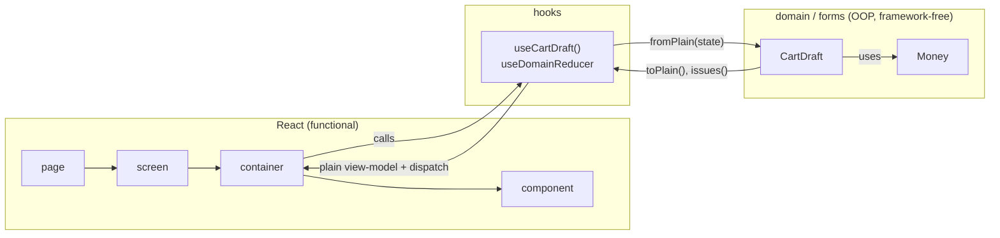

# 06 — OOP domain, functional React

React is written as functions. Client-side domain logic is written as small,
immutable TypeScript classes. The two meet in hooks, and only plain data
crosses into React.

Why both? React's model (render is a pure function of props and state, state
is replaced rather than mutated) works best with plain immutable data. Domain
logic (money arithmetic, form rules, derived totals, date ranges) reads best as
objects that guard their own invariants. Keeping a hard boundary lets each
paradigm do what it is good at without leaking into the other.



## Rules

### OOP-01 — React code is functional (MUST · ADR-14)

Components, screens, containers, layouts, and hooks are functions. The one
class component allowed is the error boundary in `engines/design_system`,
because React still requires a class for it.

### OOP-02 — Where classes live (MUST · ADR-14)

| Folder | Contains |
| --- | --- |
| `domain/` | Value objects (`Money`, `DateRange`), entities with behaviour, domain services and calculators |
| `forms/` | Form models: field rules reported through `issues()`, cross-field validation, derived values, conversion to the payload `useForm` submits |

Where a class lives follows the sharing ladder (ARCH-05):

- a domain-free value that every module needs (`Money`, `DateRange`) lives in
  `@core/domain/`;
- a business concept that several modules share lives in a domain engine's
  `domain/` (for example `engines/example_customers`). Its `public/` surface
  (`@example_customers/public/...`) re-exports the class and never defines
  one, so the `domain/` rules (OOP-04) still apply to it;
- anything specific to one module stays in that module's `domain/` or
  `forms/`.

Classes are never copied between engines. Pages, components, and the design
system contain no domain classes.

### OOP-03 — Classes are immutable; only invariants throw (MUST · ADR-14)

- Fields are `readonly`. Methods that "change" an object return a new
  instance.
- Constructors are `private`. Static factories (`of`, `fromPlain`) are the
  only way in.
- `throw new DomainError(code)` is reserved for invariant violations, which
  are programmer errors: adding amounts in two currencies, a fractional
  number of minor units. The error carries a stable code.
- Input from a person (a typed quantity, a date range, a filter) is never
  validated by throwing. The class keeps what was entered and reports problems
  from `issues()`, a list of stable codes that the UI translates. The reason
  is rendering: hooks rebuild objects on every render (OOP-06), and a throw
  during render replaces the whole page with the error boundary (FE-15).
- So `fromPlain` accepts every value its plain type allows, invalid input
  included, and throws only when code has broken an invariant.
- A plain type can carry an invariant that its TypeScript type cannot
  express. `MoneyPlain.minor` is an integer by wire contract (CT-02), so a non-integer reaching
  `Money.fromPlain` is a programmer error, and `Money.of` may throw. An amount
  a person types is therefore never held as `Money` or `MoneyPlain` while it
  is being edited: the form's plain type keeps the raw value entered, and the
  form converts it to `Money` only after `issues()` is empty.
- An invariant never depends on the runtime. A class does not ask
  `Intl.supportedValuesOf("currency")`, the browser's ICU data, or the clock
  whether a value is valid: those differ between browsers and versions, so
  the same props would throw in one browser and render in another. The page
  schema decides which codes arrive (CT-03); a value the schema accepted is
  valid for the class, and the class checks only what its own type cannot
  express (an integer, a non-negative exponent).
- Every class that crosses the boundary has `toPlain()` returning a type from
  its `*.types.ts`.

### OOP-04 — Domain code is framework-free (MUST · ADR-14)

`domain/` and `forms/` import nothing from React, Inertia, i18next, Tailwind
helpers, or `@design_system/`, its formatters included. They return codes and
numbers, not translated or formatted strings, and no JSX; hooks and components
format with `@design_system/formatters` (FE-11). dependency-cruiser enforces
this.

Domain code may compute with dates but never formats one. The ESLint bans on
the date getters (`getFullYear`, `getMonth`, `getDate`) apply to presentation
code, not to `domain/` and `forms/`; the bans on `Intl` formatters and
`toLocale*String` apply everywhere outside the formatters (FE-20). `DateRange`
in `@core/domain` works on ISO calendar-date strings (`YYYY-MM-DD`, CT-02).

### OOP-05 — Class instances never enter React (MUST · ADR-14)

Props, React state, context values, and Inertia form data hold plain objects
and arrays only. Convert with `toPlain()` before data enters React and rebuild
with `fromPlain()` when logic is needed.

Plain data is `null`, `undefined`, a string, a number, a boolean, a bigint,
an array (`Array.prototype`, not a subclass), or an object whose prototype is
`Object.prototype` or `null` and that has no symbol keys, with plain data all
the way down. Functions, symbols, `Date`, `Map`, `Set`, `RegExp`, and every
class instance are not plain; a date travels as its ISO string (CT-02). A
shared or circular reference is checked once, so the check always ends.

In development, the two state wrappers (`useDomainReducer` and `useUiState`,
FE-04) assert with core's `assertPlain` that the initial state, every
next state, and every patch are plain, and freeze each of them deeply with
`deepFreeze`, so an edit in place throws. `assertPlain`'s error names the
path of the first value that is not plain. Hook tests apply `assertPlain` to
the view-model a hook returns, never to its dispatchers, which are functions
by design (OOP-06).

### OOP-06 — Hooks are the bridge (MUST · ADR-14)

A hook rebuilds domain objects from plain state, asks them questions, and
returns a plain view-model plus dispatchers. Containers receive only that
result. Rebuilding on every render is cheap and lets React Compiler handle
memoization.

### OOP-07 — State changes only through domain methods (MUST · ADR-14, ADR-15)

State with business meaning lives in `useDomainReducer` (FE-04) and changes
only through domain methods. The reducer translates an event into one domain
call and returns the new plain state. It holds no business rule and never
edits fields of the plain state itself:

```ts
case "line_added":
  return CartDraft.fromPlain(state).addLine(event.line).toPlain();
```

In development the state a reducer receives is deeply frozen (FE-04), so a
reducer that edits it in place throws a `TypeError` instead of slipping
through.

A purely local optimistic change is a pair of events: one applies the domain
call, and an explicit rollback event restores the previous plain state.

### OOP-08 — The server decides (MUST · ADR-01, ADR-08)

Client-side domain logic exists for presentation, derived values, and instant
feedback. It never grants access (that comes from `can`, CT-01) and never
replaces upstream validation. When the upstream rejects input, its field codes
win (CT-07).

### OOP-09 — Composition over inheritance (SHOULD · ADR-14)

Prefer small objects that hold other objects. Inheritance goes at most one
level deep. Side-effecting collaborators (a clock, an id generator) are
`interface` ports injected through the factory, so tests pass a fake.

### OOP-10 — Test each side on its own terms (MUST · ADR-14)

- Each engine has two Vitest projects, and so does the app (`app` and
  `app:node`, TS-09). Domain classes and form models (`domain/` and `forms/`
  `*.test.ts`) run in `<engine>:node`, with every other `*.test.ts` outside
  `hooks/`: no DOM, no React. Hooks and components (`*.test.tsx` and
  `hooks/**/*.test.ts`) run in `<engine>`, under jsdom. `bin/check` runs
  both.
- Every class that crosses the boundary has a round-trip test:
  `X.fromPlain(x.toPlain())` yields the same plain value.
- Input rules are tested through `issues()` with valid, invalid, and edge
  input.
- Hooks are tested with `renderHook`, asserting with `assertPlain` that the
  view-model they return, without its dispatchers, is plain data (OOP-05).
  Components are tested with React Testing Library against plain props.

```ts
// engines/core/app/frontend/domain/money.test.ts
import { describe, expect, it } from "vitest";

import { Money } from "./money";

describe("Money", () => {
  it("round-trips through plain data", () => {
    const money = Money.of(12_550, "THB", 2);
    expect(Money.fromPlain(money.toPlain()).toPlain()).toEqual(money.toPlain());
  });
});
```

## Worked example

```ts
// engines/core/app/frontend/domain/money.types.ts
// An ISO 4217 code. `moneySchema` validates it (CT-02); no list of codes here, so every currency the
// schema accepts (IQD, LAK, MMK, HUF included) type-checks as the class input (OOP-03).
export type CurrencyCode = string;
// The wire shape (CT-02): `minor` is an integer, `exponent` is the ISO 4217 exponent Rails sent,
// never derived from Intl. A typed amount is never a MoneyPlain (OOP-03).
export type MoneyPlain = { readonly minor: number; readonly currency: CurrencyCode; readonly exponent: number };
export type CurrencyPlain = { readonly code: CurrencyCode; readonly exponent: number };
```

```ts
// engines/core/app/frontend/domain/money.ts
import { DomainError } from "./domain_error";

import type { CurrencyCode, MoneyPlain } from "./money.types";

export class Money {
  private constructor(
    readonly minor: number,
    readonly currency: CurrencyCode,
    readonly exponent: number,
  ) {}

  // Invariant: minor units and the exponent are whole numbers (CT-02), so anything else here is a
  // programmer error. A typed amount stays raw in its form's plain type until that form's issues()
  // is empty (OOP-03).
  static of(minor: number, currency: CurrencyCode, exponent: number): Money {
    if (!Number.isInteger(minor)) throw new DomainError("money.not_integer");
    if (!Number.isInteger(exponent) || exponent < 0) throw new DomainError("money.bad_exponent");
    return new Money(minor, currency, exponent);
  }

  static fromPlain(plain: MoneyPlain): Money {
    return Money.of(plain.minor, plain.currency, plain.exponent);
  }

  // Invariant: callers never mix currencies.
  plus(other: Money): Money {
    if (other.currency !== this.currency || other.exponent !== this.exponent) {
      throw new DomainError("money.currency_mismatch");
    }
    return new Money(this.minor + other.minor, this.currency, this.exponent);
  }

  times(quantity: number): Money {
    return Money.of(this.minor * quantity, this.currency, this.exponent);
  }

  toPlain(): MoneyPlain {
    return { minor: this.minor, currency: this.currency, exponent: this.exponent };
  }
}
```

```ts
// engines/billing/app/frontend/forms/cart_draft.types.ts
import type { CurrencyPlain, MoneyPlain } from "@core/domain/money.types";

export type CartLinePlain = {
  readonly id: string;
  readonly unitPrice: MoneyPlain; // from props: integer minor units (CT-02)
  readonly quantity: number; // the raw value as typed; issues() reports a bad value
};

export type CartDraftPlain = { readonly lines: readonly CartLinePlain[]; readonly currency: CurrencyPlain };

export type CartIssue =
  | { readonly field: "lines"; readonly code: "blank" }
  | { readonly field: "quantity"; readonly lineId: string; readonly code: "not_positive_integer" };

export type CartEvent =
  | { type: "line_added"; line: CartLinePlain }
  | { type: "quantity_changed"; lineId: string; quantity: number }
  | { type: "line_removed"; lineId: string }
  | { type: "reset"; to: CartDraftPlain };
```

```ts
// engines/billing/app/frontend/forms/cart_draft.ts
import { Money } from "@core/domain/money";

import type { CartDraftPlain, CartIssue, CartLinePlain } from "./cart_draft.types";

const isValidQuantity = (quantity: number) => Number.isInteger(quantity) && quantity > 0;

export class CartDraft {
  private constructor(
    private readonly lines: readonly CartLinePlain[],
    private readonly currency: CartDraftPlain["currency"],
  ) {}

  static fromPlain(plain: CartDraftPlain): CartDraft {
    return new CartDraft(plain.lines, plain.currency);
  }

  addLine(line: CartLinePlain): CartDraft {
    return new CartDraft([...this.lines, line], this.currency);
  }

  // Keeps whatever was typed; issues() reports it, nothing throws.
  changeQuantity(lineId: string, quantity: number): CartDraft {
    return new CartDraft(
      this.lines.map((line) => (line.id === lineId ? { ...line, quantity } : line)),
      this.currency,
    );
  }

  removeLine(lineId: string): CartDraft {
    return new CartDraft(this.lines.filter((line) => line.id !== lineId), this.currency);
  }

  // Typed values reach Money only once issues() is empty (OOP-03); until then there is no total,
  // so a half-typed quantity never reaches Money during render.
  total(): Money | null {
    if (this.issues().length > 0) return null;
    return this.lines.reduce(
      (sum, line) => sum.plus(Money.fromPlain(line.unitPrice).times(line.quantity)),
      Money.of(0, this.currency.code, this.currency.exponent),
    );
  }

  issues(): CartIssue[] {
    if (this.lines.length === 0) return [{ field: "lines", code: "blank" }];
    return this.lines
      .filter((line) => !isValidQuantity(line.quantity))
      .map((line): CartIssue => ({ field: "quantity", lineId: line.id, code: "not_positive_integer" }));
  }

  toPlain(): CartDraftPlain {
    return { lines: [...this.lines], currency: this.currency };
  }
}
```

```ts
// engines/billing/app/frontend/hooks/use_cart_draft.ts
import { CartDraft } from "@billing/forms/cart_draft";
import { useDomainReducer } from "@core/lib/use_domain_reducer";
import { formatMoney } from "@design_system/formatters";

import type { CartDraftPlain, CartEvent } from "@billing/forms/cart_draft.types";
import type { Locale } from "@core/contracts/locales.generated";

function reducer(state: CartDraftPlain, event: CartEvent): CartDraftPlain {
  switch (event.type) {
    case "line_added":
      return CartDraft.fromPlain(state).addLine(event.line).toPlain();
    case "quantity_changed":
      return CartDraft.fromPlain(state).changeQuantity(event.lineId, event.quantity).toPlain();
    case "line_removed":
      return CartDraft.fromPlain(state).removeLine(event.lineId).toPlain();
    case "reset":
      return event.to;
  }
}

export function useCartDraft(initial: CartDraftPlain, locale: Locale) {
  const [state, dispatch] = useDomainReducer(reducer, initial);
  const draft = CartDraft.fromPlain(state);
  const total = draft.total();

  return {
    lines: state.lines,
    total: total === null ? null : formatMoney(total.toPlain(), locale),
    issues: draft.issues(),
    dispatch,
  };
}
```

The container calls `useCartDraft`, passes `lines`, `total`, and `issues` to
presentational components, and wires `dispatch` to their callbacks. A quantity
typed as `1.5` stays in the plain state as typed and shows an issue next to
its field, and the total stays empty until every issue is fixed. The typed
value never reaches `Money`, so nothing throws during render. The unit prices
came from props as integer minor units in the cart's currency, so a throw from
`Money` here would mean the server broke the contract: a programmer error, as
OOP-03 intends. No component ever holds a `Money` or a `CartDraft`.
