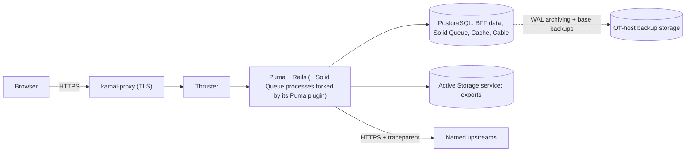
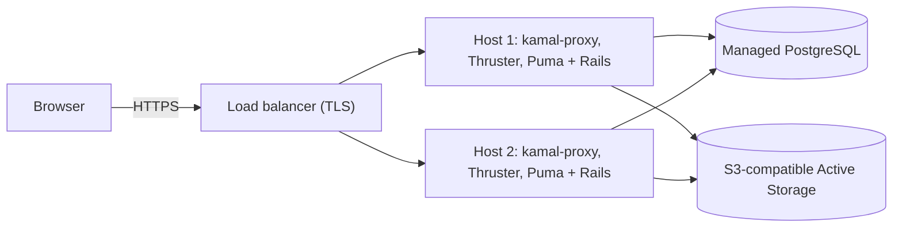

# 13 — Operations

How the application is observed, deployed, backed up, audited, and developed.
A BFF sits on every request path, so when something goes wrong it must say
which side failed: the browser, Rails, or an upstream.

The diagram shows the default single-host profile; OPS-06 describes both
profiles.

## Rules

### OPS-01 — Structured, safe logs (MUST · ADR-25)

Lograge writes one JSON line per request. A single `LogPayload` object builds
it from an allow-list:

- time, request id, trace id, method, path without the query string,
  controller and action, Inertia page name, status;
- duration, database time, SQL query count, upstream call count and total
  upstream time per upstream, props bytes;
- an opaque viewer id and the locale. The opaque id is an HMAC-SHA256 of the
  viewer id, hex, truncated to 16 characters, keyed through
  `Rails.application.key_generator` with a fixed salt; never a plain or
  unsalted hash, which anyone can reverse by hashing candidate ids (a
  12-character SHA-256 prefix of ids up to two million falls in a fraction of
  a second). Jobs use the same helper, so their lines join the request's. The
  log payload spec asserts the logged id is neither the raw id nor its bare
  SHA-256;
- on the line for a CSP report (SEC-05): the effective directive, the blocked
  URI reduced to its origin (or `inline`, `eval`), the document path without
  its query string, the source file's origin and line, and the release.

Never log parameters, props, headers, cookies, tokens, upstream bodies, or
personal data. Background jobs log the same ids so a request can be followed
into the jobs it enqueued (core's job base class carries them, BE-11).

- **What counts as a query.** The SQL query count, here and in the page
  budgets (TS-02), counts `sql.active_record` events except those named
  `SCHEMA` or `TRANSACTION` (`BEGIN`, `COMMIT`, savepoints) and query-cache
  hits (`payload[:cached]`). Active Record 8.1.4.1's own counter skips the
  first two but counts cache hits (`RuntimeRegistry#record`), so core counts
  with one subscriber of its own, which `LogPayload` and the budget matcher
  share. A spec runs one query twice under the query cache inside a
  transaction and expects a count of 1.
- **Lograge everywhere.** Lograge is on in every environment, development and
  test included, with `keep_original_rails_log = false`, so Rails' own
  request lines (which print parameters) never appear and a spec sees the
  line production writes. A log spec sends a request with a token-like
  parameter and a query string and asserts that neither reaches the output.
- **Job arguments are not logged.** Active Job 8.1.4.1 logs a job's
  arguments by default (`log_arguments` defaults to `true`), and they hold
  ids and values this rule keeps out of logs.
  `config.active_job.log_arguments = false` turns it off for
  `ActiveJob::Base`, and a spec asserts `log_arguments?` is false for every
  job class after eager loading, so no job turns it back on.
- **Specs compare keys.** The log payload spec, and every spec of a metric
  (OPS-04), compares each JSON line's keys, or each metric's tags, with this
  allow-list, so a new field fails until it is listed. An assertion that a
  value is absent checks each forbidden value on its own over the whole
  output (TS-05).

### OPS-02 — W3C trace context from end to end (MUST · ADR-25)

- A core Rack middleware, inserted after `ActionDispatch::RequestId`, accepts
  an incoming `traceparent` header or starts a new trace (a random, non-zero
  trace id), and stores the trace id and the sampled bit in the request env.
  It runs before any controller callback, the throttle included (BE-12).
  `Current` (BE-09), the error responder, the exceptions app (CT-06), and the
  log payload (OPS-01) read the trace id there, so a throttled request's
  error page and log line carry the same trace id.
- **Parsing is strict.** The trace id reaches every log line and the error
  page, so only a value that matches W3C Trace Context is accepted:
  `version-traceid-parentid-flags`, all lowercase hex; the version is two
  digits and not `ff`; the trace id is 32 digits and not all zeros; the
  parent id is 16 digits and not all zeros; the flags are any two digits.
  Version `00` ends after the flags; a higher version is read by its first
  four fields when a `-` or the end follows them (the W3C rule for future
  versions). Anything else starts a new trace, and the rejected value is
  never logged or echoed.
- `UpstreamClient` sends `traceparent` on every call to every named upstream,
  so the upstreams' logs join the same trace: version `00`, the request's
  trace id, a new random parent id for each call, and flags `01` when the
  incoming sampled bit was set, otherwise `00`; no other flag bit is passed
  on.
- A request spec sends hostile headers (uppercase hex, version `ff`, an
  all-zero trace id, an all-zero parent id, a short field, a version `00`
  value with a trailing field) and asserts a new trace id each time and that
  the value appears in no log line; a valid header's trace id reaches the
  upstream call with a new parent id and only the sampled bit.
- The trace id appears in every log line and on the error page (SEC-05), which
  makes it the support reference users read out.
- An OpenTelemetry exporter MAY be added later; it needs its own ADR and exact
  version pins.

### OPS-03 — Errors are reported from both sides (MUST · ADR-25)

- **Server.** Every handled and unhandled exception goes through `Rails.error`
  with the request id, trace id, and release tag (the `VERSION` plus the Vite
  digest). One error subscriber forwards to the reporting service; no personal
  data is attached.
- **Client.** `POST /core/client_errors` accepts reports from the page error
  boundary (FE-15), schema parse failures (CT-04), unhandled promise
  rejections, and `window` `error` events (an error thrown outside React,
  for example in an event handler or a timer). It requires the
  `X-CSRF-Token` header (SEC-05), is rate-limited
  per IP and per session as two limits with distinct names (BE-12; one
  combined key would let a new session reset the IP cap), rejects bodies over
  a small limit (for example 8 KB) in a core Rack middleware before Rails
  parses them (BE-12),
  keeps only message, stack, page name, path without its query string,
  release, request id, and trace id (the ids from `trace`, CT-01, so a report
  joins the server's log lines), and scrubs every kept text field (below).
  The ids are kept only in their own formats (a trace id as OPS-02 parses
  it), and `release` only in the shape of the asset version (CT-12; 40
  lowercase hex characters with vite_ruby 3.11.1, whose digest is a SHA-1);
  anything else is stored as `unknown`. The client's `release` is the digest
  part of the server's release tag, so client and server reports join on it.
  The endpoint spec asserts the scrubbed path, both ids, and a forged
  `release`.
- **What the reporter sends.** The client reporter (FE-15) builds each field
  from a fixed source and bounds it before sending: the message cut to 1,000
  characters and the stack to 4,000, the path from `location.pathname` (never
  `location.href`, which carries the query and fragment), and `release` from
  the Inertia page `version` (CT-12). A rejection whose reason is not an
  `Error` is reported with a fixed message and no stack, never serialized:
  the reason can be any value, a response body or the viewer's data
  included. Reports are sent with `keepalive: true`, so a report survives the
  navigation that often follows an error. Reporter tests: a 50 KB message
  produces a body under the endpoint's cap; a `window` `error` event and a
  rejection with a non-`Error` reason each send one report, the second with
  the fixed message.
- **Scrubbing.** Every kept text field, the path and the page name included,
  is scrubbed before it is logged or forwarded. Each match becomes
  `[FILTERED]`: `Bearer` and the credential after it, a JWT (three base64url
  segments joined by dots, the first starting with `eyJ`), an email address,
  and any run of 32 or more base64url characters (`[A-Za-z0-9_-]`), which
  covers opaque tokens and session ids. The scrubber then cuts the message to
  1,000 characters and the stack to 4,000 again, because a report need not
  come from the reporter. The scrubber spec has one row per class and one
  per cut.

### OPS-04 — Measure what matters for a BFF (SHOULD · ADR-25)

Derive these from logs or instrumentation, per page, per upstream, and per
gateway:

- request rate and latency (p50, p95, p99), and error rate by catalog code;
- upstream latency and error rate per upstream and per gateway, and the
  upstream call count per request;
- circuit-breaker state and open count per upstream, and calls refused by its
  bulkhead (BE-05);
- token refreshes and refresh failures;
- grants that `PermissionSet` drops as malformed (BE-03);
- CSP reports per directive and blocked origin (SEC-05);
- job queue latency and failures;
- database connection-pool waits: how often and how long a checkout had to
  wait (BE-21);
- the dead-tuple ratio of the busiest tables (`core_sessions`,
  `core_idempotency_keys`, Solid Queue's), which shows whether vacuum keeps
  up, and the share of HOT updates on `core_sessions`, which shows whether
  its `fillfactor` leaves enough room (SEC-08).

Alert when the upstream error ratio rises, a circuit opens, p95 latency
exceeds a p95 target the app states, refresh failures spike, pool waits
appear under normal load, or the job backlog grows.

### OPS-05 — Liveness never depends on an upstream (MUST · ADR-25)

- `/up` stays Rails' default liveness check: it proves the app booted and
  checks no dependency. Kamal's deploy health check uses it.
- `/core/ready` adds a trivial PostgreSQL query for monitors that need it.
- Neither calls an upstream: if they did, an upstream outage would make the
  proxy restart a healthy Rails app in a loop. Upstream reachability and
  circuit-breaker state are metrics and alerts (OPS-04), not health checks.

### OPS-06 — Two deployment profiles with Kamal (MUST · ADR-10, ADR-26)

The same image and the same code run in both profiles, because nothing is
host-local (ARCH-13): data lives in PostgreSQL, files in an Active Storage
service, and local disk holds only request and job temp files.

| | Single host (default) | Multi-host |
| --- | --- | --- |
| App | Kamal deploys one image to one host | Kamal deploys the same image to several hosts behind a load balancer |
| PostgreSQL | a Kamal accessory on a persistent volume, or a managed service | a managed service |
| Active Storage | a Disk service on a persistent volume, or an S3-compatible service | an S3-compatible service |
| Scaling | vertical | more hosts; recheck BE-21 |

- Thruster runs in front of Puma for compression, asset caching, and
  efficient file serving; kamal-proxy terminates TLS, or a load balancer in
  front of it does.
- The PostgreSQL accessory image is pinned by version and digest, at the same
  major version as the Dev Container (OPS-09). A major upgrade is planned work
  (dump and restore, or `pg_upgrade`), never a tag bump.
- Solid Queue starts with Puma: its Puma plugin forks a supervisor, which
  forks the workers and dispatchers, and the scheduler when recurring tasks
  are configured, each a process with its own connection pool (BE-21 counts
  them). Move Solid Queue to a separate `job` role when job
  load starts to affect request latency. The Rails-generated `config/puma.rb`
  loads the plugin with `plugin :solid_queue if ENV["SOLID_QUEUE_IN_PUMA"]`
  and the generated `config/deploy.yml` sets `SOLID_QUEUE_IN_PUMA: true`. Any
  value turns the plugin on, `"false"` included, so the move deletes the
  variable from the web role's `env`; otherwise both roles run a supervisor.
  Solid Queue, Cache, and Cable share
  the primary database by default; ADR-10 names the trigger for giving them
  their own databases (measured queue or cache load on the primary), and the
  BE-21 arithmetic is checked again after a split.
- During a deploy, the old and new containers run side by side against the
  same database. So migrations are expand-and-contract (BE-22), stored formats
  are readable by both releases (SEC-16), contract changes are additive
  (CT-12), and jobs are idempotent (BE-11).
- **Asset bridging.** `asset_path` in `config/deploy.yml` points at the Vite
  output directory inside the image, so a tab still running the previous
  release can load its lazily imported chunks during and just after a deploy,
  until its next visit reloads the page (CT-12). With vite_ruby's defaults
  (`publicDir: public`, `publicOutputDir: vite`) and the `/rails` working
  directory of the Rails-generated Dockerfile, that is `/rails/public/vite`.
  The Rails-generated `config/deploy.yml` sets `asset_path: /rails/public/assets`,
  Propshaft's output, which holds no Vite chunk; the application template
  rewrites it, and `script/ci/deploy_preflight` fails on any other value.
  Kamal 2.12.0 fills the volume with the new release's files first and then
  adds the old release's without overwriting (`cp -rnT`), so the new
  `.vite/manifest.json` wins. Bridging relies on fingerprinted file names,
  which the Vite build produces.
- In the multi-host profile, hosts switch one after another
  (`boot: limit: 1`, BE-22), so a page served by an updated host may request
  a new chunk from a host that has not switched yet. Kamal 2.12.0 closes that
  gap: before it boots any host, it extracts the new release's assets on
  every app host and copies them, without overwriting, into the volume the
  running old container serves as well as into the new one. An old host
  therefore already serves the new chunks, and its own manifest stays in
  place.
- Rate limits and audit records rely on `request.remote_ip`. Behind kamal-proxy
  on the Docker network, Rails' default trusted proxy ranges already apply. If
  a load balancer with public addresses sits in front, add it to
  `config.action_dispatch.trusted_proxies`; never trust a client-supplied
  `X-Forwarded-For` beyond known proxies.
- Production secrets are Rails encrypted credentials (BE-08):
  `config/credentials/production.yml.enc` is committed encrypted, and its key
  is the one secret Kamal delivers. `.kamal/secrets` fetches it from a
  password manager or the deploy environment, never from the repository, and
  `config/deploy.yml` lists `RAILS_MASTER_KEY` as the app's only `env.secret`;
  every other app environment variable is a clear value. Production reads
  `secret_key_base`, the Active Record encryption keys, and every other secret
  from the credentials through typed configuration at boot, so a missing
  encryption key fails boot instead of the first sign-in (Active Record
  raises only when the key is first read). Changing a secret is a commit of
  the re-encrypted file followed by a deploy; rotating the key re-encrypts
  the file and replaces the password manager entry in the same release.
- `script/ci/deploy_preflight` runs in CI (a `bin/ci` step,
  `09_enforcement.md`) and before every deploy, from the Kamal hook
  `.kamal/hooks/pre-deploy`, which Kamal 2.12.0 runs with the secrets before
  `deploy`, `redeploy`, and `rollback` boot anything. It fails
  when a key in `.env.ci.production` is missing from `config/deploy.yml`'s
  `env.clear`; when the app's `env.secret` holds anything besides
  `RAILS_MASTER_KEY`, or `config/deploy.yml` names `SECRET_KEY_BASE` or
  `SECRET_KEY_BASE_DUMMY`; when the final image stage's effective `USER` (the
  last `USER` directive, with `ARG` values substituted) is missing, `root`, or
  numerically 0; when a secret file is tracked (SEC-07); when `asset_path` is
  not `/rails/public/vite` (CT-12); when `config/deploy.yml` lists more
  than one host and `boot.limit` is not `1` (BE-22); and when
  `config/deploy.yml` sets no `deploy_timeout`, whose 30-second default would
  interrupt a longer boot-time migration (BE-22). Before a deploy, where
  the production key is available, it also compares the key paths of the
  production credentials with those of the dummy credentials and fails on any
  difference, printing paths and never values; in CI, which never holds the
  production key, it skips that comparison and says so. Canaries (TS-07): a
  build-stage `USER` with none in the final stage, `USER root` after a
  non-root user, `USER 00`, an `ARG UID=0`, a tracked `.env.local`, a tracked
  `config/credentials/production.key`, a `.env.ci.production` key missing
  from `env.clear`, a second app `env.secret`, a `config/deploy.yml` naming
  `SECRET_KEY_BASE`, one naming `SECRET_KEY_BASE_DUMMY`, the generated
  `asset_path: /rails/public/assets`, two hosts without `boot: limit: 1`, and
  a `config/deploy.yml` without `deploy_timeout`.
- **The image is built on pull requests.** A CI job builds the production
  image without pushing it, after `rafelo:module` has created a throwaway module,
  with `BUNDLE_FROZEN=false` because the new engine changes `Gemfile.lock`
  (the second exception to the frozen bundle, after generator smoke, GEN-04),
  on pull requests that change the `Dockerfile`, `.dockerignore`, `Gemfile`,
  `Gemfile.lock`, any gemspec, `.env.ci.production`, or the dummy
  credentials, and nightly. Otherwise
  the image build that BE-08 and SEC-12 rely on would first run at deploy.
  Engines are path gems, so the `Dockerfile` copies every engine's gemspec and
  the files those gemspecs load (such as `lib/acme/<engine>/version.rb`)
  before `bundle install`; Rails' generated `Dockerfile` copies only the
  `Gemfile` and the lockfile at that point, and Bundler then fails in
  deployment mode. This job needs Docker on the runner, so, like the job that
  builds the Dev Container image, it does not run in that prebuilt image
  (09_enforcement.md).
- Move from one host to several when vertical scaling no longer carries the
  load, or when the service needs failover to another machine. The move
  changes configuration only: hosts, the load balancer, the database, the
  Active Storage service, `boot: limit: 1` (BE-22), and the BE-21 numbers.

### OPS-07 — Backups and retention (MUST · ADR-10)

| Data | Value | Policy |
| --- | --- | --- |
| Audit records | must survive | in the PostgreSQL backups; kept for a configured period (for example 365 days), then removed by dropping whole monthly partitions (OPS-08) |
| Sessions | losing them only forces sign-in | in the backups, but never restored: every restore empties `core_sessions` before the app takes traffic (below); purged in batches after expiry (SEC-08) |
| Idempotency keys | short-lived | purged in batches once older than their retention, which is at least the absolute session lifetime (SEC-08) plus a margin, for example 24 hours against 12-hour sessions; a form token older than the retention is refused (BE-15) |
| Queue, cache, cable | transient | in the backups because they share the primary database; jobs restored from a backup may run again, which BE-11 makes safe |
| Export files | short-lived | in Active Storage, not backed up; expire after a few hours and are purged with their records (BE-18) |

- Back up PostgreSQL with point-in-time recovery: continuous WAL archiving
  plus regular base backups, stored off the host. A managed service provides
  this; for the Kamal accessory, a tool chosen by ADR does (for example
  pgBackRest or WAL-G). Never copy the data directory of a running database.
- Run a restore drill on a schedule: restore to a chosen point in time into a
  scratch environment, and write down the recovery point and recovery time you
  actually achieved.
- Every restore, drills included, empties `core_sessions` (the migration role,
  which owns it, truncates it) before the app takes traffic. A point-in-time
  restore brings back every session revoked after the recovery point
  (sign-out, sign-out everywhere, a refresh `401`), and its cookie would work
  again until absolute expiry. Everyone signs in again, which SEC-16 already
  accepts. Idempotency keys claimed after the recovery point are lost the same
  way, so a resubmitted form may write again (BE-15). The drill asserts the
  table is empty after its restore.
- Purges run in batches and audit retention drops partitions, so retention
  never becomes one long delete that holds locks or leaves the table full of
  dead tuples. On an S3-compatible service, a bucket lifecycle rule MAY act as
  a backstop for export expiry.

### OPS-08 — Audit the events that matter (MUST · ADR-09)

Append-only audit records for:

- sign-in success and failure, sign-out, sign-out everywhere, and sessions
  revoked because refresh returned `401` or the resent call got a second
  `401` (SEC-04);
- authorization denials (`403`), with the policy and page;
- rate-limit hits on authentication endpoints;
- downloads and exports;
- every write action: resource, action, outcome, and the upstream id.

Each record stores the time, viewer id, request id, trace id, a truncated IP
address, the user-agent family, the event, the outcome, and the target. Never
store passwords, tokens, or request bodies. The user-agent family is one of
a fixed set (for example `chrome`, `edge`, `firefox`, `safari`, `other`),
mapped by one core helper; the raw header is never stored, and the helper's
spec maps an unknown, empty, and oversized header to `other`.

- **One recorder, every outcome.** Core records a write's audit row in two
  places only: the write path, for the outcomes it handles (success, `422`,
  conflict, a refused claim, BE-13, BE-15), and the error responder, with
  outcome `failure`, for a non-GET request that raises. Never only in an
  `after_action`, which does not run when the action raises or a callback
  halts (BE-24). A request-scoped marker makes it exactly one row per
  audited request: a write refused with `403` records the denial, not a
  second row. Core's session-less endpoints (BE-02) record none, and a read
  that fails records no write row. A core request spec drives each outcome
  (success, `422`, conflict, `403`, an upstream `503`, a raise in a
  callback) and asserts exactly one row, or none for the session-less
  endpoints and for a `GET` that fails with an upstream `503`.

One core helper truncates the IP address: it parses the value with `IPAddr`,
applies `native` first (an IPv4-mapped address such as `::ffff:203.0.113.77`
would otherwise truncate to `::`, and every such client would look the same),
then keeps the /24 of an IPv4 address or the /48 of an IPv6 address, and
stores `nil` for a value that does not parse. Its spec covers all three forms.

- **Append-only by the database.** A trigger rejects every `UPDATE` and
  `DELETE` on audit rows, whatever code or console issues them, and a spec
  proves both are refused. The trigger is defined on the partitioned table so
  every partition carries it (verify on the pinned PostgreSQL version).
- **Two database roles.** A migration role owns the tables and runs
  migrations, the entrypoint's boot-time `db:prepare` included (BE-22: an
  environment switch that `config/database.yml` reads, set for that one
  command). The runtime role, which Puma, Solid Queue, and consoles use,
  owns no table: it reads and writes the other tables as usual, but on the
  audit tables it has only `INSERT` and `SELECT`, with no `UPDATE`, `DELETE`,
  or `TRUNCATE` (row triggers do not fire on `TRUNCATE`). Without ownership it
  cannot disable the trigger either. `config/database.yml` defines both roles,
  and the BE-21 spec reads both.
- **Partitioned by month.** The audit table, `core_audit_events`, lives in
  `engines/core/db/migrate` with the other kernel tables (ARCH-03) and is
  partitioned by month on the event time. One idempotent routine creates the
  upcoming monthly partitions and a DEFAULT partition. It runs on boot in
  development and test, and from a scheduled job in production. Creating and
  dropping partitions needs the owner, so the routine connects with the
  migration role (verify the multi-database setup that gives it that
  connection on the pinned Rails).
- **DEFAULT partition as a backstop.** If a month's partition is missing, rows
  land in the DEFAULT partition instead of failing the insert, and an alert
  fires as soon as it holds a row. PostgreSQL refuses to create a partition
  while the DEFAULT partition holds rows that belong in it, so the alert's
  runbook moves them without a row `DELETE`: detach the DEFAULT partition,
  create the missing month, copy the rows into the parent table, drop the
  detached table, and let the routine create a new DEFAULT partition (verify
  on the pinned PostgreSQL version).
- Retention drops whole partitions older than the retention period (OPS-07);
  dropping a partition is not a row `DELETE`, so retention needs no exception
  to the trigger.
- **What this does not stop.** The trigger and the roles stop the
  application, its jobs, and consoles on the runtime role. Anyone holding the
  migration role's or a superuser's credentials can still disable the trigger
  or drop a partition, and the migration credentials reach the container that
  migrates on boot (BE-22) and the partition routine. Audit records that must
  hold against that threat are also shipped to an external append-only store,
  which is an adopter's decision.
- Triggers and partitioning cannot be expressed in `schema.rb`, so the schema
  is kept as `structure.sql` (`config.active_record.schema_format = :sql`).
  The dump leaves out the audit partitions through the structure dump flags
  (`--exclude-table=core_audit_events_*`, which matches the partitions but not
  the parent table; verify the flag and the pattern on the pinned Rails and
  PostgreSQL), so a new month never changes the file; the routine above
  creates the partitions in every database. Product modules rarely own tables
  (ARCH-03), so `structure.sql` churn stays low.

### OPS-09 — Development runs in a Dev Container (MUST · ADR-28)

- The host needs only Docker (Docker Desktop, OrbStack, or similar) and an
  editor that supports Dev Containers. Nothing requires a cloud service.
- The definition in `.devcontainer/` starts from the Dev Container that Rails
  generates (`--devcontainer`) and adds Node, the Playwright browsers, and
  PostgreSQL as a service. The PostgreSQL image is pinned by version and
  digest, at the same major version as production (OPS-06).
- **Versions.** Ruby is pinned by the Dev Container image tag (and digest).
  Node and npm are pinned by `mise.toml` and installed inside the container
  from it. `mise.toml` names the Ruby version too, and so does
  `.ruby-version`, which the Gemfile reads (`ruby file:`); the production
  `Dockerfile` pins the same version in `ARG RUBY_VERSION`, because it cannot
  read `.ruby-version` (`ruby-` prefix). `script/ci/pins` fails unless
  `mise.toml`'s Ruby, `.ruby-version`, the `Dockerfile`, and the image tag
  agree, and unless every Node and npm pin agrees (`00_README.md`).
- **One prebuilt image.** A workflow that runs on changes to
  `.devcontainer/**` builds the image and pushes it to the registry by digest,
  and the digest is recorded in `.devcontainer/image_digest`, committed
  through a pull request like any other change, never pushed to `main` by a
  workflow. A change to that file alone does not trigger a rebuild: the
  workflow's filter is `paths: [".devcontainer/**", "!.devcontainer/image_digest"]`
  (GitHub Actions refuses `paths` and `paths-ignore` on the same event). That
  file is the only place CI learns the digest: a first `ci.yml` job reads it
  and outputs the image reference, and every other `ci.yml` job, except one
  that needs Docker on the runner (OPS-06), runs in
  `container: ${{ needs.image.outputs.ref }}` (WF-03), so workflow YAML never
  contains the digest. `devcontainer.json` references the same image, and
  `script/ci/pins` fails unless its digest equals the file's. Passing locally
  and passing in CI therefore mean the same thing, and no CI job rebuilds the
  container. The digest file is a global input of `script/ci/affected`
  (`09_enforcement.md`).
- Windows: Docker Desktop on WSL2. Keep the repository in the WSL2 filesystem
  or in a container volume, not on `C:\`, where file watching and disk access
  through the mount are slow. `.gitattributes` forces `eol=lf`, so scripts and
  generated files are identical on every host.
- Vite listens on `0.0.0.0` inside the container, so the forwarded port
  reaches it (vite_ruby's `host` setting; verify the option when adopting).
  Ports 3000 (Rails) and 3036 (Vite) are forwarded.
- The production image is built from a separate `Dockerfile` (OPS-06); the
  Dev Container never ships.
